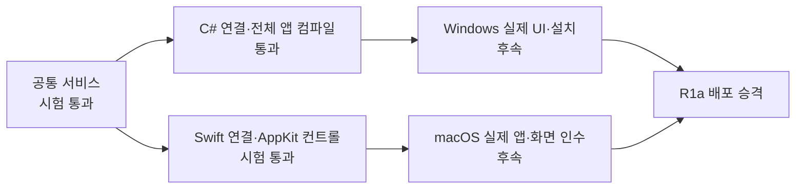

# 내 표현 첫 빌드는 공통 서비스와 두 UI를 구현했으며 실물 배포 인수는 남았다

- Rust 서비스와 C#·Swift 연결 시험을 통과했다. [§2](#2-실행한-검증)
- 네이티브 창의 등록·추천·복원·삭제를 자동 검사했다. [§2](#2-실행한-검증)
- 키 입력 경로와 개인 표현 저장을 분리했다. [§1](#1-구현-범위)
- 실제 Windows UI·설치·화면 눈검수는 미완료다. [§4](#4-아직-확인하지-못한-것)

관측 기준: 2026-10-17, Apple Silicon macOS 작업 환경. 이 문서는 [MVP 명세](specs/PERSONAL-ASSIST-MVP.md)의 R1a 개발 증분이다. 전체 로드맵 종료나 일반 배포 승인 기록이 아니다.



## 1. 구현 범위

- `core/tools/assist/`: 같은 Rust 정규화·검색·순위·저장 로직, JSONL 서비스. 한 줄 2~256자·512개·top-3·NFC, 복사 신호 감쇠, 최근 신호 1회 복원, 삭제·전체삭제·중지.
- Windows: 트레이 `내 표현…` 및 `--personal-expressions`, 네이티브 WinForms 창, 비동기 서비스 클라이언트. Windows TSF 메뉴 연결은 포함하지 않는다.
- macOS: 입력 메뉴 `내 표현…` 및 `--personal-expressions`, AppKit 창, 비동기 클라이언트. 독립 창은 IMK 입력기 등록 없이 실행한다.
- 빌드: 서비스 패키지 포함, 버전 검사·제3자 고지·개인정보 안내, 3 OS 서비스 CI 작업 정의.

키보드 후크·IMK 키 처리 루프에는 추천 I/O를 추가하지 않았다. 사용자가 별도 창에 입력하는 검색어는 저장하지 않고 등록한 표현만 저장한다. 입력 중 자동 팝업·본문 교체·다음 단어·문장 수집·모델 실행은 미구현이다. 복사 빈도는 문서 채택률이 아니다.

## 2. 실행한 검증

| 검사 | 결과 | 해석 범위 |
|---|---|---|
| 테스트 먼저 작성 | 추천 엔진 5개 실패 → 구현 후 통과 | 구현 전 `not_implemented` 실패를 확인 |
| Rust 추천·저장·프로토콜 | 12개 통과(단위 5 + 서비스 7) | NFC/중복/한도/순위/되돌림/삭제/재시작/잠금/손상/쓰기 실패/프레임 제한 |
| Rust clippy | `--all-targets -- -D warnings` 통과 | 해당 새 crate의 정적 경고 검사 |
| Windows 대상 Rust 검사 | `cargo check --target x86_64-pc-windows-gnu` 통과 | 대상 코드 컴파일 검사; Windows EXE 링크·실행 아님 |
| 전체 Windows C# 앱 | net48/C#5 컴파일 성공, 경고·오류 0 | macOS에서 참조 어셈블리로 컴파일; Windows GUI 실행 아님 |
| C#→실제 Rust 서비스 | 12개 단언 통과 | 동일 JSONL 경로·복사/복원/삭제·불량 프레임·helper 없음 |
| Swift→실제 Rust 서비스 | 10개 단언 통과 | 프로세스 유지·Unicode·복사/복원·오류 이후 복구 |
| AppKit 내 표현 컨트롤 | 15개 단언 통과 | 실제 컨트롤 + 실제 서비스 + 임시 저장소. 복사는 테스트 수신기로 대체 |
| 기존 C# 입력 회귀 | 27,869개 단언 통과 | 이전 판별·띄어쓰기·조합 회귀 |
| 기존 Rust 엔진 | 132개 통과, 기존 ignored 2개 | 기존 검사 정의의 제외 항목을 통과로 세지 않음 |
| macOS 전체 build.sh --test | 통과 | KeyMap 71·bridge 32·input 194·기존 AppKit 5·installer 8; replay 26,185키 |

AppKit 컨트롤 시험은 등록 → 추천 켜기 → 검색 → 복사 → 순위 되돌림 → 빠른 검색 변경 → 삭제를 실행한다. 실제 시스템 클립보드·기존 사용자 데이터·설치된 입력기를 바꾸지 않는다. 이는 실제 IMK 클라이언트에서 물리 키로 입력한 인수 시험과 다르다.

### 통합 시험에서 수정한 결함

Swift의 파이프 `read(upToCount:)`가 짧은 응답 프레임 뒤에도 기다려 3초 제한에 자식 프로세스를 종료했다. 파일에 저장된 표현은 유지돼 일반 검색 시험은 지나갈 수 있었지만, 프로세스 메모리에 있는 순위 복원 토큰이 사라져 undo가 실패했다. `availableData`로 현재 도착한 프레임을 읽도록 수정했다. 동일 실제 프로세스에서 copied→undo와 UI 복원 시험이 통과했다.

추가 검토로 요청 ID를 대조해 이전 검색 결과를 버리고, 저장 중 새 표현 편집을 잠그며, 설정 저장 실패 시 체크 상태를 복구했다. Windows 타이머는 현재 요청 번호를 다시 확인해 이전 타이머가 다음 요청의 프로세스를 종료하지 않게 했다. 독립된 외부 리뷰 결과를 주장하지 않는다.

## 3. 성능과 패키지

`cargo run --release --locked --manifest-path core/tools/assist/Cargo.toml --example benchmark`로 합성 표현 512개에서 동일 접두어를 2,000번 조회했다. **엔진 내부 p50 0.063ms / p95 0.083ms / 최대 0.205ms**였다. 이 값은 한 기기의 짧은 합성 검색 관측이며 JSONL 통신·UI debounce 150ms·표시·사용자 판단 시간·cold start를 포함하지 않는다. 입력 지연이나 문장 AI 성능으로 인용하지 않는다.

macOS arm64 앱·서비스와 **Intel/Apple Silicon universal ZIP**을 만들었다. 압축을 푼 실제 배포물에서 두 실행 파일의 아키텍처, deep/strict 코드 서명, `--version`, 표현 등록→추천 켜기→검색을 확인했다. 기존 맞춤법 payload 30개 파일의 해시 및 `되요 → 돼요` 실행도 통과했다. 서명은 ad-hoc이며 신뢰 인증·공증 완료를 뜻하지 않는다.

산출물: `Hanautomata-0.6.1-macos.zip`, 약 25 MiB. SHA-256: `7b4834cbfb4d540c04c09d7ee462f9dd0cc690125a30706c8b1de32b29257c19`. 제품 버전은 기존 0.6.1 개발선이며 공개 릴리스와 구분해 `deliverables/personal-assist-r1a-20261017/`에 보관한다. 설치된 입력기는 이번 작업에서 교체하지 않았다. 신규 태그·공개 릴리스·원격 CI 성공을 주장하지 않는다.

## 4. 아직 확인하지 못한 것

| 항목 | 상태·필요한 증거 |
|---|---|
| Windows 실제 패널·클립보드·설치/갱신/제거 | 미실행. Windows CI 및 실제 Windows 365 인수 필요 |
| macOS 실제 입력 메뉴에서의 사용·클립보드 | 자동 컨트롤 시험과 별도로 물리 조작·실제 앱 인수 필요 |
| Aside 화면 눈검수 | 이미지 접근 시 `Path escapes Project and session roots`로 거부됨. 대체 실행면으로 우회하지 않음 |
| 접근성 | 네이티브 컨트롤·레이블 구현. VoiceOver/Narrator·확대·고대비·다중 모니터 실제 시험 미실행 |
| 배포 신뢰 | Developer ID 공증·Windows 코드 서명·실제 업그레이드 인수 미완료 |
| 자동 개인화·문장 AI | R1b/R1c/R3 이후. 자동 저장·모델 다운로드·외부 전송 없음 |

다음 구현 단위는 **R1b 입력 중 추천**이다. 최신 접두어·문서 버전·보호 상태를 가진 요청, 짧은 추천 표시, 명시적 수락, 원문 재검증, apply와 copied의 피드백 분리, 즉시 undo 연계를 먼저 시험한다. 현재 개발 창을 일반 입력기의 자동 추천 완료로 취급하지 않는다.

## 재현 명령

```sh
cargo test --locked --manifest-path core/tools/assist/Cargo.toml
cargo clippy --locked --manifest-path core/tools/assist/Cargo.toml --all-targets -- -D warnings
dotnet build tests/dotnet/Hanautomata.App.Net48 -c Release
dotnet run --project tests/dotnet/Hanautomata.Assist -c Release -- core/tools/assist/target/debug/hanautomata-assist
./macos/build.sh --test
./macos/package.sh --with-proofreading
python3 macos/Tests/verify_package.py macos/build/dist/Hanautomata-0.6.1-macos.zip --with-proofreading
```

Windows에서 서비스 실행 파일 이름은 `.exe`를 붙인다. `build.ps1`은 Rust를 요구하고 서비스 EXE를 포함한다. `tests/ReleaseTests.ps1`에 ZIP의 helper 버전 및 누락 시 설치 거부 검사를 추가했지만 이 회차에서는 해당 Windows 명령을 실행하지 않았다.
