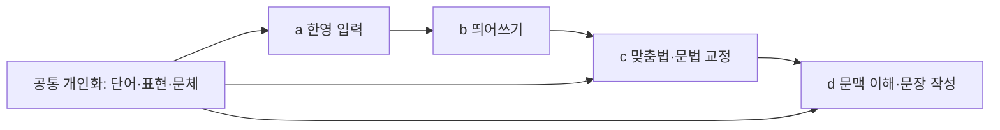

# Hanautomata는 한영 입력에서 개인화된 문장 작성으로 확장한다

- a~d는 두 OS가 공유할 기능 정의다.
- 개인화·추천은 모든 단계에 걸쳐 발전시킨다.
- 기본 맞춤법에는 LLM이 필수이지 않다.
- AI는 이어쓰기·다듬기·답장·번역으로 확장한다.
- 구현 완료와 실제 앱 인수·일반 배포를 구분한다.

이 문서는 **제품 방향과 후속 개발 계약**이다. 현재 설치본이 아래의 개인화 추천이나 LLM 기능을 제공한다는 뜻은 아니다. 구현 현황은 [기능 비교](FEATURES.md), 현재 데이터 처리 방식은 [개인정보 안내](../PRIVACY.md)가 정본이다.

전체 작업 분해와 의존성은 [기술 로드맵](TECHNICAL-ROADMAP.md), 첫 개인 표현 추천의 구현 계약은 [MVP 명세](specs/PERSONAL-ASSIST-MVP.md), 개발 빌드 증거는 [검증 원장](PERSONAL-ASSIST-VALIDATION.md)에 있다.

## 1. 기능 정의와 현재 구현을 구분한다

| 기능 | 제품 목표 | 기본 구현 방식 | 현재 상태 |
|---|---|---|---|
| a. 기본 한영 입력 | 모드 전환 부담을 줄이는 입력 | 오토마타·통계 판별·명시적 선택 기억 | 세 구성에 구현됨; 실제 앱 검증 범위는 각 원장 참조 |
| b. 띄어쓰기 | 잘못 붙인 표현을 확정 시 교정 | 검증된 규칙, 원문 복원 | Windows 트레이·macOS 14개 규칙; TSF 연결은 남음 |
| c. 맞춤법 | 표기·조사·어미 오류를 제안 | 로컬 사전·활용·규칙·형태 처리; 문맥 모델은 보강 | 선택문 검사 실험판; 기본 기능 승격 전 |
| d. 문맥 이해·문장 대체 | 의도에 맞는 새 문장·표현 | 선택형 LLM·문체 프로필·명시적 적용 | 미구현 |
| 개인화·예측 | 내 단어·표현·문체를 더 잘 추천 | 로컬 기억·검색·순위, 선택형 문맥 모델 | 기존 한영 선택 기억 + R1a 수동 등록 표현 추천 창 개발; 자동 수집·인라인·LLM은 후속 |

**c는 무료·오프라인 기본 기능으로 제공할 수 있다.** 사전·활용·규칙을 이용하는 Hunspell과 한국어 사전이 기술적 기준선이다. 다만 미등록 단어를 모두 틀렸다고 판정하거나 문맥이 불명확한 표현을 자동 변경하지 않는다. [Hunspell](https://hunspell.github.io/), [한국어 사전](https://github.com/spellcheck-ko/hunspell-dict-ko).

기본 제공과 자동 적용은 별도다. c는 오류 수정과 의미 보존, d는 사용자가 요청한 표현·구성 변경을 목표로 한다. UI에서도 `맞춤법 검사`와 `자연스럽게 다듬기`를 구분한다. `할수없다 → 할 수 없다`는 b이고, `할 수 없다 → 할 수 있다`는 의미 반전이다.

현재 c의 구현 단계 M0~M4는 [맞춤법 로드맵](PROOFREADING-ROADMAP.md)에 유지한다. M4의 문맥·형태 분석 비교는 d의 생성형 문장 기능 완료를 뜻하지 않는다. 79개 자체 개발 예문의 오류 29건 top-3 68.97%, 규칙 개발 5건을 제외한 오류 24건 62.50%, 오류 집중 300자 warm p95 약 1.12초라는 기존 관측은 일반 배포 승격의 한계로 유지한다. [측정 범위](PROOFREADING-VALIDATION.md).

## 2. 추천과 AI 작성은 네 가지 진입점으로 제공한다

| 진입점 | 제공할 기능 | 처리 원칙 |
|---|---|---|
| 추천 | 단어 완성·다음 단어·내 표현·짧은 이어쓰기 | 먼저 로컬 검색·순위; 생성형 이어쓰기는 품질·지연 검증 후 선택 활성화 |
| 다듬기 | 맞춤법·자연스럽게·짧게·내 말투·메모를 문장으로 | 선택문·요청 의도·변경 차이 확인 |
| 답장 | 수락·거절·보류·직접 설명 | 사용자가 고른 받은 글과 명시한 답장 의도만 사용 |
| 번역 | 한↔영 작성·용어 보존·문체 조정 | 원문과 결과 비교, 이름·수치·조건 보존 |

짧은 추천은 기본 한 줄, 펼치면 최대 3개를 비교하는 안부터 검증한다. 긴 작업은 별도 패널에서 입력 의도와 결과를 충분히 보여 준다. 추가 기능은 작업 안에서 펼치고, 반복 작업은 이름 붙인 개인 명령으로 저장할 수 있게 한다. 구체적인 화면·단축키는 호스트 및 접근성 시험을 거쳐 확정한다.

Apple의 선택문 Writing Tools, SwiftKey의 톤 선택, Grammarly의 확인·수정 가능한 문체 프로필은 참고할 UX 선례다. 이 제품들의 설명은 Hanautomata의 한국어 품질이나 모든 앱 지원을 입증하지 않는다. [Apple](https://support.apple.com/guide/mac-help/writing-tools-write-improve-summarize-mchldcd6c260/mac), [SwiftKey](https://support.microsoft.com/en-us/swiftkey-keyboard/how-to-use-tone-in-microsoft-swiftkey-keyboard), [Grammarly](https://support.grammarly.com/hc/en-us/articles/23153676821773-View-and-customize-your-voice-profile).

## 3. 개인화는 단어·표현·문체·반응을 나눠 기억한다

| 단계 | 기억과 반영 | 사용자 통제 |
|---|---|---|
| 단어 | 허용된 확정 단어의 빈도·최근성·용어 보호 → 추천 순위 | 목록·삭제·학습 중지 |
| 표현 | 명시 저장 또는 별도로 켠 표현 학습 → 자주 쓰는 구절 검색 | 보기·편집·개별 삭제·전체 초기화 |
| 문체 | 높임말·길이·메시지/문서별 선호 → 문장 AI 설정 | 프로필 확인·수정·초기화 |
| 반응 | 수락·수정·되돌림·다시 추천 금지 → 순위·노출 조정 | 최근 학습 복원·기능별 끄기 |

현재 한영 선택 기억과 새 예측 저장소는 구분한다. 자동 한영 판별을 정답으로 재학습하지 않는다. AI가 생성만 한 문장도 학습하지 않는다. 수락 직후 되돌린 결과는 학습을 취소한다. Esc·무시를 영구 거절로 간주하지 않고, 오래된 빈도는 감쇠한다.

초기 구현은 로컬 검색·빈도·문체 프로필로 한다. 문장 AI에는 필요한 개인 표현만 검색해 제공한다. 사용자가 조금 입력할 때마다 LLM 전체를 재학습하지 않는다. 소량 데이터로의 온라인 학습·LoRA는 단순 기준선보다 실제 효과가 좋고 삭제·복구가 가능한지 확인한 뒤 검토한다.

새 구절 저장과 클라우드 전송은 기존 선택 기억 설정에 묶어 켜지 않는다. 앱 제외·민감 입력 제외·조회 실패 시 수집 중지·학습 일시 중지·삭제를 공통 제공한다. 모든 브라우저 비공개 상태를 자동 감지한다고 약속하지 않는다. 문장 원문 저장 여부·보존 기간·암호화·파생 캐시 삭제를 구현 전에 계약으로 정한다. 이 로드맵은 현재 개인정보 안내를 변경하거나 수집을 활성화하지 않는다.

## 4. 입력·복원·처리 위치를 공통 UX 계약으로 둔다

1. **입력 우선:** 키 콜백에서 모델 로딩·네트워크·디스크 처리를 기다리지 않는다. AI 장애 때도 기본 입력은 유지한다.
2. **명시적 수락:** 추천 텍스트를 원문에 미리 넣지 않는다. Space·Enter로 생성 문장을 자동 수락하지 않는다. Tab은 명시적으로 포커스된 제안 UI 안에서만 사용한다.
3. **원문 재확인:** 수락 때 같은 문서·선택 범위·커서·원문·보안 상태인지 확인한다. 다른 상태이면 폐기한다.
4. **변경 설명:** 맞춤법과 문체 변환을 구분하고, 이름·날짜·숫자·부정·조건·확약의 변화를 보여 준다. 의미 변화 검출의 완전성을 보장하지 않는다.
5. **복원:** 한 번 적용·즉시 되돌림·학습 취소를 연결한다. 기존 F2 기능의 의미를 바꾸지 않는다.
6. **처리 위치:** `이 기기에서 처리`와 선택한 원격 제공자를 구분한다. 로컬 실패를 클라우드 전송으로 자동 대체하지 않는다.
7. **실패와 접근성:** 대기·생성·제안 없음·실패·완료 상태, 취소, 키보드·스크린리더·고대비·확대·다중 모니터를 검증한다.

Windows 트레이는 현재 선택문 교정의 직접 적용 없이 복사를 제공한다. TSF는 read/write edit session, macOS는 IMK의 원문·범위 확인을 사용한다. 같은 기능 이름을 쓰더라도 안전하게 가능한 적용 방식은 표시한다. C#·Rust의 결과 동등성, 플랫폼 UI의 동작 동등성, 앱별 인수는 서로 다른 검사다.

## 5. 로컬 기본과 선택형 AI 제공자를 결합한다

기본 a/b/c와 경량 개인화는 계정·유료 API 의존 없이 제공하는 것을 목표로 한다. d는 선택 다운로드한 로컬 모델, 지원되는 OS 모델, 사용자가 고른 원격 제공자를 같은 요청·응답 계약으로 연결한다. 본체 MIT와 사전·모델·런타임의 배포 조건은 구분한다.

일반 사용자는 `AI 글쓰기 사용`에서 기기에 맞는 권장 구성을 고르게 한다. 다운로드 용량·저장 위치·처리 위치를 먼저 보여 주고 설치 진행·취소·제거를 제공한다. 첫 화면에서 모델 이름·양자화·API 키 설정을 모두 요구하지 않는다. 제공자·모델 세부 선택은 고급 설정에 두며, 로컬 실행이 어려운 기기는 가능한 기능과 선택지를 명확히 안내한다.

공통 로컬 추론은 [llama.cpp](https://github.com/ggml-org/llama.cpp)를 우선 검토한다. 첫 모델 비교 후보는 [Qwen3.5-4B](https://huggingface.co/Qwen/Qwen3.5-4B)와 [Gemma 3n](https://ai.google.dev/gemma/docs/gemma-3n/model_card)이다. 선정은 실험 후보 결정이며 채택·한국어 성능 판정이 아니다. 버전·양자화·해시·프롬프트·런타임을 고정해 비교하고, Gemma의 별도 이용 조건을 포함한 고지를 확인한다.

[Apple Foundation Models](https://developer.apple.com/foundation-models-framework/)와 [Windows AI APIs](https://learn.microsoft.com/en-us/windows/ai/apis/)는 기기·언어·OS/API 채널별 실행 가능성을 확인하는 선택 경로다. 한쪽 OS의 모델을 공통 기능의 유일한 의존성으로 두지 않는다. 무료 앱이 클라우드 추론 비용까지 없애 주는 것은 아니므로, 원격 기능에는 사용자 키·한도·전송 범위를 표시한다.

## 6. 개발 순서와 승격 조건을 함께 유지한다

| 단계 | 산출물 | 완료·승격 조건 | 상태 |
|---|---|---|---|
| R0 공통 계약 | a~d·개인화 정의, 공통 설정·요청·반응·복원 계약 | 문서 정의와 구현된 API/fixture를 구분 | 추천 JSONL v1·파일 v1 구현; 문장 AI는 명세 단계 |
| R1 로컬 개인화 | 단어·표현 추천, 저장·삭제·중지 UI | 기존 입력 회귀, 오래된 추천 폐기, 삭제 후 재등장 없음, 실제 앱 적용/복사 | R1a 추천 창 개발 빌드; R1b 인라인·R1c 사용 패턴 학습은 후속 |
| R2 c 승격 | 오프라인 검사 기본 배포 | 독립 정상문 1,000건 오탐 ≤1%, 고정 오류 top-3 ≥80%, 300자 warm p95 ≤300ms, 실앱 인수 | 실험판; 목표 미통과 |
| R3 호출형 AI | 다듬기·내 말투·메모 확장·답장·번역 | 한국어 의미 보존 검수, 차이 보기·수락·복원, 제공자 취소·기한·처리 위치 | 미구현 |
| R4 문맥 추천 | 짧은 이어쓰기·앱별 프로필·개인 명령 | 개인화 없는 기준선 대비 작성 효용, 지연·노출 빈도·학습 퇴행 평가 | 미구현 |
| R5 배포·운영 | 양 OS 설치·업데이트·롤백·모델 제거·고지 | 호스트·접근성 인수, 라이선스·해시, 실제 처리와 개인정보 안내 일치 | 현 배포 검증을 확장할 후속 단계 |

R1·R2 및 R3의 모델/UX 실험은 공통 계약 뒤에 병행할 수 있다. R4의 자동 추천 노출은 호출형에서 얻은 품질·속도 근거 뒤에 승격한다. 기능별 배포를 허용하며 모든 AI 기능 완료까지 기존 입력기 업데이트를 멈추지 않는다. 정확한 일정·다음 버전은 실험 결과 뒤에 정한다.

평가에는 `할 수 없다/있다`, `아직 승인하지 않았다/승인했다`, 수치·날짜·고유명사·조건·높임말을 포함한다. 정상문·오류문·문체 변환·추천을 각각 평가하고, 규칙 개발문과 평가문을 분리한다. a에서 한국어 오타가 영문으로 판별되어 c를 지나치는 경우도 물리 키→최종 텍스트 시험으로 확인한다.

추천 품질은 수락률 외에 수락 후 유지율·수정량·Undo·과제 완료 시간·불편도를 본다. 첫 실험 목표안은 로컬 후보 계산 p95 50ms, 지원 기기의 짧은 문장 첫 제안 p95 500ms, 수동 300자 변환 완성 p95 3초다. 모두 **미달 기기에서는 자동 추천을 생략하거나 호출형으로 제공하기 위한 실험 기준**이며 현재 성능 보장이 아니다. cold/warm·메모리·발열·배터리와 OS별 차이를 함께 기록한다.

자동완성의 실제 효용은 생성 품질만으로 결정되지 않는다. [RLC 2024 연구](https://arxiv.org/html/2403.15502v2)처럼 읽고 판단하는 비용을 고려하고, [CHI 2023 연구](https://arxiv.org/abs/2302.00560)의 관점 영향 사례를 참고해 원문 의미 보존을 별도로 검증한다. 의미·개인정보·입력 안전성 결함이 있으면 수락률이 높아도 일반 배포로 승격하지 않는다.
