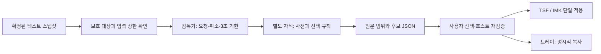

# 선택문을 로컬에서 검사하고 사용자가 제안을 선택한다

- 공개 사전을 준비하면 검사 실행에는 네트워크가 필요 없다.
- 원문 위치와 후보를 JSON으로 반환하며 입력문을 저장하지 않는다.
- 사전 밖 어절은 검토 대상이며 문법 오류의 확정 판정이 아니다.
- TSF·macOS 적용과 트레이 복사는 명시적으로 실행한다.

현재 개발판에는 독립 Rust CLI, 분리 작업 프로세스, macOS·Windows 제안 UI와 호스트 어댑터가 있다. 품질 승격 목표를 통과한 정식 맞춤법 서비스는 아니다. 자동 수정이나 매 키 검사는 하지 않는다. 플랫폼별로 실행한 범위는 [검증 기록](PROOFREADING-VALIDATION.md), 완료 조건은 [로드맵](PROOFREADING-ROADMAP.md)에 있다.



## 빌드와 실행

저장소 루트에서 실행한다. Rust 프로젝트 선언 MSRV는 1.89이며 이번 실행 도구는 Rust 1.96.0이다. Python 3.9 이상, C++ 컴파일러, libclang이 필요하다. macOS는 Xcode Command Line Tools, Ubuntu는 `build-essential clang libclang-dev`를 준비한다. 라이브러리는 Cargo의 고정된 소스로 빌드하며, 시스템 Hunspell 설치는 요구하지 않는다.

```sh
# 개발 시 최초 다운로드: 공개 사전 + 고정된 대응 소스와 라이선스
python3 core/tools/proofread/prepare_dictionary.py --with-source

# Cargo.lock으로 의존성을 고정하여 릴리스 빌드
cargo build --release --locked --manifest-path core/tools/proofread/Cargo.toml

# 해당 호스트의 라이선스 고지·링크된 크레이트 원본 보존
python3 core/tools/proofread/write_notices.py

# 표준 입력만 읽고 JSON 결과를 표준 출력으로 보냄
printf '%s' '😀 됬다 웬지' | \
  core/tools/proofread/target/release/hanautomata-proofread \
  --dictionary build/proofreading-data
```

위 다운로드는 **개발 준비 단계**다. 검사 바이너리는 네트워크 API를 호출하지 않는다. 사전은 Git에 복사하지 않고 ignored `build/proofreading-data/`에 둔다. 이미 받은 사전은 `prepare_dictionary.py --archive <zip>`으로 네트워크 없이 준비할 수 있다. `--with-source`는 대응 소스가 캐시에 없으면 별도 다운로드한다. Cargo 의존성도 한 번 받은 뒤에는 `--offline --locked`로 빌드할 수 있다.

실행 결과에서 `됬다`의 첫 후보는 `됐다`, `웬지`의 첫 후보는 `왠지`로 관측했다. 모든 문맥의 정답을 보장하지 않는다. 사용자가 선택하기 전 원문을 변경하는 기능은 없다.

### UI 포함 개발 빌드

macOS에서는 다음 명령이 사전·대응 소스·런타임 고지를 포함한 입력기 번들과, 설치 없이 실행할 수 있는 별도 검증용 편집기를 만든다. Intel Mac에서는 해당 호스트 아키텍처로 빌드한다. 현재 스크립트는 universal 검사기 번들을 만들지 않는다.

```sh
core/tools/proofread/build-macos.sh --test
open macos/build/Hanautomata-Proofreading-Demo.app
```

검증용 편집기에서 문장을 선택한 뒤 **선택한 글 검사**를 누른다. 패널에서 제안을 고르고 적용한다. 원문·선택·입력 칸이 달라지면 적용을 거부하며 다시 검사해야 한다. 보호어는 그 패널을 닫을 때까지 메모리에만 유지한다. 실제 IMK 어댑터의 진입점은 입력기 메뉴의 **선택 영역 한국어 표기 검사 (실험)**이다. 이 빌드 명령은 시스템 입력기를 설치하거나 등록하지 않는다.

Windows에서는 Python·C++·libclang과 Rust 도구가 준비된 PowerShell에서 실행한다. 기존 TSF GNU 빌드와 C++ 검사기의 도구 의존성은 다르며, 임의 LLVM 경로를 GNU 링커 앞에 넣으면 런타임 충돌이 날 수 있다.

```powershell
.\core\tools\proofread\build-windows.ps1
.\build\proofreading-windows\Hanautomata.Proofreading.Preview.exe
```

출력 폴더에는 `Hanautomata.Proofreading.exe`(TSF의 stdio UI), `Hanautomata.Proofreading.Preview.exe`(독립 편집기), `proofreading/`(검사기·사전·고지)이 함께 있다. TSF 개발 환경에서는 helper와 `proofreading/`를 해당 DLL과 같은 폴더에 둔다. helper는 AnyCPU이고 검사기는 별도 프로세스라 호스트 비트 수와 분리된다. 실제 x86 호스트 인수는 별도로 확인해야 한다. TSF 패키저와 설치·업데이트 스크립트는 `sha256.json`에 명시된 교정 payload를 지원하며, 기능을 포함할 때는 x64·x86 양쪽의 helper·검사기·사전·대응 소스·고지가 완비되어야 한다. 부분 payload와 목록 밖 파일은 거부한다. [TSF 배치 계약](../tsf/README.md), [개발판 설치 기록](PROOFREADING-INSTALLATION.md).

Windows 트레이와 TSF는 선택문에 **Ctrl+Shift+F7**을 사용한다. 트레이는 제안을 확인하고 **복사**하는 기능이다. 복사 버튼을 누를 때만 클립보드를 변경하며 원래 앱에서 사용자가 붙여넣는다. UIA 선택에는 원자적 교체 기능이 없어 합성 키로 문서를 덮어쓰지 않는다. TSF는 동일 문서·리비전·범위·원문·보안 상태를 읽기/쓰기 edit session 안에서 확인한 뒤 한 번 적용한다.

### 장기 실행 프로토콜

UI는 `--serve --rules --dictionary DIR`로 실행한 감독 프로세스와 UTF-8 JSONL로 통신한다. 입력 한 프레임은 64KiB, 출력은 256KiB까지다. 시작 `ready` 이벤트에 기한·메모리 정책을 명시한다.

Windows CLI는 시작 시 Unicode 경로를 OS API로 해석하고 사전 폴더를 해당 프로세스의 작업 디렉터리로 삼는다. 네이티브 Hunspell에는 ASCII 상대 파일명만 전달한다. 이 처리는 별도 검사 프로세스에 한정되며, 호스트 앱이나 라이브러리 호출자의 작업 디렉터리는 바꾸지 않는다. TSF의 WinExe helper는 콘솔 없이 실행되므로 표준 스트림에 명시적 UTF-8 reader/writer를 사용한다.

```json
{"schema_version":1,"command":"check","request":{"request_id":"r1","document_id":"d1","revision":"1","text":"됬다","protected_words":[]}}
{"schema_version":1,"command":"cancel","request_id":"r1"}
{"schema_version":1,"command":"shutdown"}
```

각 `result`에는 `request_id`와 `report`가 있다. `error`는 안정된 `code`, `cancelled`는 취소 이유를 반환한다. 새 유효 요청은 진행 중인 이전 요청을 대체한다. 취소·시간 초과·EOF는 네이티브 자식을 종료하고 회수한다. 이후 요청은 새 자식으로 재시작한다. 기본 기한은 3,000ms, 자원 예산은 512MiB이며 `--timeout-ms`(1~10,000), `--memory-mib`(64~1,024)로 조정한다. macOS는 5ms 간격 RSS 감시라 순간 최고 메모리의 hard cap은 아니다. Windows는 Job Object commit 한도, Linux는 RLIMIT_DATA다.

`--rules`는 정확한 5어절(`되요`, `할수있다`, `할수있어요`, `할수없다`, `할수없어요`)에만 자체 작성한 제안을 더한다. 활용형 전체나 문맥 교정으로 일반화하지 않는다. 보호어·코드·혼용문 생략은 규칙보다 먼저 적용한다. 근거는 [국립국어원 되/돼 설명](https://korean.go.kr/front/mcfaq/mcfaqView.do?mcfaq_seq=6761&mn_id=62)과 [한글 맞춤법 제42항](https://www.korean.go.kr/kornorms/m/m_regltn.do)이다. 규범 본문을 사전 데이터로 재배포하는 구현은 아니다.

## JSON 계약

`--json`을 주면 표준 입력에서 다음 객체 하나를 받는다. 알 수 없는 필드는 거부한다.

```json
{
  "request_id": "request-42",
  "document_id": "editor-7",
  "revision": "12",
  "text": "😀 됬다 하나오토마타",
  "protected_words": ["하나오토마타"]
}
```

호스트는 검사마다 고유한 `request_id`와 실제 문서·선택 스냅샷에 대응하는 `document_id`, `revision`을 공급해야 한다. CLI 기본 텍스트 모드는 일회성 검사에만 쓰는 고정 식별자를 사용한다. 이를 그대로 편집기 세션의 식별자로 재사용하지 않는다.

| 출력 | 의미 |
|---|---|
| `schema_version: 1` | 서비스 계약 판 |
| `request_id`, `document_id`, `revision` | 요청과 결과 연결 |
| `snapshot_sha256` | 정규화하지 않은 원문 UTF-8의 해시 |
| `engine`, `dictionary` | 실제 엔진·사전 버전 식별 |
| `checked_words` | 검사한 어절 출현 수; 반복 어절 포함 |
| `diagnostics[].kind` | `unknown_word`: 사전 밖 후보, `rule_suggestion`: 선택 규칙의 제안 |
| `rule_id`, `source` | 규칙 진단의 식별자와 근거; 사전 진단에서는 생략 |
| `diagnostics[].utf8`, `.utf16` | 원문 기준 `[start, end)`; 각각 바이트와 UTF-16 코드 단위 |
| `original`, `normalized` | 보존한 원문과 검사에 사용한 NFC 표현 |
| `suggestions` | 중복 제거한 NFC 후보 최대 3개; 비어 있을 수 있음 |
| `skipped` | 검사하지 않은 범위와 이유 |
| `limited` | 작업·어절 길이 상한으로 일부 검사를 중단했는지 여부 |
| `timing_ms` | CLI에서 관측한 로딩·검사 시간; 라이브러리 Report에는 없음 |

NFD 한글은 검사할 어절만 NFC로 바꾼다. 위치는 원래 문자열에서 계산하므로 이모지·CRLF·분해 자모가 앞에 있어도 별도 매핑을 잃지 않는다. Swift의 문자 인덱스나 화면의 글자 수를 UTF-16 범위와 동일시하면 안 된다.

`apply_suggestion(current, report, diagnostic_index, candidate_index)`는 **새 문자열 미리보기만 만드는 라이브러리 함수**다. 요청·문서·리비전·원문 해시·원문 범위·현재 보호어를 검증한다. 적용 후에는 새로운 스냅샷으로 다시 검사한다. 이 함수가 운영체제 포커스·선택 영역·조합 중 상태를 검사하거나 실제 앱에 쓰는 것은 아니다. Report는 로컬에서 생성된 신뢰하는 결과로 취급하며, 외부에서 받은 JSON을 적용 권한으로 사용하지 않는다.

## 보호와 상한

첫 단계는 완성된 한국어 어절을 보수적으로 검사한다. 공백으로 나눈 구간에 영문·숫자·경로·URL·전자우편·식별자 문자가 섞이면 그 구간을 생략한다. 백틱 코드 구간과 닫히지 않은 백틱 이후도 생략한다. 전문적인 Markdown/HTML 파서는 아니므로 문서 형식 전체를 해석한다고 가정하지 않는다. 순수 한글 고유명사는 사전 밖 후보가 될 수 있으므로 `protected_words`에 정확한 어절을 지정한다. 보호어는 활용형까지 자동 확장하지 않는다.

| 제한 | 값 | 도달 시 |
|---|---|---|
| CLI 요청 | 64 KiB | 오류 종료 |
| 원문 UTF-8 | 16 KiB | 오류 종료 |
| 식별자 | 각각 128바이트 | 오류 종료 |
| 보호어 | 256개, 각각 256바이트 | 오류 종료 |
| 검사 어절 | 128개 | `limited: true` |
| 정규화한 어절 | 32음절 | 해당 어절 생략, `limited: true` |
| 구간 / 진단 / 후보 | 512 / 32 / 3 | 구간·진단 상한은 제한 표시 |

동일 어절의 사전 조회·후보 생성은 **한 요청 안에서만** 재사용한다. 요청이 끝나면 캐시를 버리며 사용자 어휘로 학습하지 않는다. 원문·오류 문맥·로컬 경로를 진단 로그에 쓰지 않는다. JSON 결과 자체에는 문제 어절이 포함되므로 파일에 저장하는 것은 호출자의 명시적 선택이다.

CLI 종료 코드 0은 결과 반환 성공이며 ‘완벽한 문장’ 인증이 아니다. 코드 2는 잘못된 요청·사전 누락·해시 불일치 등 실패다. 오류는 입력문을 되풀이하지 않는다. 일회성 CLI는 동기식이며 강제 중단 기한이 없다. UI는 반드시 기한·취소가 있는 `--serve` 경로를 사용한다.

## 검증과 재현

```sh
cargo test --locked --manifest-path core/tools/proofread/Cargo.toml
python3 -m unittest discover -s core/tools/proofread -p 'test_*.py'

# 기본 테스트에서 명시적으로 제외한 실사전 검사를 따로 실행
HANAUTOMATA_KO_DATA="$PWD/build/proofreading-data" \
  cargo test --release --locked --manifest-path core/tools/proofread/Cargo.toml \
  -- --ignored

cargo run --release --locked --manifest-path core/tools/proofread/Cargo.toml \
  --example measure -- build/proofreading-data
```

합성 테스트는 자체 작성한 MIT 예문이다. 국립국어원·AI Hub의 신청형 말뭉치나 실제 사용자 입력을 포함하지 않는다. 실제 사전 검사는 정상 활용형 5개와 오류 3개를 NFC/NFD로 반복한다. 이 작은 집합을 제품 정확도 벤치마크로 해석하지 않는다.

## 데이터 갱신과 배포

사전 갱신은 `dictionary.lock.json`의 버전·출처 커밋·아카이브와 파일별 크기·SHA-256을 함께 검토하는 변경이다. 준비 스크립트는 아카이브 경로를 그대로 풀지 않고 허용한 파일만 검증해서 쓴다. 실행 시에도 사전 2개와 라이선스 2개의 해시를 확인하고, 정상 활용형 3개로 로딩을 자체 점검한다. 검증 실패를 빈 사전이나 ‘오류 없음’으로 바꾸지 않는다.

자체 코드는 MIT, `hunspell-rs`는 Apache-2.0, `hunspell-sys`는 MIT OR Apache-2.0이다. 그 안의 Hunspell 1.7.1은 MPL-1.1 선택과 MySpell의 원고지를 보존한다. 한국어 사전의 GPL-3.0-or-later 고지와 원천별 조건은 별도다. `write_notices.py`는 호스트 런타임 의존성을 Cargo.lock과 대조하여 고지와 정확한 `.crate` 원본을 보존한다. 사전 대응 소스도 공개 커밋과 아카이브 해시로 고정했다.

`package.py`는 바이너리·본체 LICENSE·THIRD-PARTY-NOTICES·고정 크레이트 원본·사전 원고지·사전 대응 소스를 모으고 `MANIFEST.json`에 파일별 해시를 기록한다. `--target`은 실제 바이너리의 Cargo target이어야 한다. 크로스 빌드인데 생략하면 호스트 고지를 잘못 선택할 수 있다. LLVM-MinGW 등 별도 C++ 런타임을 링크한 Windows 빌드는 그 런타임의 고지·정확한 원천도 추가 확인해야 한다. 기본 패키징 스크립트는 임의 툴체인의 DLL을 자동 수집하지 않는다.

이번 Windows 365 GNU 빌드는 검사기 옆에 `libc++.dll`·`libunwind.dll`을 배치하고, 고정 LLVM-mingw 아카이브의 원고지와 LLVM 커밋의 libc++/libunwind 라이선스를 별도로 보존했다. 해당 환경은 `build/evidence/windows-build-environment.ps1`, 구성·해시는 [실행 기록](../core/tools/proofread/observations/20261016-windows-verification.json)을 따른다. 원격의 `build/script-verified-windows`는 수정된 스크립트로 만든 helper·독립 편집기·검사 payload이며, `build/final-windows`에는 트레이 등 전체 개발 빌드도 있다. 환경 스크립트의 프로젝트 경로를 맞추고 사용하며 전역 PATH로 복사하지 않는다.

현재 산출물은 로컬 개발 빌드다. macOS는 ad-hoc 서명이며 공증하지 않았다. 공개 배포 전에 플랫폼 런타임 고지, 전체 대응 소스, 서명·설치·업데이트, 최신 엔진의 보안·호환성, 독립 품질 및 앱 인수를 검토해야 한다. `MANIFEST.json` 생성만으로 이 게이트가 통과하지 않는다.
