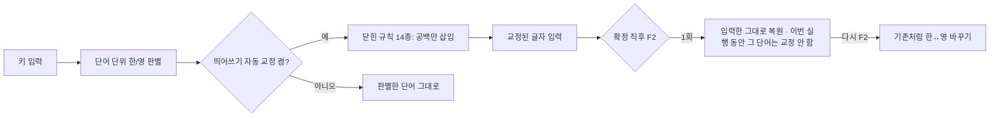

# 트레이 앱은 Space로 확정할 때 의존 명사 띄어쓰기를 자동으로 고친다

2026-10-17: macOS 0.6.1에도 같은 규칙을 이식했다. 규칙 정본은 아래 표이며 Rust 구현은 `core/src/spacing.rs`, 두 언어가 공유하는 사례는 `tests/corpora/spacing.tsv`다. macOS의 확정·후보창·원문 복원·배포 상태는 [별도 검증 기록](../macos/SPACING-VALIDATION.md)에 적는다. 아래 Windows 측정 수치를 macOS 실물 성능으로 간주하지 않는다.

- `gkftndlTek` + Space → **할 수 있다**. 확정 직후 F2 → **할수있다**(입력한 그대로).
- 교정은 공백 삽입뿐이다. 공백을 지우면 언제나 원래 입력과 같다.
- 위키백과 어절 61,759개 + 시험 어절 1,000개에서 바뀌는 어절은 검토한 6개뿐이다.
- 개인 문서 무작위 표본 100건의 교정이 모두 맞았다(95% 신뢰 하한 약 97%).
- 메모장에서도 글자가 빠지지 않도록 공백·문장부호마다 앱이 처리를 마칠 때까지 기다렸다 보낸다(§3).
- 0.6.0에서는 Windows 트레이 앱에만 있다. 입력기(TSF)·macOS는 다음 단계다.

## 1. 무엇을 고치나

[한글 맞춤법 제42항](https://www.korean.go.kr/kornorms/m/m_regltn.do)(의존 명사는 띄어 쓴다)과 보조 구문 중 자주 틀리고 오판 위험이 낮은 것만 다룬다. 규칙마다 뒤에 올 수 있는 어미·조사를 **닫힌 목록**으로 두고, 목록에 없는 형태는 손대지 않는다. 틀린 공백 하나가 놓친 공백보다 글쓴이에게 더 큰 비용이기 때문이다.

| 규칙 ID | 형태 | 예 | 붙여 쓰는 예외 |
|---|---|---|---|
| `ko-space-su` | ㄹ 수 있다/없다·수밖에·수도 | 할수있다 → 할 수 있다 · 할수밖에없다 → 할 수밖에 없다 | 공부할수록 · 실수없이 · 별수없다 · 수없이 · 홀수 · 밀수 · 코드줄수를 |
| `ko-space-geot` | ㄴ/ㄹ 것 · 것 같다 | 하는것 → 하는 것 · 할것같다 → 할 것 같다 | 날것 · 탈것 · 들것 · 별것 · 군것질 · 그것같이(조사) |
| `ko-space-geo` | ㄴ/ㄹ 거(구어) | 할거야 → 할 거야 · 하는거죠 → 하는 거죠 | 선거 · 근거 · 자전거 · 설거지 · 준거 · 논거 · 실거래 · 먹을거리 · 알거든 |
| `ko-space-ttae` | ㄹ 때 | 할때마다 → 할 때마다 | 볼때기 · 물때 |
| `ko-space-ttaemun` | 때문 | 그것때문에 → 그것 때문에 | — |
| `ko-space-jul` | ㄹ 줄 알다/모르다 | 할줄알아 → 할 줄 알아 | — |
| `ko-space-jeok` | ㄴ 적 있다/없다 | 본적있어 → 본 적 있어 | 흔적·인적 등 -적(的) 명사: 앞 음절 목록제 |
| `ko-space-deut` | ㄴ/ㄹ 듯(듯하다·듯이는 붙임) | 할듯 → 할 듯 · 올듯하다 → 올 듯하다 | 그럴듯하다 · 반듯이 · 번듯한 · 불현듯 |
| `ko-space-eoya` | -어야 하다/되다 | 해야한다 → 해야 한다 · 가야해 → 가야 해 | 해야겠다 · 해야지 · 조야한 |
| `ko-space-te` | ㄹ 테니 · ㄹ 텐데 | 할테니까 → 할 테니까 | 이를테면 |
| `ko-space-ri` | ㄹ 리가 없다 | 할리가없다 → 할 리가 없다 | 멀리·널리·달리(부사) |
| `ko-space-ppeon` | ㄹ 뻔하다 | 할뻔했다 → 할 뻔했다 | — |
| `ko-space-jung` | 는/던 중 | 하는중이다 → 하는 중이다 | — |
| `ko-space-ge` | 는/던 게(것이) + 서술어 | 하는게좋아 → 하는 게 좋아 | 나는게임을 |

다루지 않는 것: `데`(-는데 어미와 겹침), `지`(-ㄴ지), `만큼`·`뿐`·`대로`(조사와 겹침), `척`(친척), 일반 명사 사이 띄어쓰기, 맞춤법(되/돼 등)과 문체. 이들은 형태만으로 구별되지 않아 자동 교정 대상이 아니다.

## 2. 안전장치

- **공백 삽입만.** 한 한글 음절 덩어리 안에서만 공백을 넣는다. 글자를 바꾸거나 지우지 않는다. 시험이 모든 말뭉치 어절에서 "공백 제거 = 원래 입력"을 확인한다.
- **멱등.** 교정한 결과를 다시 교정해도 같다(확인 사례 64개 전부 검사).
- **되돌리기.** 확정 직후(15초 안, 같은 칸) F2를 누르면 입력한 그대로 돌아간다. 이 되돌림은 학습하지 않으며, 이번 실행 동안 같은 단어는 다시 교정하지 않는다(메모리 256개, 저장 안 함). 한 번 더 F2를 누르면 기존처럼 한↔영을 바꾼다.
- **끄기.** 트레이 메뉴 **‘띄어쓰기 자동 교정’**(기본 켬). `settings.json`의 `AutoSpacing`에 저장한다.
- **후보창 미리보기.** 조합 중 후보창에 Space로 입력될 교정 결과와 `띄어쓰기 교정` 표시를 보여 준다.
- **입력 경로 비용.** 키보드 후크 안에서 실행되는 순수 함수다. 입력 256자를 넘으면 그대로 둔다. 파일·네트워크·외부 프로세스를 쓰지 않는다.
- **학습 분리.** 앞 단어 문맥과 개인 학습은 교정 전 판별 결과를 기준으로 한다. 교정은 표시 방식이지 새 선택이 아니다.

## 3. 메모장 출력 조절

교정된 단어는 안에 공백이 생긴다. Windows 11 메모장(11.2607.14.0)은 공백·문장부호 직후 같은 묶음으로 들어온 키를 잠시 미뤘다가, 미룬 유니코드 키를 마지막 글자의 복사본으로 바꾸거나 잃었다. 트레이는 그래서 출력을 경계마다 끊어 보낸다(`src/OutputSegments.cs`, `src/InputController.cs`의 `Drain`).

| 2026-10-17 측정(합성 키) | 결과 |
|---|---|
| `할 수 있다`를 한 묶음으로 | `할`만 남음 |
| `example.` 뒤 `com done.`을 50ms 뒤에 | `eeeeeee.`처럼 앞 글자의 복사본 |
| 영문 단어 뒤 간격 110 / 140 / 170 / 200ms | 5회 중 4 / 2 / 1 / 0회 실패. 긴 단어는 250ms 뒤에도 1회 실패 |
| `!` 뒤 Enter 0~30ms / 50~200ms | 32회 중 5회 Enter 손실 / 32회 중 0회 |
| 공백을 지운 Backspace 뒤 60ms / 100~250ms | 10회 중 1회 Backspace 손실 / 30회 중 0회 |
| 경계 뒤 최소 대기 + 메모장 CPU가 조용해질 때까지 대기 | 40회 모두 일치 |

- **모든 앱.** 경계(공백·문장부호·Enter) 뒤 다음 조각은 60ms 뒤에 보낸다. Backspace는 지우는 경계마다 끊어 보낸다.
- **메모장.** 영문 단어 뒤와 Backspace 뒤에는 150ms(그 밖은 60ms)를 쉰다. 그다음 메모장 프로세스의 CPU 사용이 15ms 창에서 거의 0이 될 때까지 기다린다. 경계에서 최대 0.4초다. Word는 늘 CPU를 써서 이 대기가 매번 최대치까지 가므로 메모장에만 적용한다.
- **기다리는 동안 친 키.** 모두 보관했다가 친 순서대로 하나씩 다시 넣는다. 후크가 앞 키를 처리한 뒤 다음 키를 넣으므로 순서와 단축키(Ctrl+A 등)가 유지된다.
- **멈춤 조건.** 클릭하거나 앞 창이 바뀌면 남은 출력은 보내지 않고 트레이 메뉴의 복구 항목에 남긴다.
- **비용.** 메모장에서 띄어쓰기 단어 하나가 끝나기까지 0.1~0.4초 걸린다. 그 사이 친 글자는 그 뒤에 나타난다. Word에서는 마지막 키 뒤 0.28초 안에 끝났다(1회 측정).
- **한계.** 64조각을 넘는 Shift+F2 선택 변환은 이전처럼 한 묶음으로 보낸다. 메모장 판이 바뀌면 필요한 대기가 달라질 수 있다. Chrome·Edge는 이 판으로 다시 시험하지 않았다.

## 4. 정밀도 근거

| 점검 | 대상 | 결과 |
|---|---|---|
| 위키백과 전수(단위 시험의 게이트) | 내장 어절 61,759개 + held-out 1,000개 | 바뀌는 어절 6개(해야한다·수있다·수있는·살때·볼때·이때문에) — 모두 올바른 교정이며 목록과 다르면 시험 실패 |
| 개인 문서 말뭉치(저장소 밖) | 유지보수자의 한국어 문서 45,958개 · 한글 덩어리 72만 종 · 출현 4,684만 회 | 6,476종(24,417회) 교정. 규칙별 상위 패턴을 전부 검토해 오탐 6계열을 예외로 막음 |
| 무작위 표본 | 위 교정 중 12음절 이하 5,243종에서 무작위 100개 | 100개 모두 올바른 공백(1건은 원문이 비정상이라 중립) |

개인 문서 말뭉치의 내용은 저장소에 넣지 않았다. 검토 중 막은 오탐은 `그럴듯`·`반듯`·`번듯`·`불현듯`, `준거`·`논거`, `-거래`(구어 `거래` 어미 오인), `코드줄수를`, `자전거`, `밀수`·`열수`·`살수`, `이를테면`, `윤거`(이름)다. 각 반례는 단위 시험에 고정했다.

정밀도 수치는 위 문서들의 문체(보고서·강의·메모)에 한정된다. 채팅·소설·전문 분야 문장에서의 오탐률은 측정하지 않았다. 새 오탐은 [문제 알리기](https://github.com/peterkimpmp/hanautomata/issues)에 단어와 기대 결과로 알려 주면 반례로 추가한다.

## 5. 유지보수

- 규칙과 예외는 `src/Spacing.cs` 한 파일에 있다. 규칙을 바꾸면 `.\build.ps1 -Test`의 위키백과 게이트가 바뀐 어절 전체를 보여 준다. 목록을 늘리려면 각 어절을 검토한 뒤 시험의 기대 목록에 추가한다.
- 실제 후크 경로는 `.\build.ps1 -Integration`의 띄어쓰기 시나리오 6개(교정·F2 복원·무학습·재교정 안 함·다른 규칙·끄기)와 출력 조절 3개(대기 중 친 키의 순서·대기 중 F2·대기 중 단축키)가 확인한다. 메모장의 지연 동작은 WinForms 시험 창에서 재현되지 않으므로, 출력 경로를 바꾸면 메모장 저장 파일 대조를 다시 한다.
- 입력기(TSF)·macOS로 옮길 때는 같은 확인 사례·반례·위키백과 게이트를 Rust 엔진에 그대로 적용해 세 구성의 결과가 같은지(G1) 확인한다. 실험 맞춤법 검사기(`--rules`)의 정확 5어절 규칙과는 별개다.
