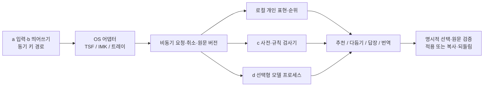

# Hanautomata는 로컬 추천부터 문맥 AI까지 검증 가능한 단계로 만든다

- 키 입력과 추천·AI 처리는 실행 경로를 분리한다. [§2](#2-공통-아키텍처)
- 첫 빌드는 직접 등록한 내 표현의 추천·관리다. [§4](#4-첫-mvp와-구현-순서)
- 맞춤법 기본 제공에는 LLM이 필수가 아니다. [§5](#5-맞춤법과-모델의-선정-게이트)
- 문장 AI는 원문·의도·변경 내용을 함께 보여 준다. [§6](#6-문장-ai의-공통-계약)
- 구현·기기 시험·공개 배포는 각각 증거를 남긴다. [§8](#8-출시와-운영)

제품 방향은 [공통 제품 로드맵](PRODUCT-ROADMAP.md), 첫 구현의 수용 기준은 [내 표현 MVP 명세](specs/PERSONAL-ASSIST-MVP.md)가 정본이다. 이 문서는 전체 작업 분해와 기술 의존성을 정한다. 아래의 목표 성능·일정은 실측 결과가 아니다.



## 1. 현재 자산과 남은 차이

| 영역 | 재사용할 구현 | 남은 과제 |
|---|---|---|
| a 한영 입력 | C# 트레이 엔진, Rust 공통 엔진, Swift IMK·Rust TSF | 기존 두 엔진의 동일 예문 회귀 유지; 트레이 Rust 통합은 독립 작업 |
| b 띄어쓰기 | Windows 트레이·macOS의 14개 규칙, F2 복원 | TSF 연결, 실제 앱·첫 조합·빠른 입력 회귀 |
| c 맞춤법 | 별도 Hunspell 프로세스, 선택문 검사·범위 검증·UI | 독립 평가 세트·지연 개선·오탐 억제·배포 기본 포함 여부 |
| 개인화 | 명시적 한영 선택 기억·삭제·한 번 되돌림 | 개인 단어/표현, 추천 순위, 표현별 관리, 사용자 효용 시험 |
| d 문장 AI | 조사와 UX 방향 | 실행기·모델 선정·다운로드·요청 계약·비교 UI·의미 보존 평가 |

현재 한영 선택 기억은 개인 표현 완성 기능이 아니다. Windows 트레이와 Windows TSF는 서로 다른 호스트이므로, 한쪽 구현을 Windows 전체 완료로 표기하지 않는다. 기존 시험 결과는 [기능 비교](FEATURES.md) 및 각 검증 원장을 참조한다.

## 2. 공통 아키텍처

| 구성 | 책임 | 금지·제약 |
|---|---|---|
| 키 엔진 | 조합, 모드 판별, 확정 시 검증된 띄어쓰기 | 네트워크·모델 추론·디스크 대기 없음 |
| 호스트 어댑터 | 포커스·문서·선택 영역·보호 입력 확인, 표시·적용 | 조회 실패를 안전한 입력으로 추정하지 않음 |
| 로컬 추천 서비스 | 표현 정규화·검색·순위·명시적 반응·저장 | 원문 타이핑 자동 수집은 별도 opt-in 구현 전 금지 |
| 맞춤법 서비스 | 사전·규칙 후보, 요청 범위·오프셋 | 사전 미등록=오류로 자동 확정하지 않음 |
| 모델 서비스 | 모델 수명·토큰 예산·취소·추론 | 키 엔진과 독립 프로세스; 로컬 실패 시 원격 전송 금지 |
| 개인화 저장소 | 기억의 출처·종류·삭제·보존·버전 | 기존 한영 선택 파일과 구분, 텍스트 로그 없음 |
| UI 계약 | 요청 상태, 후보, 원문 비교, 적용/복사/취소 | Space·Enter로 생성 문장 암묵 수락 없음 |

**결정 ADR-01:** 새 추천의 정규화·순위·저장 로직은 Rust 서비스 하나에 둔다. C#·Swift에 알고리즘을 각각 복제하지 않는다. 첫 서비스 `hanautomata-assist`는 JSONL 표준 입출력만 사용하고 네트워크 포트를 열지 않는다. 사전 검사기와는 별개이므로 설치되지 않은 모델·사전 때문에 기본 입력이나 내 표현 검색이 멈추지 않는다.

**ADR-02:** UI와 무관한 서비스 계약·파일 스키마를 먼저 고정한다. 두 UI는 요청 ID를 대조하고 늦은 검색 결과를 버린다. 변이 요청은 직렬화하며 UI 스레드에서 프로세스·파일 응답을 기다리지 않는다. 서비스 실패는 패널에 표시하고 기본 입력 경로에 전파하지 않는다.

**ADR-03:** 실시간 인라인 추천은 추천 품질보다 먼저 적용 안전성을 갖춘다. 문서/클라이언트 ID, revision, 선택 범위, 원문 해시, 보호 상태를 다시 확인한다. IMK/TSF의 편집 계약을 이용하고 트레이에서 원자적 교체를 보장하지 못하면 복사로 제공한다. 이 제한은 UI에 명시한다.

## 3. 전체 기술 로드맵과 완료 조건

`R`은 전체 제품 단계다. 맞춤법 문서의 기존 `M0~M4`와 혼동하지 않는다. 상태와 증거는 [구현 원장](PERSONAL-ASSIST-VALIDATION.md)에 기록한다.

| 단계 | 개발 묶음 | 선행 조건 | 완료 판정 |
|---|---|---|---|
| R0 공통 계약 | 기능 a~d, 기능별 설정, capability, 요청/피드백/원문 버전, 오류·삭제 계약, 공통 예문 | 현재 소스·조사 | 두 OS의 용어·상태·요청이 같고 계약 회귀 통과 |
| R1a 내 표현 MVP | 수동 등록, 로컬 접두어 top-3, 복사 이력 순위, 최근 순위 복원, 목록·삭제·중지, 독립 창 | R0 | Rust 서비스 + Windows 트레이·macOS 패널, 영속화·Unicode·실패 회귀, 빌드 |
| R1b 입력 중 추천 | 1행 미리보기, 펼침 최대 3개, 명시적 수락, 짧은 멈춤·최신 요청만 표시, 안전 적용·undo | R1a + 호스트 계약 | 보호/unknown/focus 전환에서 0건 수집·0건 오적용, Space/Enter/F2 회귀, 실제 앱 시험 |
| R1c 사용 패턴 | 명시 허용된 확정 단어, 다음 단어, 앱별 프로필, 빈도 감쇠, 삭제·복원·보존·암호화 | R1b + 별도 저장 동의 | 자동 생성 결과 미학습, 즉시 undo 철회, 삭제 후 큐/캐시에서 부활 없음, 효용 개선 |
| R2 c 기본 기능화 | 사전 고정·라이선스, 규칙 확장, 형태 분석 비교, 오탐 억제·캐시·취소, 두 OS 패키지 | 독립 평가 데이터 | 정상문 1,000건 FP≤1%, 고정 오류 세트 top-3≥80%, 300자 warm p95≤300ms; 조건 미달 시 실험 유지 |
| R3 호출형 AI | 로컬 실행기·모델 선택/삭제, 다듬기·내 말투·메모→문장·답장·번역, diff·적용/복사·취소 | R0 + 모델 평가 + R1 개인화 계약 | 의미 보존·취소·stale 폐기·OOM 복구·모델 라이선스·호스트 시험, 실제 작성 효용 |
| R4 문맥 추천 | 짧은 이어쓰기, 개인 명령, 조절 가능한 자동 노출, 문체 프로필, 선택형 원격 provider | R3 실사용 | 부담·되돌림·시간 측정에서 기준선보다 개선; 외부 전송 범위 확인·철회 |
| R5 일반 배포 | OS별 설치/갱신/제거/롤백, 접근성, 서명·공증, 모델 제거, SBOM·고지, 공개 문서 | 기능별 승격 게이트 | 지원 OS/기기/앱 매트릭스와 실제 ZIP 증거, 체크섬·CI·개인정보 정합 |

R2 평가와 R3 모델 실험은 R0 이후 독립 작업이다. R2가 늦다고 검증된 R1을 막지 않으며, R3가 좋아도 c의 정확도 시험을 대체하지 않는다. 버전 번호와 출시일은 각 게이트 통과 후 정한다.

### 작업 예산의 초기 범위

아래는 개발자 1명의 작업을 분해하기 위한 **추정 작업일**이며 납기 약속이나 현재 완료 시간은 아니다. 실제 OS 시험·모델 다운로드·사용자 평가 대기는 별도다.

| 묶음 | 추정 | 큰 불확실성 |
|---|---:|---|
| R0 + R1a | 3~6일 | 기존 패키지·UI 계약 통합 |
| R1b | 5~10일 | 트레이/TSF/IMK의 포커스·undo 차이 |
| R1c | 5~10일 | 수집 동의·삭제·암호화·평가 설계 |
| R2 | 8~15일 | 독립 정답 데이터 확보·오탐과 속도 개선 |
| R3 | 10~20일 | 한국어 모델 품질·저사양 기기·안전 적용 |
| R4 | 5~15일 | 인지 부담과 추천 효용 실험 |
| R5 | 5~10일 | 서명 계정·호스트 실제 시험·업데이트 회귀 |

각 묶음 종료 시 실측 작업량으로 재산정한다. 혼자 관리할 수 있는 무료 OSS가 기준이므로 서버 운영·상시 과금·복잡한 모델 학습 파이프라인은 첫 배포의 의존성으로 두지 않는다.

## 4. 첫 MVP와 구현 순서

**이번 빌드 범위는 R0의 추천 계약과 R1a**다. 사용자는 `내 표현` 창에 단어 또는 짧은 표현을 직접 저장하고, 두 글자 이상 입력해 찾고, 복사해서 사용한다. 명시적 복사 이력이 추천 순위를 바꾼다. 이를 실제 문서 채택·작성 완료·LLM 학습으로 부르지 않는다.

1. 공통 엔진과 실패하는 계약 시험을 만든다: 정규화·중복·순위·복원·삭제·꺼짐.
2. JSONL 서비스와 원자적 영속화를 구현한다: 용량·스키마·손상·단일 writer·실패 시 원본 보존.
3. Windows 트레이·macOS 메뉴에 같은 패널을 연결한다: 등록/추천/관리/복사/되돌림.
4. 비동기 요청 ID와 검색 취소, 실패 메시지·재시작, 접근성 레이블을 연결한다.
5. 빌드·패키지에 서비스를 포함하고 라이선스·개인정보·운영 문서를 갱신한다.
6. 회귀와 실제 패키지를 검증하고 미검증 실물 항목을 원장에 남긴다.

다음 착수 작업은 R1b다. 전역 단축키는 기존 키를 보존한 상태에서 호스트 충돌 시험 후 확정한다. R1a에서 기본 입력 훅에 새 자동 수락 키를 추가하지 않는다. 현재 TSF는 R1a 진입 UI 범위 밖이며 R1b에서 어댑터를 연결한다. 같은 OS라는 이유로 트레이와 TSF를 동시에 완료 처리하지 않는다.

## 5. 맞춤법과 모델의 선정 게이트

### c: 로컬 기본 맞춤법

Hunspell + `hunspell-dict-ko` 고정 버전을 기준선으로 유지한다. 국립국어원 자료는 규범·평가 근거로 검토하며, 공개 열람/API 이용 가능성과 원문·파생 데이터 재배포 권리를 구분한다. Kiwi는 활용·문맥 후보 보강 실험이다. 원문 수집·변환 방법·버전·라이선스·해시·정답 작성자를 데이터 카드로 남긴다. 기존 정본: [데이터·검사기 구성](PROOFREADING.md), [검증 결과](PROOFREADING-VALIDATION.md).

개발에 쓴 예문과 공개 평가를 분리한다. 한국어 고유명사·한영 혼용·숫자/단위·URL·코드·부정·조건·조사/어미를 층화하고, 정상문 오탐과 오류문 재현율을 따로 보고한다. 개발 표본 79문장의 성적을 사용자 전체 정확도로 외삽하지 않는다. 기본 포함을 통과해도 일반 교정은 제안형이며 자동 적용에는 더 엄격한 별도 기준이 필요하다.

### d: 모델·런타임

| 후보 | 판단할 것 | 채택 조건 |
|---|---|---|
| llama.cpp 공통 실행기 | Win x64 CPU/GPU·Mac Metal, 취소·메모리·양자화·배포 크기 | 고정 커밋·지원 백엔드·실제 기기 결과 |
| Qwen3.5-4B | 한국어/한영 혼용 품질, 짧은 비추론 응답, 양자화 편차 | 모델 카드·Apache-2.0·원본/변환 해시, 사실 보존·지연 |
| Gemma 3n | 저자원 실행·한국어 편집, 실제 메모리 | 별도 Gemma 조건·고지·변환/배포 허용 범위 확인 |
| Apple/Windows 네이티브 모델 | OS·기기·언어·API capability | 런타임 탐지 후 옵션; 두 OS 공통 필수 기반으로 가정하지 않음 |
| 사용자 API key | 사용자 선택 provider·전송 범위·취소·비용 | R4 별도 opt-in; API key OS 보안 저장소, 기본 입력은 계정 불필요 |

모델은 아직 채택·동봉하지 않는다. 최소 3개 기기군(메모리 제한 CPU Windows, GPU Windows, Apple Silicon Mac)에서 동일 과제·양자화·입력 길이를 고정해 cold/warm 지연, 메모리 peak, 소비 전력 조건, 의미 변화를 기록한다. 임의로 저장된 사용자 표현을 외부 벤치마크에 넣지 않는다.

## 6. 문장 AI의 공통 계약

아래는 **후속 구현 명세**이며 R1a 서비스가 LLM을 실행한다는 뜻은 아니다.

```text
WritingRequest v1
  request_id, action: polish | shorten | my_voice | notes | reply | translate
  source: {document_id, revision, utf16_range, sha256, text}
  intent, target_language?, style_profile_id?, selected_context[]
  provider: local | explicit_remote, deadline_ms, max_output_tokens

WritingEvent v1
  request_id, state: queued | generating | proposal | cancelled | error
  proposal: {original_sha256, text, changes[], fact_change_flags[]}
  execution: {provider_id, model_id, model_digest, local}

ApplyResult v1
  request_id, status: applied | copied | stale | unsupported | rejected
  feedback_id?, undo_token?  // 적용과 복사를 학습 신호에서도 구분
```

외부 문장은 편집 대상 데이터로 전달한다. 문장 속 지시나 모델 출력에 파일·OS 조작 권한을 주지 않는다. 모델은 편집안을 반환하며 키 입력·전송·다른 앱 조작 도구를 갖지 않는다. 응답 길이·형식·원문 참조를 검증하고 잘못된 응답은 폐기한다.

키 이벤트에서 처리 중인 모델을 기다리지 않는다. 문서가 바뀌면 revision을 올려 이전 결과를 무효화하고, 생성 중인 글자를 원문에 넣지 않는다. `cannot → can`, `할 수 없다 → 할 수 있다`, 금액·기한·조건·고유명사를 의미 보존 회귀에 포함한다. 문자열 차이만으로 의미 보존을 보장한다고 취급하지 않는다.

## 7. 평가·데이터·운영 예산

| 평가 | 비교·지표 | 초기 게이트 |
|---|---|---|
| 추천 엔진 | 512개 표현, 한국어/영문/NFD, top-3, 결정적 순서 | 서비스 query p95≤50ms 측정, GUI 시간은 별도 |
| 개인화 | 사용 후 남은 채택률, 편집량, undo, 완료 시간, 방해 정도 | 빈도 없는 기준선과 비교. 복사 수를 채택률로 바꾸지 않음 |
| 입력 경로 | 기존 replay·키 누락·보호 입력 | 회귀 0건. 모델 처리로 키 지연 p99를 악화시키지 않음 |
| 文장 AI | 의미 보존·요청 충족·한국어 자연스러움·재수정 | 눈가림 사람 평가 + 부정/수치/조건 실패는 별도 집계 |
| 자원 | warm/cold·p50/p95·RAM·다운로드/설치 크기 | 300자 수동 작업 p95≤3s는 검증 목표; 지원 기기별 공개 |
| 개인정보 | 원문 로그·네트워크·삭제·대기 큐·파생 기억 | 기능 끔/삭제 후 다시 생성 0건, 내용 없는 진단 |

평가 데이터에는 source/license/split/hash/normalization/annotator/version을 붙인다. 모델·규칙 개발 세트와 release gate 세트를 잠근다. 새로운 규칙이 평가 예문에서 유래하면 해당 항목을 개발로 옮기고 평가를 보충한다. 대규모 학습은 일반 추천과 검색 기준선보다 확실한 개선이 입증될 때만 착수한다.

## 8. 출시와 운영

기본 입력·띄어쓰기·개인 표현에는 서버 비용과 계정이 없다. 선택형 로컬 모델은 별도 다운로드로 크기·저장 위치·라이선스·삭제를 보여 준다. 원격 모델 비용은 사용자가 선택한 provider 계약에 따른다는 점을 설정에서 알린다.

릴리스 체크는 빌드와 공개 ZIP에서 각각 수행한다. 전체 파일·버전·아키텍처·서명·제3자 고지·설치/갱신/제거를 확인한다. Windows 트레이/TSF, macOS IMK, 메모장/TextEdit·Word·Chrome·Edge·검색·관리자 앱을 별도 행으로 관리한다. 자동화 통과를 물리 입력 성공으로 기록하지 않는다. R1a 시연 창의 성공을 인라인 교체 성공으로 대체하지 않는다.

서명·공증·원격 CI·실제 기기 인수가 남으면 개발 빌드로 유지한다. 공개 릴리스·태그 승격은 실제 범위와 증거를 확인한 후 수행한다. 기존 선택 기억 파일은 migration 없이 유지하고 새 개인 표현 파일은 schema_version으로 관리한다. 손상된 파일은 덮어쓰지 않고 복구 안내를 제공한다.

## 9. 근거와 결정 이력

제품·UX·모델 선택의 조사 정본은 aipm의 `research/20261017-deep-hanautomata-ai-personalization-ux.md`다. 이전 데이터 조사 두 편과 연결되며, 공개 제품에는 고객 사례·사용자 사전·비공개 원문을 복사하지 않는다.

- [Mozc 사용자 예측 구현](https://github.com/google/mozc/blob/master/src/prediction/user_history_predictor.h): 작은 개인 이력·삭제·되돌림의 선례.
- [llama.cpp](https://github.com/ggml-org/llama.cpp), [Qwen3.5-4B](https://huggingface.co/Qwen/Qwen3.5-4B), [Gemma 조건](https://ai.google.dev/gemma/terms): 후속 실행·배포 평가의 원문.
- [Rust 파일 잠금](https://doc.rust-lang.org/std/fs/struct.File.html#method.try_lock), [Unicode 정규화](https://docs.rs/unicode-normalization/latest/unicode_normalization/trait.UnicodeNormalization.html): R1a 구현 API.

2026-10-17: 사용자의 전체 로드맵·MVP/Spec·빌드 요청에 따라 작성. AI가 문서와 코드를 보조했으며, 기능 상태는 검증 원장의 관측으로만 승격한다.
