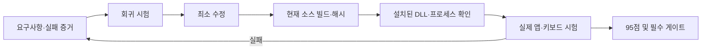

# Windows 품질 목표는 95점과 필수 시험 전부 통과로 판정한다

- Word F2·공백 포함 선택 변환은 자동 고침 ON에서 보강했다. [직접 시험](WINDOWS-QUALITY-RESULTS.md#word-shiftf2의-공백-포함-선택-변환-보강--2026-10-15)
- 이전 후보의 70개 검사는 병합된 0.5.0 전체 빌드 증거가 아니다.
- 설치 성공, 합성 키, 물리 키보드 결과를 각각 기록한다.
- 미실행·간접 증거에는 점수를 주지 않는다.

## 범위와 완료 조건

사용자 목표는 Windows에서 100점에 가까운 동작을 위한 계획·개발·빌드·시험 완료다. 공개 C# 트레이 앱과 Rust TSF 시험판을 함께 다룬다. 트레이 결과를 TSF 결과로 대체하지 않는다. 95/100 이상이고 아래 필수 게이트가 모두 통과해야 목표 완료다. 이 점수는 제품 품질을 관리하는 인수 지표이며 실제 정확률·무결점 확률이 아니다.

실행 중 학습 회복의 추가 인수 조건(2026-10-15): 미저장 선택은 최대 64개로 별도 보존하고 과거 거부 횟수를 기능 차단에 쓰지 않는다. 재시도는 원래 Action을 반환받아 같은 세대·연결로만 제출한다. 원래 Action이 없는 선택은 저장하지 않으며, 최초 사전에서 삭제 이력이 없음을 입증했을 때만 메모리 합성에 사용한다. 이후 Forget은 해당 단어, Reset은 이전 세대 전체를 제거한다. 이력 누락·범위 초과·다른 저장소는 허용으로 해석하지 않고 무효화/상한 초과 수를 남긴다. 사전 전체 준비는 worker가 하고 깨끗한 단어 경계에서 최대 64개 로컬 델타만 메모리에 적용한다. 이 경로의 시간 측정은 WQ-08에서 확인하며 아직 입력 지연을 승인한 것은 아니다.

앱 간 충돌에서는 저장 권한을 가진 원래 Action의 재시도와 저장 불가능한 임시 기억을 구분한다. 재시도 가능한 선택은 원래 Action으로 제출하며 저장소의 확정 순서를 따른다. Action이 없는 임시 기억은 같은 raw/keys의 저장된 항목이 있으면 문맥과 무관하게 물러나고, 다른 단어의 임시 기억은 보존한다. 이는 저장되지 않은 선택의 실제 시간 순서를 추정하는 규칙이 아니라 저장 정본 우선 정책이다. 입력 문서는 바꾸지 않으며 대체된 선택 수를 집계한다. 두 서비스·각 저장 자식·공유 시험 저장소에서 재현하고, 큐 가득 참의 재시도와 삭제/초기화 경계를 함께 회귀한다.

TSF 후보창·설정 편집기·학습 저장의 개발 구현과 실제 앱 연결·화면 검증의 차이를 남긴다. 최신 개발 소스는 일반 데스크톱용 비동기 저장 프로세스와 학습 관리 UI를 연결했지만 설치된 시스템 후보에는 아직 없다. 제한 호스트·관리 UI의 제품 설치 검증·전체 앱 시험을 마치기 전에는 TSF를 완성된 Windows 제품으로 승인하지 않는다. 서명과 공개 릴리즈는 별도의 배포 승인 항목이며 개발 빌드 완료를 공개 출시로 확대하지 않는다.



## 현재 설치와 실제 시험의 경계 — 2026-10-15

사용자가 `5971010`의 동결 후보 `wq-5971010-20261015`를 관리자 화면에서 적용했다. 설치 파일 6개의 해시, 프로필 활성화, x64/x86 등록 COM 생성은 확인했다. 이후 열린 파일의 실제 경로를 확인한 결과 에이전트의 LocalAppData 읽기·쓰기는 Codex LocalCache로 연결됐다. 따라서 앞선 설정 생성은 실제 Word 사용자의 설정 준비를 증명하지 않는다. 이전 revision 파일은 보존했다. 실제 등록 실패 복구·제거·로그인 시험은 아직 남아 있다.

적용 직후 기존 Word 5개는 모두 이전 DLL을 적재했고 트레이 앱도 실행 중이었다. 사용자의 저장·재시작 후 새 Word PID 28784가 최신 DLL을 적재했고 트레이 프로세스가 없는 것을 확인했다. 이후 사용자가 모든 시험을 에이전트가 수행하도록 지시했으므로 물리 키 응답 대기를 종료했다. 기존 `문서1`은 보존하고 새 `문서2`에서 Sky 키 주입으로 시험했다. `dkssud`→Space 뒤 `안녕`이 나타났지만 F2 뒤에도 그대로였다. Undo는 자동 고침을 가리켰으며 실제 호스트 로그는 입력 필드 조회 `E_FAIL`·F2 미처리를 기록했다. 한글 표시만으로 TSF 성공으로 계산하지 않는다. 현재 앱 승인은 **0/6**이다. [직접 시험과 증거 정정](WINDOWS-QUALITY-RESULTS.md#에이전트-직접-시험과-파일-경로-증거-정정--2026-10-15)이 최신 판정이다.

## 가중치와 추적 가능한 인수 기준

각 행은 명시된 하위 시험의 통과 비율에 비례해 배점한다. 미검증은 0점이며, 필수 실패는 총점과 무관하게 완료를 막는다. 트레이·TSF 각각 같은 표로 평가하고 두 경로의 최저 점수를 최종 점수로 사용한다. 구조상 적용하지 않는 항목은 근거와 동등한 사용자 결과를 적으며 가중치를 다른 쉬운 항목으로 옮기지 않는다.

| ID | 배점 | 시험·기대 결과 | 필수 | 권위 있는 증거 |
|---|---:|---|:---:|---|
| WQ-01 | 20 | 한글 조합·겹받침·분리·Backspace·Enter/Space/Tab·영어/숫자/URL/코드 보존·빠른 반복·긴 문장. 누락/중복/비의도 교체 0 | 예 | 엔진 회귀 + 실제 입력 전후 문자열 |
| WQ-02 | 20 | 메모장·Chrome·Edge·Word·시작 검색·관리자 메모장 각각 조합/확정/삭제/전환/재변환. Word 자동 고침 ON 유지 | 예 | 앱별 실제 프로세스·DLL·화면·입력 방식·각 케이스 결과 |
| WQ-03 | 15 | 암호 필드 통과, 조회 실패 시 입력을 수집하지 않음, 잠금/초점 변경 시 세션 폐기, 트레이와 TSF 이중 처리 없음, 평문 입력 로그 없음 | 예 | 결함 주입 회귀 + 보호 필드/초점 실제 시험 + 로그 검사 |
| WQ-04 | 10 | F2 왕복·Shift+F2 선택 변환·Esc 취소·F12 정지/복귀·Shift+Space 모드. 호스트가 바꾼 범위 덮어쓰기 금지 | 예 | 정책 회귀 + 실제 앱 명령 전후 + Word Undo 원인 대조 |
| WQ-05 | 10 | x64/x86 설치·일반 사용자 활성화·갱신·이전 revision 보존·등록 실패 복구·제거 후 기존 IME 유지 | 예 | 격리 설치 시험 receipt/해시 및 실제 제거·복구 결과 |
| WQ-06 | 10 | 자동 시작 ON/OFF, 공백·한글 경로, 로그인 후 1개 프로세스, 재실행/중복 실행, 시작 항목 복구 | 예 | 단위/설치 회귀 + 실제 로그아웃/로그인 후 프로세스·옵션 결과 |
| WQ-07 | 5 | 후보/옵션/트레이 표시, DPI 100/150/200%, 설정 유지, 학습 저장/리셋·손상 파일·동시 쓰기 | 예 | 저장소 회귀 + 실제 UI/재시작 + TSF 기능 격차 해소 |
| WQ-08 | 5 | 10,000키 반복 입력 누락 0, p95 입력 처리 20ms 이내, 30분 연속 입력 오류/핸들 증가 조사 | 예 | 재현 가능한 시각/하드웨어·표본·측정 원장 |
| WQ-09 | 5 | 소스/VERSION/바이너리/문서 버전 일치, 두 비트수 selftest, 의존 파일·해시·깨끗한 설치 경로 | 예 | 현재 HEAD 빌드 로그·매니페스트·ReleaseTests |
| **합계** | **100** | **95점 이상 + 필수 게이트 전부 통과** | | |

## 실행 순서와 중단 조건

1. 격리 브랜치에서 현재 기준 소스의 C# 테스트·앱 빌드와 TSF x64/x86 테스트·selftest를 실행한다. 명령·종료 코드·커밋·해시를 보존한다.
2. Word 기존 실패와 암호 조회 실패·초점 이동·편집 거부를 회귀 입력으로 만든다. 실패를 확인하고 최소 수정한다. 문서의 언어 속성 보강은 실제 Word 결과 전까지 가설이다.
3. 자동 시작·설치·설정·학습과 성능을 현재 코드로 검증하고 발견한 결함을 수정한다. 의도적으로 실패한 테스트 로그와 수정 후 로그를 구분한다.
4. 새 revision 묶음은 해시·사전 점검·복구 방법을 완성한 후 적용한다. 기존 DLL을 덮어쓰지 않고 사용자 문서·입력기 설정을 보존한다.
5. 실제 프로세스가 새 DLL을 적재한 것을 확인한 뒤 6개 앱을 시험한다. 새 창만 열린 것은 새 프로세스 증거가 아니다. 가상 키와 물리 키를 구분한다.
6. 실제 로그인 시험과 관리자 앱 시험은 사용자가 관리하는 화면·권한에서 실시한다. 에이전트가 보이지 않는 UAC를 반복하거나 자동 재부팅/로그오프하지 않는다.
7. 실패·미검증 항목을 남긴 평가표와 원장을 현행화한다. 기능 구현과 모든 필수 증거가 갖춰질 때까지 목표를 완료 처리하지 않는다.

사용자 문서 손실, 암호 수집, 입력 누락/중복이 발생하면 해당 후보의 사용을 중지하고 기존 입력기로 복구한다. UI 도구가 차단한 화면은 다른 실행면으로 우회하지 않고 미검증으로 남긴다.

## 명령과 증거 원장

```powershell
.\build.ps1 -Test
.\build.ps1
.\build.ps1 -Integration
.\tests\ReleaseTests.ps1
.\tsf\build.ps1 -Test -X86
```

명령의 실제 매개변수와 실행 전제는 각 스크립트를 읽어 확정한다. 통합 시험은 실제 키 입력을 보내므로 시험 전용 화면에서만 실행한다. Rust는 ASCII `CARGO_HOME`/`RUSTUP_HOME`/`CARGO_TARGET_DIR`을 사용한다. 원장에는 다음을 기록한다.

| 필드 | 기록 내용 |
|---|---|
| identity | 소스 커밋, 변경 diff, 버전, 바이너리 SHA256, 설치 receipt |
| environment | OS/비트수, 앱 버전·PID·적재 DLL, 입력 모드, 트레이 상태, Word 자동 고침 |
| case | WQ ID, 입력, 기대/실제, 자동/합성/물리 구분, 시간, 로그·화면 위치 |
| verdict | pass/fail/not-run 및 그 한계. API 성공만으로 화면 시험 pass 금지 |
| restoration | 기존 IME·트레이·옵션·문서 보존 상태 |

빌드 로그와 개인 PC 화면은 무시된 `build/windows-quality/` 아래 보관하고, 공개 문서는 필요한 결과만 요약한다. 이전 근거 정본은 [VERIFICATION](VERIFICATION.md), [D2](../tsf/D2-VALIDATION.md), [TSF 범위](../tsf/README.md)다. Vault는 이 직접 근거로 대체한다(`waiver: already-in-context`). ATLAS 검색은 현재 런타임의 openpyxl 부재로 실패해 참고 절차를 생략했으며 제품 작업을 막지 않는다.

## 남은 구현의 시작점 — WQ-07

2026-10-14 소스 확인에서 TSF는 `Outcome.learned`를 전달하지만 `Engine.save()`를 호출하지 않는다. `core/src/store.rs`는 단일 저장 주체 계약이며 파일 잠금·원자적 교체는 손상 방지다. 다른 앱이 가진 오래된 사전의 변경을 병합하는 동작은 없으므로, 각 TSF 서비스가 단순히 `save()`를 호출하도록 바꾸면 안 된다. 기존 C# `PreferenceStore`도 프로세스 내부의 저장 직렬화만 제공한다. 영속 학습은 여러 앱의 선택·삭제·리셋이 서로 되살아나거나 사라지지 않는 시험과 함께 설계·구현한다.

초기 점검 당시 Windows 설정은 `src/App.cs`의 트레이 메뉴와 `settings.json`에 있고, TSF의 `shell::Settings`는 별도 기본값이었다. 후보 UI도 C# 트레이와 macOS에만 있었다. 아래에 누적하는 개발 구현은 다음 사용자 결과를 모두 보존해야 한다.

| 작업 | 구현·검증 조건 |
|---|---|
| 설정 저장과 적용 | 트레이/TSF의 지원 옵션·기본값 대응, 손상 설정 복구, 재시작 유지, 조합 중 변경의 확정 경계 |
| TSF 후보 표시 | 실제 caret 위치·DPI·초점 이동·보호/비공개 필드 억제, 앱 입력을 가로채지 않는 UI |
| 학습 단일 저장 책임 | 키 콜백 밖 저장, 여러 앱의 동시 선택·삭제·리셋·중단 복구, 동일 사용자 범위와 AppContainer 제약 |
| 트레이 공존 | 설정/학습 관리 역할이 기존 입력 후크의 실행 표시로 오인되어 TSF 전체를 중지시키지 않도록 구분 |

이는 후속 구현 범위의 구체화이며 구현 완료나 별도 아키텍처 승인 기록이 아니다. 관리자 적용을 기다리는 것과 위 개발 작업의 진행 가능 여부는 구분한다. 실제 Word 시험, UI·학습 기능, 실제 로그인 및 장기 성능 증거가 모두 갖춰질 때까지 전체 목표를 활성 상태로 유지한다.

### 학습 저장 통신의 선행 시험 — 2026-10-15

시험용 실제 AppContainer에서 단일 저장 프로세스와 통신할 수 있는지 먼저 대조했다. x64/x86 모두 `LOCAL` 파이프 주소는 허용·거부 조건에서 오류 2였고, 직접 주소는 해당 시험 프로필 SID를 허용했을 때 왕복 성공·허용하지 않았을 때 오류 5였다. 프로세스 PID 대조와 종료 후 객체 부재도 확인했다. 근거는 [통신 시험 원장](WINDOWS-QUALITY-RESULTS.md#학습-저장-통신의-실제-appcontainer-시험)이다.

### 학습 저장 코어와 개발 도구 — 2026-10-15

`core/src/learning.rs`에 전용 파일의 단일 저장 주체를 구현했다. 전체 사전의 오래된 사본을 덮어쓰는 대신 선택·단어 삭제·전체 초기화를 순번 있는 요청으로 처리한다. 마지막 요청 재시도는 중복 저장하지 않으며, 삭제 세대는 이전 선택이 단어를 되살리는 것을 막는다. 단어 삭제는 다른 단어의 대기 선택을 허용하되, 전체 초기화 또는 256개를 넘겨 소실된 삭제 이력은 오래된 선택을 거부한다.

전용 파일 잠금, 체크섬·의미 검사, 프로세스 중단 전후 복구, 명시적 연결 기록 정리, Windows 파일 공유 오류의 제한 재시도와 수치 직렬화 회귀를 검사한다. `quality-probes`의 `hanautomata-learning-store`는 부모가 고른 시험 파일과 표준 입출력만 사용하는 개발 도구다. TSF 키 처리에 연결하지 않았으며 자동 실행·설치·인증된 통신 채널을 제공하지 않는다. 결과와 남은 위험은 [저장 코어 원장](WINDOWS-QUALITY-RESULTS.md#학습-저장-코어와-별도-프로세스-시험)에 기록한다.

남은 구현은 동일 사용자·세션의 인증된 브로커, 앱별 대기열과 응답 유실 복구, 제한 호스트의 통신, 일시 정지·민감 필드·교정 취소의 학습 정책, 이전 사전 가져오기, 백업 복구 시 새 store ID, 설치·종료 수명 관리다. 최종 연결 후 실제 앱 재시작과 동시 선택·삭제·리셋 시험을 다시 수행해야 WQ-07을 승인할 수 있다.

### 문서 반영과 학습 확정의 경계 — 2026-10-15

저장 연결을 조사하면서 실제 TSF COM 콜백의 문서 쓰기가 거부되어도 학습 항목이 늘어나는 결함을 재현했다. 선택은 최대 8개의 임시 항목으로 보관하고 문서 반영 성공 후 한 번만 사전에 적용하도록 수정했다. 지연된 이전 조합은 원래 범위가 그대로일 때만 학습하며, 삭제·초기화·되돌리기·학습 일시정지·비공개 전환은 보류 중인 선택을 무효화한다. 일반 키 확정의 커서/조합 종료 등 후속 작업이 실패하면 텍스트는 보존하되 해당 학습은 보수적으로 생략한다.

확정 API는 정규화한 선택 델타를 돌려주지만 현재 서비스는 메모리 사전에만 반영한다. 다음 브로커 연결에서는 문서 작업 시작 시점의 저장 세대와 확정 델타를 결합하고, 키 콜백 밖의 제한된 대기열로 전달해야 한다. 이 변경은 디스크 저장·앱 간 동기화·설치 완료를 뜻하지 않는다. [확정 경계 검사](WINDOWS-QUALITY-RESULTS.md#문서-쓰기-실패가-학습되는-결함-수정--2026-10-15)를 통과해도 WQ-07과 실제 앱 승인은 열어 둔다.

### 확정 선택 대기열과 저장 프로세스 재시도 — 2026-10-15

`learning::client`에 문서 작업 전 세대 캡처·최대 64개 대기열·최대 8개 일괄 제출·입력 스레드 잠금 대기 없는 경로를 구현했다. 응답 유실은 같은 요청으로 재시도하고, 늦은 성공 응답은 더 최신의 초기화 세대를 되돌리지 않는다. 삭제/초기화로 거부된 항목은 다음 요청의 순번에 구멍을 남기지 않는다. 일시정지는 미제출 작업을 무효화하며 이미 수락한 확정 선택의 삭제를 뜻하지 않는다.

x64/x86 별도 저장 프로세스 시험에서 재시작 후 정확히 한 번 저장, 초기화 전 세대를 가진 늦은 문서 선택의 거부를 확인했다. 최초 시험은 개발용 stdio이며 후속 named pipe 시험과 구분한다. 메모리 대기열에서 ACK 전에 호스트가 끝나는 경우의 내구성도 미검증이다. 기존 저장소 마이그레이션·실제 앱/설정·WQ-07 완료 조건을 유지한다.

### 실제 연결 상대 확인과 lease 결합 — 2026-10-15

`quality-probes`의 개발 named pipe에 OS가 관측한 사용자·로그온·세션·프로세스 생성 시각과 nonce를 결합했다. 다른 프로세스의 기존 lease 재사용, 익명 토큰, 과대·불완전 메시지, 잘못된 서버와 통신 정체를 거부한다. 일반 사용자 프로세스끼리의 실제 통신·서버 재시작·대기열 재시도·초기화 전 늦은 선택 거부를 검증한다. 설치된 DLL은 바꾸지 않는다.

제품 연결 전 남은 작업은 신뢰된 서버 실행/발견·동시 연결/lease 수명·학습과 관리 권한·응답 버전 계약·독립 보안 검토, TSF의 작업 시작 세대와 문서 쓰기 후 확정 델타 연결, 스냅샷 반영·종료/가득 참 상태다. 관리자·AppContainer·제한 토큰은 현재 보수적으로 거부하며 해당 환경의 영속 학습 승인을 뜻하지 않는다. [개발 통신 계약](../tsf/README.md#실제-peer에-묶인-개발용-named-pipe)과 결과 원장으로 남기며 **WQ-07·실제 앱 0/6**을 유지한다.

### 현재 배율의 설정 탭 표시 확인 — 2026-10-15

사용자 보고에 따라 탭의 고정 행 높이와 여백을 보강했다. 잘림/숨김 9건을 회귀로 재현한 뒤 설정 28개·배치 40개·패키지 21개가 통과했다. Sky의 실제 새 창에서 입력·단축키 옵션과 학습 안내문을 확인했고 사용자는 `화면 검수본`에 대해 “모두 정상으로 보임”으로 답했다. [상세 근거](WINDOWS-QUALITY-RESULTS.md#설정-탭의-잘림-보강과-사용자-확인)는 현재 DPI의 표시 승인이다. 다른 배율·UI 저장과 재열기·설치 연결·실제 앱 동작을 대신하지 않는다.

이 결과로 확인한 범위는 비패키지·capability 0개인 시험 프로세스다. 패키지 앱·LPAC·다른 사용자·다른 로그인 세션의 권한은 별도로 입증해야 한다. 직접 주소를 모든 호스트에 적용하는 것으로 결정하지 않는다. 실제 저장 프로세스는 키 콜백 밖의 제한된 큐, 상대 토큰/세션 확인, 취소 가능한 I/O와 함께 구현한다. 선택 중복 처리, 삭제·리셋 후 오래된 클라이언트의 재생 방지, 쓰기 중단·손상 복구가 모두 남아 있다. 각 DLL의 오래된 전체 사전을 저장하는 방식은 계속 제외한다.

### 설정 기능 개발 진행 — 2026-10-14

위 표의 설정 저장·적용 경로를 구현했다. `src/ImeSettings.cs`와 `tsf/src/settings.rs`가 같은 PascalCase Format 1 계약을 읽고, 전용 `Hanautomata.ImeOptions.exe` 또는 `Hanautomata.exe --ime-settings`는 입력 후크를 시작하지 않는다. TSF는 활성화 시 설정을 읽으며 키 콜백의 파일 I/O를 추가하지 않는다. 앱 제외는 컨텍스트 정책과 편집 명령 전달에서 함께 유지한다. 실패한 설정 읽기는 키 통과로 처리한다.

이는 WQ-07 완료 판정이 아니다. 실제 설정 화면·DPI·재활성화 적용, 설치·Windows 메뉴 연결, 후보 UI 및 영속 학습 구현은 남아 있다. 사용자 설치를 기다리는 f839115 후보에는 이 변경이 없으며 기존 설치 묶음을 덮어쓰지 않았다. 새 소스의 검사와 리뷰는 [결과 원장](WINDOWS-QUALITY-RESULTS.md)에 별도로 기록한다.

### AppContainer 설정 접근 검증의 경계 — 2026-10-15

다음 검증은 경로와 접근 권한을 분리한다. [KNOWN_FOLDER_FLAG](https://learn.microsoft.com/en-us/windows/win32/api/shlobj_core/ne-shlobj_core-known_folder_flag)의 `KF_FLAG_NO_PACKAGE_REDIRECTION`은 패키지 밖의 경로를 얻는 옵션이며 해당 파일을 읽을 권한의 증거가 아니다. [Microsoft IME 요구사항](https://learn.microsoft.com/en-us/windows/apps/develop/input/input-method-editor-requirements)에 따르면 IME는 호스트의 AppContainer 제한을 그대로 받는다. 파일을 다른 위치에 둘 때에는 명시적인 접근 권한 설계가 필요하다.

1. 일반 프로세스와 시험용 AppContainer에서 설정의 실제 경로·읽기 결과·내용 해시가 같은지 재현 가능한 검사를 만든다. 환경 변수 차이, 경로 조회 실패, 권한 거부, 없는 파일을 서로 구분한다.
2. 사용자별 설정에 한정한 읽기·쓰기 계약을 정하고 실제 제한 토큰에서 확인한다. 사용자 프로필 전체의 ACL을 완화하거나 관리자 권한을 입력 처리의 전제로 삼지 않는다. 경로 해결만으로 문제를 닫지 않는다.
3. 트레이 공존 mutex가 같은 사용자라도 AppContainer 안에서 같은 객체로 보이는지 별도로 확인한다. 두 입력 경로가 동시에 동작하지 않아야 한다.
4. 격리 프로세스 검사를 통과해도 실제 시작 검색·관리자 앱의 설정 적용과 입력 시험을 별도로 수행한다. 실제 앱 승인은 간접 시험으로 대체하지 않는다.

이는 다음 작업의 검증 범위를 구체화한 것으로, 새로운 저장 경로나 ACL 배포를 승인·적용한 기록이 아니다.

### 설정 공유 구현과 화면 결함 수정 — 2026-10-15

위 경로·권한 계약을 개발 소스에 구현했고 C# 저장·교체·복원 후 일반 AppContainer에서 읽기·쓰기 거부·mutex 권한을 확인했다. 설정 26개, Rust 131개, 진단 4개가 통과했다. 실제 설정 미리보기의 저장·다시 읽기를 확인하던 중 창 배율과 안내문 잘림을 발견했고 실패 회귀 5개를 수정했다. 배치 5개 통과와 새 C# 빌드는 확인했으나 수정본 화면, DPI별 검수와 실제 앱 승인은 남아 있다. [결과 원장](WINDOWS-QUALITY-RESULTS.md)에 로그와 독립 검토 범위를 기록한다.

다음 인수 항목은 이전 설정의 읽기 권한 마이그레이션·백업 ACL 정책, LPAC·실제 패키지 호스트, 설치/메뉴 연결, 수정본 설정 화면과 DPI, Word F2 및 6개 앱이다. 후보 UI·영속 학습·로그인·장기 성능 게이트도 유지한다. 관리자 후보를 자동 갱신하거나 기존 입력기 설치를 바꾼 상태가 아니다.

### 설치 묶음과 현재 사용자 준비 연결 — 2026-10-15

설정 편집기·실행 설정을 TSF 묶음에 포함하고 설치/갱신 시 여섯 파일의 해시를 확인하도록 연결했다. 새 `enable-user`는 일반 사용자 설정 준비 성공 후에만 활성화를 진행한다. 유효한 기존 파일과 백업은 원문 보존, 새 사용자만 기본값 생성, 손상·복구 대기 파일은 자동 초기화 거부가 계약이다. `options` 명령은 편집기 진입점이며 Windows 입력기 메뉴를 대신 검증한 것으로 보지 않는다.

저장소 28개·관리자 거부와 배치 6개·PowerShell 7/5.1 묶음 및 일반 사용자 준비 21개씩·Rust 133개와 양쪽 빌드를 확인했다. 첫 독립 검토의 이전 revision 도구 혼용·롤백 도구 의존성·쓰기 중 강제 종료 지적을 반영했고 후속 소스 검토에서 High/구체적 Medium 잔여 없음으로 확인했다. 관리자 설치·실패 롤백 및 6종 앱은 미실행이다. 다음 단계는 실제 메뉴 진입점, LPAC/패키지 호스트와 설치 승인 경계 연결이며 원래의 전체 완료 조건을 유지한다.

### 표준 속성 인터페이스 개발 — 2026-10-15

Text Services의 `ITfFnConfigure`를 구현하고 인터페이스 부재와 자식 종료 전 대기 실패를 회귀로 재현했다. 현재 등록된 revision의 편집기만 일반 데스크톱 세션에서 열며, AppContainer·관리자·보안 상태 불명은 거부한다. 독립 검토의 세 지적을 반영해 부모 창 복원·명시적 메시지 처리·정상 사용자 판정을 보강했다. 추가 Alt+F4 회귀를 포함해 Rust **144개 통과 + 자식 fixture 1개 제외**, x64/x86 selftest는 통과했지만 실제 메뉴가 이 콜백을 호출하는지, 별도 편집기의 포커스·닫기·저장 적용은 설치 후 확인해야 한다. 현대 Windows 입력 전환 메뉴를 표준 제어판 API와 동일시하지 않는다. 수정본 화면은 도구 권한 오류로 미확인이고 WQ-07은 진행 중이다.

### 후보 표시 개발 — 2026-10-15

TSF 후보 요소·비활성 미리보기 창·문서 편집 성공 후 표시를 만들고 조합 중 F2를 공통 엔진에 연결했다. 독립 검토의 H2·소유 스레드·제한 호스트·COM 호출 경계를 보강했다. H1 지연 레이아웃은 후보 보존→읽기 세션 재검증→지연 위치 갱신으로 수정했고, 원문/선택/초점 변경과 오래된 콜백을 폐기한다. 후속 검토에서 재현한 비동기 대기·취소·메시지 재시도 결함도 보강했다. Rust **178개(52+107+19) 통과 + 자식 fixture 1개 제외**, x64/x86 빌드·selftest 근거는 `candidate-final-reviewed-build.log`다. 코드 검토와 실제 화면 승인은 별개이며 현재 설치 승인을 뜻하지 않는다. 실제 caret·DPI/멀티 모니터·접근성·제한 호스트와 6종 앱 승인은 남았다. WQ-07, 영속 학습·로그인·장기 성능 등 필수 게이트를 완료로 올리지 않는다.

### 관리자 재설치 없이 일반 Word 후보 시험 — 2026-10-15

기존 시스템 프로필 위에 제품 자신의 x64 COM 클래스만 사용자별로 임시 등록하고, 새 Word의 적재 모듈을 확인하는 경로를 확보했다. 각 시험 뒤 원래 사용자 등록 부재로 복구한다. 따라서 일반 Word의 다음 후보 시험은 사용자 UAC 응답 없이 진행할 수 있다. 관리자/패키지 앱의 설치·시험은 별도로 검증해야 한다.

실제 `ScopeValue/E_FAIL`에 대해 비공개 조합 정책을 적용하자 Word의 Space 이전 조합이 복구됐다. 암호·비활성/빈 입력란은 차단하고 해당 호환 모드의 학습·미리보기·입력 추적은 끈다. F2 처리도 도달하지만 Word 자동 고침이 결과를 되돌린다. 교정 전 언어 지정과 명시적 교정 조합 가설 모두 실제 Word 시험에서 실패했다. 효과가 없던 명시적 조합 구현은 제외하고 실험 패치를 보존했다.

다음 후보는 이미 확정된 단어 뒤 공백을 다시 쓰지 않고 단어 범위만 교체한다. 개발 검사 **233개(core 90 + TSF lib 124 + shell 19)**와 x64/x86 빌드·selftest가 통과했다. 실제 Word 시험 전 원격 세션이 연결 해제되어 후보 효과는 미검증이다. `wq-word-separator-20261015`를 동결했으며 시스템·사용자 등록에는 적용하지 않았다. **전체 앱 승인 0/6**을 유지한다. 화면이 복구되면 기존 시험 문서 저장 상태를 먼저 확인하고, 새 Word에서 해당 DLL 적재·자동 고침 ON·F2 왕복·공백과 커서 위치를 직접 검증한다. [결과 원장](WINDOWS-QUALITY-RESULTS.md)의 실제 PID·후보 경로·화면을 기준으로 판단한다.

후속 재연결 때 이전 문서를 저장·확인하고 새 Word PID 24952에 공백 보존 수정을 포함한 `wq-learning-client-20261015`를 적재했다. **Space 전 조합과 F2 왕복·반복·문장 중간·Undo/Redo가 성공**했고 Word 한/영 자동 고침 ON과 기존 공백 뒤 커서를 확인했다. 개별 합성 키의 해당 사례 승인이다. Shift+F2는 `안녕 `처럼 뒤 공백을 포함하면 실패하고 공백을 제외하면 성공해 별도 수정 대상으로 분리했다. 시험 문서는 DOCX로 저장·XML 확인 후 해당 창만 닫았고 임시 사용자 등록을 복구했다. 다음 실제 시험은 선택 변환 수정본과 나머지 앱이다. 앱 전체 승인은 0/6이다.

후속 `wq-selection-space-20261015`를 적재한 Word PID 30504에서 **공백 포함 Shift+F2 양방향·Undo/Redo가 성공**했다. 선택 끝의 기존 ASCII 공백을 다시 쓰지 않으며, 축소 거부는 원문을 보존한다. 일반 F2 왕복·Space 전 조합·겹받침 삭제·Enter 확정·Esc 취소도 확인했다. 자동 고침 ON은 다시 화면으로 확인했고 옵션은 바꾸지 않았다. 시험 문서 저장·XML 확인·사용자 COM 복구까지 완료했다. Shift+Space의 고정 모드 전환과 F12 복귀의 전체 계약, 나머지 앱·보호 필드·설치·학습 저장·로그인·장기 시험은 계속 열어 둔다. 고유 Rust 검사 273개와 양쪽 빌드는 개발 증거이며 앱 전체 승인으로 합산하지 않는다.

### TSF 문서 확정→큐 handoff — 2026-10-15

서비스별 Link와 단어 시작 Stamp를 연결해 실제 문서 작업 성공 후 확정 델타만 제한 큐에 제출한다. 지연 완료는 오래된 세대를 유지하고 초기화 이후의 세대로 다시 찍지 않는다. 실패한 문서 작업과 비공개/무효화 선택은 제외한다. 큐의 가득 참·연결 종료는 문자를 보존하며 저장 누락 상태를 남긴다. 별도 스레드·인증된 자식 프로세스·재시작 스냅샷까지 합성 COM 문서 시험으로 검증했다.

제품 broker 실행과 lease 공급은 아직 활성화하지 않았다. 다음 구현은 신뢰된 실행/발견·응답 버전·수명 관리와 스냅샷 반영이며, 입력 콜백의 I/O·대기·프로세스 생성 금지를 유지한다. 이 단계의 합성 시험은 실제 앱 승인이나 WQ-07 완료가 아니다.

### 일반 데스크톱 학습 worker 연결 — 2026-10-15 후속 개발

동일 revision의 setup 도구를 서비스 전용 자식으로 실행하는 경로를 추가했다. 공유 PID 파일이나 고정 서버 검색 대신, 실행한 정확한 프로세스와 무작위 파이프·세션 nonce를 확인한다. 서비스마다 별도 자식이지만 파일 잠금을 잡은 짧은 트랜잭션만 단일 작성자가 되며, 요청마다 최신 상태를 다시 읽는다. 입력 중인 앱의 오래된 전체 사전을 저장하지 않는다. 입력 경로는 큐와 준비된 초기 사전의 교환만 수행한다.

초기 사전이 도착하기 전에 로컬 선택이 바뀌었다면 덮어쓰지 않고 그 세션의 복원을 생략한다. 이미 시작한 단어를 새 저장 세대로 재지정하지 않는다. 정상 비활성화는 미제출 선택을 차단하고 수락된 큐를 제한 시간 동안 처리한 뒤 자기 lease를 반납한다. 강제 프로세스 종료 전 미확인 큐의 내구성을 보장한 것으로 간주하지 않는다.

다음 순서는 ① 학습 상태·삭제/초기화/복구·실행 중 앱 간 반영·제한 호스트 연결, ② 6개 앱 전체 명령/보호 필드 시험, ③ 설치/제거/롤백·실제 로그인·DPI·10,000키/30분 성능·최종 패키지다. 추가 3~5회 후보 검증 순환은 계획 범위이며 완료 횟수나 소요 시간 보장이 아니다. 사용자에게 시험을 다시 요청하지 않는 현재 지시를 유지하며 관측하지 못한 관리자·로그인 결과를 통과로 바꾸지 않는다. 전체 앱 승인 0/6과 WQ-01~09 완료 조건은 그대로다.

후속 개발에서는 종료된 연결 누적을 실제 자식 강제 종료로 재현했다. 등록 전에 소유하는 전역 mutex와 명시적 수명 정책으로 다음 시작 시 회수하며, 살아 있는 앱과 관리용 연결은 보존한다. 256개 한도·잠금 중 종료 후 복구를 시험했다. 유휴 100Hz polling은 작업/종료 이벤트 대기로 바꾸고 느린 저장 후 응답 예산을 분리했다. 초기 사전 병합에서 중복 때문에 1,024개가 512개로 줄어드는 결함도 수정했다. 이는 WQ-07 구현의 진전이며 제품 UI·실제 다른 세션·실제 앱·롤백·장기 시험 승인을 뜻하지 않는다. 후속 검증 원장을 기준으로 다음 실제 앱 시험과 관리 기능을 이어간다.

후속 소스 검토의 보조 프로세스 2Hz 대기와 저장 형식 롤백 문제를 보강했다. 입력 측 worker뿐 아니라 자식의 연결 대기도 부모 종료와 함께 기다리며, 오래된 reader를 실제 빌드해 신형 연결 정리 전 거부·정리 후 데이터 보존을 확인했다. `learning-prepare-rollback`은 일반 사용자 전용의 명시적 관리 명령이며 살아 있거나 불명확한 연결이 있으면 변경 없이 거부한다. 앱 종료·시스템 등록 변경과 실제 제품 롤백은 이 명령의 성공에 포함하지 않는다.

관리 기능의 다음 단계에서 기존 DB만 여는 경로를 도입해 외부 삭제 경쟁 시 초기화를 막고, 학습 상태·삭제/초기화·실행 중 갱신을 연결한다. 먼저 추가한 롤백 호환 검사는 한글 문맥·삭제/초기화 fence·가중치 경계까지 통과했지만, 설정 UI의 관리 기능이나 실제 앱 승인으로 합산하지 않는다.

### 학습 관리 연결과 실행 중 반영의 인수 경계 — 2026-10-15

기존 파일만 여는 경로, 화면 버전과 일치할 때만 삭제·초기화하는 명령, 설정 앱의 전용 관리 탭을 개발했다. 검수본은 메모리에 있는 두 가상 항목만 사용한다. 기존 사전은 새 DB를 처음 생성할 때 한 번만 가져오며 초기화 후 재시작에서 다시 합치지 않는다. 제품 설치와 실제 사용자 학습 데이터의 승인으로 합산하지 않는다.

다음 구현은 실행 중 사전 갱신이다. 외부 삭제·초기화·다른 앱의 학습을 새 단어 경계에서 반영하되 조합 중인 문자·선택·커서와 미완료 문서 콜백을 보존해야 한다. 스냅샷 요청 이후 생긴 로컬 선택을 오래된 응답으로 덮지 않아야 하며, 이전 사전으로 시작한 단어의 저장 세대를 새 세대로 바꿔 삭제한 항목을 되살리면 안 된다. 새 세대의 학습 허용 시점과 메모리 사전의 적용 시점을 함께 검증한다. 입력 콜백에서 파일/파이프 접근·프로세스 생성·잠금 대기를 추가하지 않는다.

실제 자식 프로세스를 사용하는 동시 학습·삭제·초기화 시험과 서비스 COM 문서의 단어 경계 시험을 먼저 수행한다. 이어 실제 앱에서 관리 화면→학습 변경→재시작 없는 반영을 확인해야 WQ-07의 해당 항목을 승인한다. 전체 앱 0/6과 WQ-01~09의 나머지 게이트를 유지한다.

### 실행 중 학습 반영의 구체화 — 2026-10-15

저장 응답의 generation을 관측한 것과 앱이 해당 사전을 설치한 것을 분리한다. 새 저장 세대는 메모리 사전의 교체가 성공한 뒤부터 새 단어에 사용한다. 이전 단어의 Stamp는 바꾸지 않는다. 최초 사전 설치 전에는 저장용 새 Action을 발급하지 않는다.

worker는 수락된 선택 대기열과 진행 중 저장이 비었을 때만 스냅샷 체크포인트를 만든다. 이후 새 선택이 수락되었다면 저장까지 끝났더라도 체크포인트는 낡은 것이므로 폐기한다. 사전 교체는 즉시 실패 가능한 메모리 잠금 아래 이루어지고, 그 성공과 입력 세대 변경을 한 동작으로 묶는다. 준비 중 생긴 로컬 선택·저장 실패·비공개 입력·조합 중인 단어를 덮어써서는 안 된다.

실제 저장 경로의 상위 디렉터리 변경 알림은 worker에서만 대기한다. 알림 내용 자체를 학습 데이터로 믿지 않고 인증된 자식에게 새 스냅샷을 요청한다. 임시 파일 교체·자기 저장·다른 앱 등록도 알림을 만들 수 있으므로 버전과 이미 설치한 revision을 대조하고 전송 중 사전은 한 개로 제한한다. 기존 30초 watchdog은 알림 누락 점검용으로 유지하며 유휴 100Hz polling으로 돌아가지 않는다.

Windows API 근거는 [FindFirstChangeNotificationW](https://learn.microsoft.com/en-us/windows/win32/api/fileapi/nf-fileapi-findfirstchangenotificationw)와 [FindNextChangeNotification](https://learn.microsoft.com/en-us/windows/win32/api/fileapi/nf-fileapi-findnextchangenotification)이다. 파일 이름·크기·마지막 쓰기 변화를 관측하며 구체적인 변경 파일 이름은 이 API로 확정하지 않는다. 알림 핸들은 전용 close 함수로 정리하고, 원격 공유 저장소 지원으로 확대하지 않는다.

개발 인수 증거는 ① 저장 관측 후 옛 사전의 새 세대 저장 거부, ② 새 선택 수락 전후의 스냅샷 경합, ③ 실제 두 자식의 학습·관리 Reset 전달, ④ 조합·지연 문서 완료·로컬 저장 실패의 보존, ⑤ 정상 종료·유휴 대기·잠금 회복이다. 실제 앱의 관리 변경과 재시작 없는 반영은 별도로 관측한다. 이 절은 설계와 검사 계약이며 기능 완료 기록이 아니다.

후속 읽기 전용 검토에서 `rejected > 0`을 영구적인 갱신 차단 조건으로 쓰면 최초 연결 전에 입력한 단어 하나가 세션 전체의 학습을 중지시키는 문제가 지적됐다. 따라서 누적 실패 통계는 기능을 계속 막는 조건으로 쓰지 않는다. 미저장 선택은 제한된 별도 복구 상태로 보존하고, 이후 새 단어의 학습과 사전 갱신은 회복해야 한다. 원래 세대/Action이 있는 요청만 같은 표식으로 재시도하며 연결 전 단어를 최신 세대로 다시 찍어 저장하지 않는다.

명시적 Reset은 그보다 오래된 활성 학습과 미저장 학습에 우선하지만 문서의 입력 문자열은 그대로 보존한다. Forget은 해당 단어에만 적용하며 다른 단어의 미저장 선택을 임의로 없애지 않는다. 적용 순서를 확정할 근거가 없는 선택은 새 세대로 추정해 재저장하지 않는다. 지연된 다른 문서의 학습 확정이 무효화되면 누락 통계에 드러나야 한다. 계속 입력하는 동안에도 초기화 스냅샷이 영구적으로 밀리지 않는 검사까지 마쳐야 새 후보를 동결한다.
