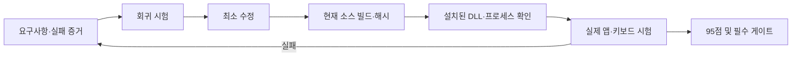

# Windows 품질 목표는 95점과 필수 시험 전부 통과로 판정한다

- Word F2는 자동 고침 ON에서 실패한 증거가 있다. [D2 기록](../tsf/D2-VALIDATION.md)
- 이전 후보의 70개 검사는 병합된 0.5.0 전체 빌드 증거가 아니다.
- 설치 성공, 합성 키, 물리 키보드 결과를 각각 기록한다.
- 미실행·간접 증거에는 점수를 주지 않는다.

## 범위와 완료 조건

사용자 목표는 Windows에서 100점에 가까운 동작을 위한 계획·개발·빌드·시험 완료다. 공개 C# 트레이 앱과 Rust TSF 시험판을 함께 다룬다. 트레이 결과를 TSF 결과로 대체하지 않는다. 95/100 이상이고 아래 필수 게이트가 모두 통과해야 목표 완료다. 이 점수는 제품 품질을 관리하는 인수 지표이며 실제 정확률·무결점 확률이 아니다.

TSF 후보창·영속 학습 부재와 개발 중인 설정 편집기의 설치·메뉴 연결·실제 화면 검증을 기능 차이로 남긴다. 이 기능들이 구현·시험되지 않았다면 TSF를 완성된 Windows 제품으로 승인하지 않는다. 서명과 공개 릴리즈는 별도의 배포 승인 항목이며 개발 빌드 완료를 공개 출시로 확대하지 않는다.



## 가중치와 추적 가능한 인수 기준

각 행은 명시된 하위 시험의 통과 비율에 비례해 배점한다. 미검증은 0점이며, 필수 실패는 총점과 무관하게 완료를 막는다. 트레이·TSF 각각 같은 표로 평가하고 두 경로의 최저 점수를 최종 점수로 사용한다. 구조상 적용하지 않는 항목은 근거와 동등한 사용자 결과를 적으며 가중치를 다른 쉬운 항목으로 옮기지 않는다.

| ID | 배점 | 시험·기대 결과 | 필수 | 권위 있는 증거 |
|---|---:|---|:---:|---|
| WQ-01 | 20 | 한글 조합·겹받침·분리·Backspace·Enter/Space/Tab·영어/숫자/URL/코드 보존·빠른 반복·긴 문장. 누락/중복/비의도 교체 0 | 예 | 엔진 회귀 + 실제 입력 전후 문자열 |
| WQ-02 | 20 | 메모장·Chrome·Edge·Word·시작 검색·관리자 메모장 각각 조합/확정/삭제/전환/재변환. Word 자동 고침 ON 유지 | 예 | 앱별 실제 프로세스·DLL·화면·입력 방식·각 케이스 결과 |
| WQ-03 | 15 | 암호 필드 통과, 조회 실패 시 입력을 수집하지 않음, 잠금/초점 변경 시 세션 폐기, 트레이와 TSF 이중 처리 없음, 평문 입력 로그 없음 | 예 | 결함 주입 회귀 + 보호 필드/초점 실제 시험 + 로그 검사 |
| WQ-04 | 10 | F2 왕복·Shift+F2 선택 변환·Esc 취소·F12 정지/복귀·Shift+Space 모드. 호스트가 바꾼 범위 덮어쓰기 금지 | 예 | 정책 회귀 + 실제 앱 명령 전후 + Word Undo 원인 대조 |
| WQ-05 | 10 | x64/x86 설치·일반 사용자 활성화·갱신·이전 revision 보존·등록 실패 복구·제거 후 기존 IME 유지 | 예 | 격리 설치 시험 receipt/해시 및 실제 제거·복구 결과 |
| WQ-06 | 10 | 자동 시작 ON/OFF, 공백·한글 경로, 로그인 후 1개 프로세스, 재실행/중복 실행, 시작 항목 복구 | 예 | 단위/설치 회귀 + 실제 로그아웃/로그인 후 프로세스·옵션 결과 |
| WQ-07 | 5 | 후보/옵션/트레이 표시, DPI 100/150/200%, 설정 유지, 학습 저장/리셋·손상 파일·동시 쓰기 | 예 | 저장소 회귀 + 실제 UI/재시작 + TSF 기능 격차 해소 |
| WQ-08 | 5 | 10,000키 반복 입력 누락 0, p95 입력 처리 20ms 이내, 30분 연속 입력 오류/핸들 증가 조사 | 예 | 재현 가능한 시각/하드웨어·표본·측정 원장 |
| WQ-09 | 5 | 소스/VERSION/바이너리/문서 버전 일치, 두 비트수 selftest, 의존 파일·해시·깨끗한 설치 경로 | 예 | 현재 HEAD 빌드 로그·매니페스트·ReleaseTests |
| **합계** | **100** | **95점 이상 + 필수 게이트 전부 통과** | | |

## 실행 순서와 중단 조건

1. 격리 브랜치에서 현재 기준 소스의 C# 테스트·앱 빌드와 TSF x64/x86 테스트·selftest를 실행한다. 명령·종료 코드·커밋·해시를 보존한다.
2. Word 기존 실패와 암호 조회 실패·초점 이동·편집 거부를 회귀 입력으로 만든다. 실패를 확인하고 최소 수정한다. 문서의 언어 속성 보강은 실제 Word 결과 전까지 가설이다.
3. 자동 시작·설치·설정·학습과 성능을 현재 코드로 검증하고 발견한 결함을 수정한다. 의도적으로 실패한 테스트 로그와 수정 후 로그를 구분한다.
4. 새 revision 묶음은 해시·사전 점검·복구 방법을 완성한 후 적용한다. 기존 DLL을 덮어쓰지 않고 사용자 문서·입력기 설정을 보존한다.
5. 실제 프로세스가 새 DLL을 적재한 것을 확인한 뒤 6개 앱을 시험한다. 새 창만 열린 것은 새 프로세스 증거가 아니다. 가상 키와 물리 키를 구분한다.
6. 실제 로그인 시험과 관리자 앱 시험은 사용자가 관리하는 화면·권한에서 실시한다. 에이전트가 보이지 않는 UAC를 반복하거나 자동 재부팅/로그오프하지 않는다.
7. 실패·미검증 항목을 남긴 평가표와 원장을 현행화한다. 기능 구현과 모든 필수 증거가 갖춰질 때까지 목표를 완료 처리하지 않는다.

사용자 문서 손실, 암호 수집, 입력 누락/중복이 발생하면 해당 후보의 사용을 중지하고 기존 입력기로 복구한다. UI 도구가 차단한 화면은 다른 실행면으로 우회하지 않고 미검증으로 남긴다.

## 명령과 증거 원장

```powershell
.\build.ps1 -Test
.\build.ps1
.\build.ps1 -Integration
.\tests\ReleaseTests.ps1
.\tsf\build.ps1 -Test -X86
```

명령의 실제 매개변수와 실행 전제는 각 스크립트를 읽어 확정한다. 통합 시험은 실제 키 입력을 보내므로 시험 전용 화면에서만 실행한다. Rust는 ASCII `CARGO_HOME`/`RUSTUP_HOME`/`CARGO_TARGET_DIR`을 사용한다. 원장에는 다음을 기록한다.

| 필드 | 기록 내용 |
|---|---|
| identity | 소스 커밋, 변경 diff, 버전, 바이너리 SHA256, 설치 receipt |
| environment | OS/비트수, 앱 버전·PID·적재 DLL, 입력 모드, 트레이 상태, Word 자동 고침 |
| case | WQ ID, 입력, 기대/실제, 자동/합성/물리 구분, 시간, 로그·화면 위치 |
| verdict | pass/fail/not-run 및 그 한계. API 성공만으로 화면 시험 pass 금지 |
| restoration | 기존 IME·트레이·옵션·문서 보존 상태 |

빌드 로그와 개인 PC 화면은 무시된 `build/windows-quality/` 아래 보관하고, 공개 문서는 필요한 결과만 요약한다. 이전 근거 정본은 [VERIFICATION](VERIFICATION.md), [D2](../tsf/D2-VALIDATION.md), [TSF 범위](../tsf/README.md)다. Vault는 이 직접 근거로 대체한다(`waiver: already-in-context`). ATLAS 검색은 현재 런타임의 openpyxl 부재로 실패해 참고 절차를 생략했으며 제품 작업을 막지 않는다.

## 남은 구현의 시작점 — WQ-07

2026-10-14 소스 확인에서 TSF는 `Outcome.learned`를 전달하지만 `Engine.save()`를 호출하지 않는다. `core/src/store.rs`는 단일 저장 주체 계약이며 파일 잠금·원자적 교체는 손상 방지다. 다른 앱이 가진 오래된 사전의 변경을 병합하는 동작은 없으므로, 각 TSF 서비스가 단순히 `save()`를 호출하도록 바꾸면 안 된다. 기존 C# `PreferenceStore`도 프로세스 내부의 저장 직렬화만 제공한다. 영속 학습은 여러 앱의 선택·삭제·리셋이 서로 되살아나거나 사라지지 않는 시험과 함께 설계·구현한다.

현재 Windows 설정은 `src/App.cs`의 트레이 메뉴와 `settings.json`에 있고, TSF의 `shell::Settings`는 별도 기본값이다. 후보 UI도 C# 트레이와 macOS에는 있지만 TSF에는 없다. 다음 구현은 다음 사용자 결과를 모두 보존해야 한다.

| 작업 | 구현·검증 조건 |
|---|---|
| 설정 저장과 적용 | 트레이/TSF의 지원 옵션·기본값 대응, 손상 설정 복구, 재시작 유지, 조합 중 변경의 확정 경계 |
| TSF 후보 표시 | 실제 caret 위치·DPI·초점 이동·보호/비공개 필드 억제, 앱 입력을 가로채지 않는 UI |
| 학습 단일 저장 책임 | 키 콜백 밖 저장, 여러 앱의 동시 선택·삭제·리셋·중단 복구, 동일 사용자 범위와 AppContainer 제약 |
| 트레이 공존 | 설정/학습 관리 역할이 기존 입력 후크의 실행 표시로 오인되어 TSF 전체를 중지시키지 않도록 구분 |

이는 후속 구현 범위의 구체화이며 구현 완료나 별도 아키텍처 승인 기록이 아니다. 관리자 적용을 기다리는 것과 위 개발 작업의 진행 가능 여부는 구분한다. 실제 Word 시험, UI·학습 기능, 실제 로그인 및 장기 성능 증거가 모두 갖춰질 때까지 전체 목표를 활성 상태로 유지한다.

### 설정 기능 개발 진행 — 2026-10-14

위 표의 설정 저장·적용 경로를 구현했다. `src/ImeSettings.cs`와 `tsf/src/settings.rs`가 같은 PascalCase Format 1 계약을 읽고, 전용 `Hanautomata.ImeOptions.exe` 또는 `Hanautomata.exe --ime-settings`는 입력 후크를 시작하지 않는다. TSF는 활성화 시 설정을 읽으며 키 콜백의 파일 I/O를 추가하지 않는다. 앱 제외는 컨텍스트 정책과 편집 명령 전달에서 함께 유지한다. 실패한 설정 읽기는 키 통과로 처리한다.

이는 WQ-07 완료 판정이 아니다. 실제 설정 화면·DPI·재활성화 적용, 설치·Windows 메뉴 연결, 후보 UI 및 영속 학습 구현은 남아 있다. 사용자 설치를 기다리는 f839115 후보에는 이 변경이 없으며 기존 설치 묶음을 덮어쓰지 않았다. 새 소스의 검사와 리뷰는 [결과 원장](WINDOWS-QUALITY-RESULTS.md)에 별도로 기록한다.
