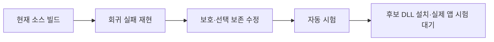

# 개발 회귀를 보강했으며 Windows 전체 동작 승인은 남아 있다

- C# 단위 단언 26,391개가 현재 기준 소스에서 통과했다.
- 트레이 통합 시험은 TSF 동시 처리 제거 후 106/106이다.
- 조회 실패·선택 보존 실패를 재현하고 독립 검토를 반영했다.
- Word 언어 속성 후보의 실제 효과와 6종 앱 승인은 미검증이다.

## 판정과 검증 경로

[계획](WINDOWS-QUALITY-PLAN.md)의 95점·필수 게이트 전부 통과를 아직 충족하지 않는다. 개발 검사 수는 품질 점수가 아니다. 현재 종합 점수는 산정 보류이며 TSF 전체 앱 승인은 **0/6**이다. 설치 API 성공을 앱 승인으로 합산하지 않는다.

## 실행된 증거

로그 정본은 무시된 `build/windows-quality/`에 보존한다. 기준 소스는 `36794fe`, 변경 소스는 `codex/windows-quality`의 해당 커밋·diff와 연결한다. 바이너리 SHA256은 `baseline.json` 및 후보 묶음 manifest에 둔다.

| 항목 | 실제 관측·명령 | 판정과 범위 |
|---|---|---|
| C# 기준 단위 | `build.ps1 -Test`, exit 0, `PASS: 26391 assertions; 0 failures` | 통과. 엔진·저장소 검증이며 실제 앱 보증 아님 |
| C# 개발 앱 | `build.ps1`, exit 0, .NET Framework 4.8용 EXE 생성 | 0.5.0 개발 빌드 |
| 기준 패키지 | `tests/ReleaseTests.ps1`, exit 0, 19 assertions | 기준 문서 구성의 패키징·해시·설치 사전 검증. 실제 설치/로그인 아님 |
| 기준 TSF | `tsf/build.ps1 -Test -X86`, exit 0, 70 tests + 양쪽 selftest | 병합된 0.5.0 기준 소스의 새 증거 |
| 보호 회귀 최초 | `cargo test --release protection_tests`, exit 101, 1 passed / 2 failed | 조회 오류 실패는 유효하다. PRIVATE도 입력 차단해야 한다던 두 번째 기대값은 독립 검토 후 교정했다 |
| 선택 결함 재현 | `cargo test --release selection_tests`, exit 101, 0 passed / 2 failed | 4,097 UTF-16 단위 선택의 앞부분만 교체, 부분 읽기·분리 surrogate 손실 |
| 후보 TSF | `tsf/build.ps1 -Test -X86`, exit 0, 52 core + 14 TSF lib + 15 shell = **81 tests** | x64/x86 release 및 양쪽 DLL selftest 통과. 미설치 후보 |
| 트레이 통합 최초 | `build.ps1 -Integration`, exit 1, 104/106 | Caps Lock 활성 확인과 영문 대문자 출력 실패 |
| 트레이 통합 수정 후 | 같은 명령, exit 0, **106/106** | 시험용 WinForms의 후크·합성 키 경로. 물리 키/다른 앱 아님 |
| 중복 시험 거부 | 실행 중인 트레이를 둔 상태의 `--integration-test`, exit 2 | 새 후크/입력 전에 중복 소유자를 거부 |
| 권한 거부 경로 | `tsf/test-machine-registration.ps1`, exit 0 | 비관리자 등록/제거 거부, 관측한 등록 경로 존재 여부·사용자 언어 목록 불변 |
| 패키징 교차 시험 | PowerShell 7 및 5.1의 `tests/ReleaseTests.ps1`, 각각 exit 0, 20 assertions | 추가 문서를 포함한 패키지. 이후 변경은 최종 묶음에서 다시 확인 |
| 입력 보존 재생 | `cargo test --release replay_loses_nothing -- --nocapture`, exit 0 | `replay: 19616 keys in 300 sentences`; 키 로직과 모의 문서 범위 |

회귀를 만들면서 발생한 Rust 컴파일 오류는 수정 후 다시 실행했다. 위 결함 재현 행은 컴파일 실패가 아닌 실제 assertion 실패 로그다. 테스트를 통과시키려고 기대 문자열·필수 기준을 낮추지 않았다.

## 변경과 원인

### 보호 필드는 오류와 정상 조회를 구분한다

이전 구현은 InputScope 조회 실패를 `false`로 바꾸고 같은 컨텍스트에서 계속 재사용했다. 최종 후보 정책은 일반·비공개·보호·조회 불명으로 구분한다. 암호/PIN/비활성 컨텍스트와 조회 불명은 키를 가로채지 않는다. 비공개 필드는 한글 조합을 유지하며 학습과 입력 상태 추적을 제한한다.

키 처리 여부를 묻는 probe에서는 조합을 끝내거나 엔진을 초기화하지 않는다. 같은 컨텍스트·키·lParam·방향의 실제 콜백이 100ms 안에 오면 그 관측을 한 번만 소비한다. 초점·컨텍스트 변경 때는 폐기한다. 조회 불명은 조합을 파괴하지 않으며, 진단을 켠 경우 내용 없이 HRESULT만 남긴다. 실제 보호/비공개 전환에서는 미확정 단어를 원래 조합 범위에 확정하고 재변환 이력을 끊는다. 늦게 온 이전 조합 종료 콜백은 새 세션에 적용하지 않는다. 실제 호스트의 편집 거부·초점 경쟁 시험은 남아 있다.

`IS_PASSWORD`는 보안 경계 자체가 아니므로 앱의 입력 서비스 비활성화도 확인한다. 공식 정의: [InputScope](https://learn.microsoft.com/en-us/windows/win32/api/inputscope/ne-inputscope-inputscope), [TSF compartments](https://learn.microsoft.com/en-us/windows/win32/tsf/predefined-compartments). 실제 앱의 조회 호환성과 지연은 설치 후 검증해야 한다.

### 선택 변환은 전체를 읽었을 때만 바꾼다

이전 구현은 최대 4,096 단위만 읽고 원래 전체 선택을 덮어썼다. 후보는 원본 선택을 유지한 채 복제 범위를 나눠 읽고 한도 초과·조회 오류·잘못된 UTF-16이면 교체하지 않는다. 인라인 개체(U+FFFC)도 일반 문자로 덮어쓰지 않는다. 한도와 정확히 같은 길이, 분리된 surrogate, 작은 청크를 각각 회귀로 검증했다.

### 통합 시험도 실제 트레이의 소유권을 따른다

최초 실패 때 설치된 TSF 로그는 시험 프로세스에서 `tray=false`였다. 시험 진입점은 실제 앱의 mutex를 건너뛰고 있어 TSF도 Caps Lock을 처리했다. 동일 사용자 mutex를 보유하도록 바꾼 후 새 시험 프로세스의 로그는 `tray=true`, 결과는 106/106이었다. Caps Lock 기대값은 그대로 유지했다. 기존 트레이는 정상 종료·복원했고 사용자 문서를 닫지 않았다.

### Word F2의 언어 속성은 아직 후보다

기존 `TF_ST_CORRECTION`만으로는 Word 한/영 자동 고침 ON 충돌을 해결하지 못했다. 후보는 확정 단어를 교체한 같은 편집 세션에서 `GUID_PROP_LANGID`를 결과에 맞춰 기록한다(ASCII 영문 0409, 한글 0412). 기존 기본 언어가 같으면 영국·호주 영어 등의 지역 설정을 보존한다. 혼합 언어·다른 문자·숫자만 있는 선택은 임의로 재분류하지 않는다. 형식 속성은 유지하고 Word 설정은 바꾸지 않는다.

이 API는 [텍스트의 언어 식별자](https://learn.microsoft.com/en-us/windows/win32/tsf/predefined-properties)를 나타낸다. Microsoft SampleIME도 [조합 언어 속성을 기록](https://github.com/microsoft/Windows-classic-samples/blob/main/Samples/IME/cpp/SampleIME/Composition.cpp)한다. **Word 자동 고침 억제를 보장하는 문서가 아니므로 실제 성공은 설치 후 화면 결과로 판정한다.**

## 남은 필수 시험

### 2026-10-14 세션 마감 체크포인트

사용자의 `[pm] done`에 따라 이번 개발·검증 기록을 마감한다. **제품 목표는 미완료이며 설치·출시는 보류한다.** 마감 턴에는 테스트나 실제 앱 시험을 다시 실행하지 않았다.

- 후속 수정 검사는 `review-fixes-build.log`에서 **86개(공통 엔진 52 + TSF lib 17 + shell 17)** 및 x64/x86 빌드·DLL selftest 통과, exit 0으로 기록됐다. 마지막 범위 수정의 `review-scope-fix-build.log`에도 검사와 양쪽 빌드·selftest 통과가 남아 있으나, 종료 코드 영수증은 대화 압축 과정에서 유실되어 별도 exit 0을 주장하지 않는다.
- 도구 없는 반대 공급자 후속 검토(`independent-review-followup.json`)는 완료됐다. 배경 문서의 컨텍스트 이벤트가 현재 조합을 끝내던 문제, 선택 읽기 오류가 키 처리 실패로 전파되던 문제는 후속 수정에 반영했다. 동일 문서 관리자 초점 알림에서도 불필요한 초기화를 줄였다.
- **미해결 검토 항목:** 조합 도중 InputScope 조회가 Unknown이면 원시 키가 살아 있는 조합 범위에 들어가 이후 덮어써지거나 순서가 바뀔 가능성, 원래 범위 확정의 비동기 순서, 편집 세션 요청 실패 처리. 실제 보호 필드로 바뀔 수 있으므로 이전 일반 필드 판정을 무조건 재사용해서 해결하지 않는다.
- 실제 초점 이동 시 F2 이력 폐기는 Word 재시험에서 검증해야 한다. 비공개 필드 안에서 학습 설정을 바꿀 때의 복원 정책은 설정 UI 구현 시 재검토한다.
- 첫 81검사 후보 묶음 `build/tsf/wq-safety-language-20261014`는 `superseded-by-review-fixes-do-not-install` 상태다. 이번 변경을 설치본으로 오인하거나 적용하지 않는다. 시스템 설치는 이번 작업으로 변경하지 않았다.
- 재개 순서: 위 입력 보존·편집 실패 경로 수정 및 회귀 → 독립 검토 → 최종 설치 묶음 재생성 → 사용자 화면의 관리자 적용 → Word F2와 6종 앱 실제 입력 검증. 현재 **0/6**, 품질 점수 산정 보류를 유지한다.

소스는 `codex/windows-quality` 개발 브랜치에 체크포인트로 보존하며, 미해결 후보를 기본 브랜치에 병합하지 않는다. 무시된 빌드 로그·설치 후보는 작업 디렉터리에 보존한다. 새 메모리 atom은 만들지 않는다. 이번 세션의 교훈과 재개 근거는 이 문서가 정본이다.

독립 검토는 도구 없는 Claude CLI 1턴으로 수행했다(`independent-review.json`, exit 0). 첫 검토에서 High 1·Medium 2·Low 2가 나와 설치 후보를 보류했다. PRIVATE의 의미를 [Chromium의 실제 구현](https://chromium.googlesource.com/chromium/src/+/main/ui/base/ime/win/tsf_input_scope.cc)과 대조하고 정책·probe 부작용·원래 범위 확정·잘못된 선택·영어 지역 설정을 수정했다. 초기 PRIVATE 회귀의 잘못된 기대값도 함께 고쳤다. 후속 회귀와 독립 재검토가 끝나기 전에는 이 후보를 설치 가능 상태로 표시하지 않는다.

| 항목 | 현재 상태 | 다음 증거 |
|---|---|---|
| Word F2 | 설치된 이전 후보 실패, 새 후보 미설치 | 새 DLL·Auto 모드·자동 고침 ON에서 실제 왕복 |
| 6종 앱 | 전체 승인 0/6 | 앱별 조합/확정/삭제/초점/재변환 및 물리 입력 |
| 자동 시작 | 이 실행 시점 HKCU Run의 Hanautomata 값 없음 | ON/OFF 옵션과 실제 로그인 시험. 현재 값을 임의 변경하지 않음 |
| 설치·복구 | 비관리자 거부와 preflight만 자동화 가능 | 관리자 갱신·제거·실패 복구 실제 실행 |
| 개인정보·입력 보존 | 초기 회귀 통과 후 독립 검토 수정 반영 중 | 실제 보호 필드, 비공개 창 입력·학습 억제, 동일 컨텍스트 이동, 편집 거부, 취소/복귀 |
| TSF 기능 완성 | 후보/설정 UI·영속 학습 없음 | 구현 및 트레이와 기능별 교차 검증 |
| 성능·지속 사용 | 엔진 재생만 있으며 UI 지연·장기 시험 없음 | 10,000키 실제 경로·p95·30분 입력 |
| 배포 | 개발 후보·미서명 | 출시 게이트 별도, 현재 공개 릴리즈 없음 |

Chrome/Edge는 허용된 Aside 실행면, 시작 검색은 도구 정책, 관리자 메모장은 사용자 화면의 관리자 권한이 필요하다. 기존 제약을 우회하지 않는다. 독립 코드 검토와 설치 후보의 최종 사전 점검은 별도 원장에 남긴다.
