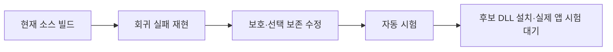
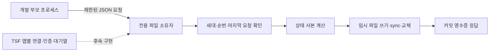

# 개발 회귀를 보강했으며 Windows 전체 동작 승인은 남아 있다

- C# 단위 단언 26,391개가 현재 기준 소스에서 통과했다.
- 트레이 통합 시험은 TSF 동시 처리 제거 후 106/106이다.
- 문서 확정→학습 큐→별도 저장 프로세스 경로를 검증했다.
- Word F2·공백 포함 Shift+F2 왕복은 자동 고침 ON에서 성공했다.

## 판정과 검증 경로

[계획](WINDOWS-QUALITY-PLAN.md)의 95점·필수 게이트 전부 통과를 아직 충족하지 않는다. 개발 검사 수는 품질 점수가 아니다. 현재 종합 점수는 산정 보류이며 TSF 전체 앱 승인은 **0/6**이다. 설치 API 성공을 앱 승인으로 합산하지 않는다.



## 실행된 증거

로그 정본은 무시된 `build/windows-quality/`에 보존한다. 기준 소스는 `36794fe`, 변경 소스는 `codex/windows-quality`의 해당 커밋·diff와 연결한다. 바이너리 SHA256은 `baseline.json` 및 후보 묶음 manifest에 둔다.

| 항목 | 실제 관측·명령 | 판정과 범위 |
|---|---|---|
| C# 기준 단위 | `build.ps1 -Test`, exit 0, `PASS: 26391 assertions; 0 failures` | 통과. 엔진·저장소 검증이며 실제 앱 보증 아님 |
| C# 개발 앱 | `build.ps1`, exit 0, .NET Framework 4.8용 EXE 생성 | 0.5.0 개발 빌드 |
| 기준 패키지 | `tests/ReleaseTests.ps1`, exit 0, 19 assertions | 기준 문서 구성의 패키징·해시·설치 사전 검증. 실제 설치/로그인 아님 |
| 기준 TSF | `tsf/build.ps1 -Test -X86`, exit 0, 70 tests + 양쪽 selftest | 병합된 0.5.0 기준 소스의 새 증거 |
| 보호 회귀 최초 | `cargo test --release protection_tests`, exit 101, 1 passed / 2 failed | 조회 오류 실패는 유효하다. PRIVATE도 입력 차단해야 한다던 두 번째 기대값은 독립 검토 후 교정했다 |
| 선택 결함 재현 | `cargo test --release selection_tests`, exit 101, 0 passed / 2 failed | 4,097 UTF-16 단위 선택의 앞부분만 교체, 부분 읽기·분리 surrogate 손실 |
| 후보 TSF | `tsf/build.ps1 -Test -X86`, exit 0, 52 core + 14 TSF lib + 15 shell = **81 tests** | x64/x86 release 및 양쪽 DLL selftest 통과. 미설치 후보 |
| 트레이 통합 최초 | `build.ps1 -Integration`, exit 1, 104/106 | Caps Lock 활성 확인과 영문 대문자 출력 실패 |
| 트레이 통합 수정 후 | 같은 명령, exit 0, **106/106** | 시험용 WinForms의 후크·합성 키 경로. 물리 키/다른 앱 아님 |
| 중복 시험 거부 | 실행 중인 트레이를 둔 상태의 `--integration-test`, exit 2 | 새 후크/입력 전에 중복 소유자를 거부 |
| 권한 거부 경로 | `tsf/test-machine-registration.ps1`, exit 0 | 비관리자 등록/제거 거부, 관측한 등록 경로 존재 여부·사용자 언어 목록 불변 |
| 패키징 교차 시험 | PowerShell 7 및 5.1의 `tests/ReleaseTests.ps1`, 각각 exit 0, 20 assertions | 추가 문서를 포함한 패키지. 이후 변경은 최종 묶음에서 다시 확인 |
| 입력 보존 재생 | `cargo test --release replay_loses_nothing -- --nocapture`, exit 0 | `replay: 19616 keys in 300 sentences`; 키 로직과 모의 문서 범위 |

회귀를 만들면서 발생한 Rust 컴파일 오류는 수정 후 다시 실행했다. 위 결함 재현 행은 컴파일 실패가 아닌 실제 assertion 실패 로그다. 테스트를 통과시키려고 기대 문자열·필수 기준을 낮추지 않았다.

## 변경과 원인

### 보호 필드는 오류와 정상 조회를 구분한다

이전 구현은 InputScope 조회 실패를 `false`로 바꾸고 같은 컨텍스트에서 계속 재사용했다. 최종 후보 정책은 일반·비공개·보호·조회 불명으로 구분한다. 암호/PIN/비활성 컨텍스트와 조회 불명은 키를 가로채지 않는다. 비공개 필드는 한글 조합을 유지하며 학습과 입력 상태 추적을 제한한다.

키 처리 여부를 묻는 probe에서는 조합을 끝내거나 엔진을 초기화하지 않는다. 같은 컨텍스트·키·lParam·방향의 실제 콜백이 100ms 안에 오면 그 관측을 한 번만 소비한다. 초점·컨텍스트 변경 때는 폐기한다. 조회 불명은 조합을 파괴하지 않으며, 진단을 켠 경우 내용 없이 HRESULT만 남긴다. 실제 보호/비공개 전환에서는 미확정 단어를 원래 조합 범위에 확정하고 재변환 이력을 끊는다. 늦게 온 이전 조합 종료 콜백은 새 세션에 적용하지 않는다. 실제 호스트의 편집 거부·초점 경쟁 시험은 남아 있다.

`IS_PASSWORD`는 보안 경계 자체가 아니므로 앱의 입력 서비스 비활성화도 확인한다. 공식 정의: [InputScope](https://learn.microsoft.com/en-us/windows/win32/api/inputscope/ne-inputscope-inputscope), [TSF compartments](https://learn.microsoft.com/en-us/windows/win32/tsf/predefined-compartments). 실제 앱의 조회 호환성과 지연은 설치 후 검증해야 한다.

### 선택 변환은 전체를 읽었을 때만 바꾼다

이전 구현은 최대 4,096 단위만 읽고 원래 전체 선택을 덮어썼다. 후보는 원본 선택을 유지한 채 복제 범위를 나눠 읽고 한도 초과·조회 오류·잘못된 UTF-16이면 교체하지 않는다. 인라인 개체(U+FFFC)도 일반 문자로 덮어쓰지 않는다. 한도와 정확히 같은 길이, 분리된 surrogate, 작은 청크를 각각 회귀로 검증했다.

### 통합 시험도 실제 트레이의 소유권을 따른다

최초 실패 때 설치된 TSF 로그는 시험 프로세스에서 `tray=false`였다. 시험 진입점은 실제 앱의 mutex를 건너뛰고 있어 TSF도 Caps Lock을 처리했다. 동일 사용자 mutex를 보유하도록 바꾼 후 새 시험 프로세스의 로그는 `tray=true`, 결과는 106/106이었다. Caps Lock 기대값은 그대로 유지했다. 기존 트레이는 정상 종료·복원했고 사용자 문서를 닫지 않았다.

### Word F2의 언어 속성은 아직 후보다

기존 `TF_ST_CORRECTION`만으로는 Word 한/영 자동 고침 ON 충돌을 해결하지 못했다. 후보는 확정 단어를 교체한 같은 편집 세션에서 `GUID_PROP_LANGID`를 결과에 맞춰 기록한다(ASCII 영문 0409, 한글 0412). 기존 기본 언어가 같으면 영국·호주 영어 등의 지역 설정을 보존한다. 혼합 언어·다른 문자·숫자만 있는 선택은 임의로 재분류하지 않는다. 형식 속성은 유지하고 Word 설정은 바꾸지 않는다.

이 API는 [텍스트의 언어 식별자](https://learn.microsoft.com/en-us/windows/win32/tsf/predefined-properties)를 나타낸다. Microsoft SampleIME도 [조합 언어 속성을 기록](https://github.com/microsoft/Windows-classic-samples/blob/main/Samples/IME/cpp/SampleIME/Composition.cpp)한다. **Word 자동 고침 억제를 보장하는 문서가 아니므로 실제 성공은 설치 후 화면 결과로 판정한다.**

## 남은 필수 시험

### 편집 실패 주입 보강 — 2026-10-14 후속 작업

실제 서비스 COM 콜백을 호출하는 격리 호스트를 `tsf/src/service_tests.rs`에 추가했다. 시스템 등록·프로필·사용자 앱·키 입력을 변경하지 않는다. 최초 3개 시험은 모두 실패했다(`edit-failures-before.log`, exit 101): 편집 권한 거절이 엔진에만 글자를 남김, 지연 확정이 호스트가 덧붙인 `x`를 삭제함, 거절된 확정의 소유권이 사라져 재시도하지 못함.

키 처리는 편집 권한을 얻은 후 시작하고, 확정 요청은 성공할 때까지 원래 조합을 보유한다. 같은 컨텍스트에서는 현재 동기 편집 세션에서 먼저 확정하며, 지연 콜백은 완료 여부와 마지막으로 쓴 원문을 검사한다. 조회 불명은 새 키를 엔진에 넣지 않고 기존 조합만 정리한다. 호스트의 중간 변경은 보존한다. 텍스트 쓰기 성공 뒤 커서 이동이 실패하면 이미 반영된 키가 다시 전달되지 않도록 처리한다.

확장 시험에서 복구 중 RefCell 재대여 panic도 발견해 수정했다(`edit-failures-expanded-before.log`, 시험 프로세스 종료 코드 0xc0000409). COM 편집 콜백 안에서 panic을 잡아 실패 HRESULT로 반환하도록 보강했다. 호스트의 조합 종료 콜백 역시 원문 확인 없이 덮어쓰던 것을 별도 실패 재현 후 수정했다(`edit-termination-before.log`, 11 통과·1 실패).

`edit-lifecycle-build.log`의 전체 검사는 **98개(공통 엔진 52 + TSF lib 29 + shell 17)**, x64/x86 빌드 및 양쪽 DLL selftest 통과, 실행 exit 0이다. 이 중 새 COM 실패 주입은 12개다. 반대 공급자의 독립 검토는 `edit-lifecycle-review.json`에 기록하며 이 시점에는 실행 중이다. 실제 앱 승인 0/6과 설치 보류는 유지한다.

추가로 기존 자동 시작 보강 `7d600a3`이 이 개발 브랜치에 포함되지 않은 것을 확인했다. 기존 회귀 스크립트를 프로세스 전용 HKCU 시험 영역에서 실행한 결과 `Windows-disabled startup is incorrectly reported as enabled`로 실패했다(`startup-missing-fix-before.log`, exit 1). 기존 보강을 통합하고 검증해야 한다. HKCU Run 값 부재만으로 자동 시작 OFF를 판정할 수 없으며, 0.4.1의 작업 스케줄러 등록까지 확인해야 한다.

### 2026-10-14 첫 세션 마감 체크포인트 — 이전 기록

사용자의 `[pm] done`에 따라 이번 개발·검증 기록을 마감한다. **제품 목표는 미완료이며 설치·출시는 보류한다.** 마감 턴에는 테스트나 실제 앱 시험을 다시 실행하지 않았다.

- 후속 수정 검사는 `review-fixes-build.log`에서 **86개(공통 엔진 52 + TSF lib 17 + shell 17)** 및 x64/x86 빌드·DLL selftest 통과, exit 0으로 기록됐다. 마지막 범위 수정의 `review-scope-fix-build.log`에도 검사와 양쪽 빌드·selftest 통과가 남아 있으나, 종료 코드 영수증은 대화 압축 과정에서 유실되어 별도 exit 0을 주장하지 않는다.
- 도구 없는 반대 공급자 후속 검토(`independent-review-followup.json`)는 완료됐다. 배경 문서의 컨텍스트 이벤트가 현재 조합을 끝내던 문제, 선택 읽기 오류가 키 처리 실패로 전파되던 문제는 후속 수정에 반영했다. 동일 문서 관리자 초점 알림에서도 불필요한 초기화를 줄였다.
- **미해결 검토 항목:** 조합 도중 InputScope 조회가 Unknown이면 원시 키가 살아 있는 조합 범위에 들어가 이후 덮어써지거나 순서가 바뀔 가능성, 원래 범위 확정의 비동기 순서, 편집 세션 요청 실패 처리. 실제 보호 필드로 바뀔 수 있으므로 이전 일반 필드 판정을 무조건 재사용해서 해결하지 않는다.
- 실제 초점 이동 시 F2 이력 폐기는 Word 재시험에서 검증해야 한다. 비공개 필드 안에서 학습 설정을 바꿀 때의 복원 정책은 설정 UI 구현 시 재검토한다.
- 첫 81검사 후보 묶음 `build/tsf/wq-safety-language-20261014`는 `superseded-by-review-fixes-do-not-install` 상태다. 이번 변경을 설치본으로 오인하거나 적용하지 않는다. 시스템 설치는 이번 작업으로 변경하지 않았다.
- 재개 순서: 위 입력 보존·편집 실패 경로 수정 및 회귀 → 독립 검토 → 최종 설치 묶음 재생성 → 사용자 화면의 관리자 적용 → Word F2와 6종 앱 실제 입력 검증. 현재 **0/6**, 품질 점수 산정 보류를 유지한다.

소스는 `codex/windows-quality` 개발 브랜치에 체크포인트로 보존하며, 미해결 후보를 기본 브랜치에 병합하지 않는다. 무시된 빌드 로그·설치 후보는 작업 디렉터리에 보존한다. 새 메모리 atom은 만들지 않는다. 이번 세션의 교훈과 재개 근거는 이 문서가 정본이다.

독립 검토는 도구 없는 Claude CLI 1턴으로 수행했다(`independent-review.json`, exit 0). 첫 검토에서 High 1·Medium 2·Low 2가 나와 설치 후보를 보류했다. PRIVATE의 의미를 [Chromium의 실제 구현](https://chromium.googlesource.com/chromium/src/+/main/ui/base/ime/win/tsf_input_scope.cc)과 대조하고 정책·probe 부작용·원래 범위 확정·잘못된 선택·영어 지역 설정을 수정했다. 초기 PRIVATE 회귀의 잘못된 기대값도 함께 고쳤다. 후속 회귀와 독립 재검토가 끝나기 전에는 이 후보를 설치 가능 상태로 표시하지 않는다.

| 항목 | 현재 상태 | 다음 증거 |
|---|---|---|
| Word F2 | 설치된 이전 후보 실패, 새 후보 미설치 | 새 DLL·Auto 모드·자동 고침 ON에서 실제 왕복 |
| 6종 앱 | 전체 승인 0/6 | 앱별 조합/확정/삭제/초점/재변환 및 물리 입력 |
| 자동 시작 | 설치된 0.4.1의 작업 스케줄러 등록은 Enabled/Registered/Healthy=true | 실제 로그인 실행은 미검증. HKCU Run 부재는 OFF 근거가 아님 |
| 설치·복구 | 비관리자 거부와 preflight만 자동화 가능 | 관리자 갱신·제거·실패 복구 실제 실행 |
| 개인정보·입력 보존 | 초기 회귀 통과 후 독립 검토 수정 반영 중 | 실제 보호 필드, 비공개 창 입력·학습 억제, 동일 컨텍스트 이동, 편집 거부, 취소/복귀 |
| TSF 기능 완성 | 후보/설정 UI·영속 학습 없음 | 구현 및 트레이와 기능별 교차 검증 |
| 성능·지속 사용 | 엔진 재생만 있으며 UI 지연·장기 시험 없음 | 10,000키 실제 경로·p95·30분 입력 |
| 배포 | 개발 후보·미서명 | 출시 게이트 별도, 현재 공개 릴리즈 없음 |

Chrome/Edge는 허용된 Aside 실행면, 시작 검색은 도구 정책, 관리자 메모장은 사용자 화면의 관리자 권한이 필요하다. 기존 제약을 우회하지 않는다. 독립 코드 검토와 설치 후보의 최종 사전 점검은 별도 원장에 남긴다.

## 최신 마감 체크포인트 — 편집 수명과 자동 시작 통합

2026-10-14 후속 작업을 사용자의 `[pm] done`으로 마감한다. 위 81·86·98개 검사와 첫 마감 절은 해당 시점의 이력이며, 최신 자동 검사 결과는 아래와 같다. **제품 인수는 미완료, 실제 앱 승인 0/6, 후보 설치·출시는 보류**다. 마감 턴에는 코드 수정·시험·독립 검토를 다시 수행하지 않았다.

| 항목 | 작업 턴에서 확보한 결과 | 증거 |
|---|---|---|
| TSF 최종 자동 검사 | 104개 = 공통 엔진 52 + TSF lib 35 + shell 17, exit 0 | `edit-review-final-build.log` |
| 양쪽 빌드 | x64/x86 release 및 DLL selftest 통과 | 같은 로그 |
| 실제 COM 콜백 회귀 | 격리 호스트 18개 포함, 사용자 앱을 승인하는 시험은 아님 | `tsf/src/service_tests.rs` |
| 자동 시작 통합 | main의 기존 보강 `7d600a3`을 개발 0.5.0에 병합, 32개 단언 + 기존 회귀 1개 통과 | `startup-merge-tests.log`, 병합 `6f40d5d` |
| 개발 패키징 | 21개 단언 통과, 버전 원천 0.5.0 일치 | `startup-merge-release.log`, 버전 검사 출력 |
| 병합 후 트레이 통합 | 106/106, exit 0, 시험용 WinForms 합성 입력 범위 | `startup-merge-integration.log`, `.json` |
| 설치본 상태 | 0.4.1 자동 시작 작업 정상 등록, 시험 후 기존 트레이 복원·ready 확인 | `installed-startup-status.json`, 작업 턴의 복원 로그 |

편집 권한을 얻기 전 엔진이 진행하지 않도록 하고, 실패한 확정은 원래 조합을 보유해 재시도한다. 외부 컨텍스트의 실패가 현재 입력을 막지 않게 분리했으며, 이미 호스트가 종료한 조합의 늦은 콜백은 무효화한다. 조합 중 커서 이동 실패는 조합을 분리하지 않는다. 보호 여부 조회가 불명인 key-up은 쓰기 세션을 요청하지 않으며, key-down은 실제 쓰기 권한 안에서 조회를 재시도한다. preserved-key의 추적 억제는 쓰기 권한 거절보다 먼저 적용한다.

독립 검토 `edit-lifecycle-review.json`은 도구 없는 반대 공급자 CLI 1턴으로 완료됐다(exit 0). 그 뒤 B1·B3·B4·B5·B6 관련 보강과 회귀를 반영했지만 **수정본의 최종 독립 승인은 아직 없다**. `edit-review-before.log`에는 12 통과·4 실패, 이후 16 통과가 남아 있다. 추가 조회 시험의 최초 실패에는 모의 호스트의 플래그 계산과 실행 중 트레이 영향이 섞였으므로, 그 실패 전체를 제품 결함 증거로 간주하지 않는다. 시험 호스트를 고치고 영향을 분리한 최종 전체 결과가 104개 통과다.

남은 검토 항목은 다음 작업의 시작점으로 보존한다.

- B2: 여러 편집 동작이 연속될 때 어느 키까지 실제 반영됐는지 판정하는 오류 경로를 검토·보강한다.
- B7: F2 원문 검증 실패 시 키 소비와 재변환 이력 유지 정책을 보강한다.
- B8: 서비스 비활성화 시 활성 조합 및 지연 콜백의 수명을 정리한다.
- 나머지 COM 진입점의 panic 경계와 오류 시 입력 모드·Caps Lock 부수 효과를 검토한다.
- 위 항목 후 독립 재검토, 새 설치 묶음·해시·복구 경로, 관리자 적용, Word F2와 6종 앱 실제 입력 순서로 진행한다.

소스는 `codex/windows-quality` 체크포인트에 보존한다. 설치된 TSF는 `d2-word-correction-20261013` 그대로이며 새 DLL은 설치하지 않았다. 첫 `wq-safety-language-20261014` 묶음은 계속 적용 금지다. 실제 로그인 시험, TSF 후보·설정 UI·영속 학습과 성능·지속 사용 게이트도 남아 있다. 무시된 로그와 후보를 보존하기 위해 작업 디렉터리를 유지한다.

disposition은 `local-reusable`이다. 메모리 신규 0건·기존 atom UPDATE 0건·인덱스 반영 0건이며, 상세 기술 기록은 이 정본에 있어 별도 atom에 중복 저장하지 않는다. Vault/ATLAS waiver: 마감은 기존 증거의 기록으로 제한하며 재검색하지 않는다.

## 목표 재개 — F2와 종료 경로 보강

마감 이후 활성 목표를 재개했다. `f2-deactivation-before.log`는 기존 18개 통과와 새 3개 실패, `key-effects-before.log`는 18개 통과와 5개 실패를 기록한다(exit 101). 시험 코드의 최초 인터페이스 선택 컴파일 오류는 고친 뒤 재현했으며, 위 로그는 실제 assertion 실패다.

- B2: 이전 단어 쓰기 성공을 현재 키의 성공으로 계산하지 않는다. 마지막 문서 동작의 실제 쓰기를 추적하며, 그 쓰기 뒤 커서/종료 처리가 실패한 경우에는 키 중복을 막는다. 현재 엔진의 보통 응답은 commit과 marked 중 하나이고, Commit+Compose 실패 시험은 향후에도 유지할 다중 동작 계약을 합성한 것이다.
- B7: F2 대상이 바뀌거나 선택이 접혀 있지 않으면 키를 처리하지 않았다고 반환하고 재변환 이력을 버린다. 단어 교체 성공 때만 재변환 학습을 갱신한다.
- B8: Deactivate에서 마지막 동기 확정을 시도하고, 성공 여부와 관계없이 이미 큐에 있는 편집을 무효화한다. 권한을 얻지 못하면 기존 화면의 문자를 보존하며 늦은 쓰기를 수행하지 않는다.
- F12 등의 제어 상태가 이미 바뀐 경우, 동반 확정 실패로 같은 명령을 호스트에 다시 전달하지 않는다. 입력 모드 표시와 Caps Lock 효과도 오류 경로에서 갱신한다.
- ThreadMgr·compartment·활성화/비활성화 콜백의 panic 경계를 보강했다. 활성화 panic은 성공으로 위장하지 않고 실패를 반환하며 부분 상태를 정리한다.

수정 후 COM 호스트 회귀는 25개다(`f2-range-after.log`, exit 0). 추가한 두 범위 시험은 실제 서비스 F2 경로에서 `prefix 안녕 `↔`prefix dkssud ` 왕복, 호스트 변경 원문 보존과 재변환 이력 해제를 확인한다. 모의 호스트는 실제 Word 자동 고침·서식·언어 속성을 구현하지 않는다.

전체 결과는 `key-lifecycle-final-build.log`: **111개(공통 엔진 52 + TSF lib 42 + shell 17)**, x64/x86 release와 양쪽 DLL selftest, exit 0이다. 첫 실행은 빌드 스크립트의 위치 변경으로 상대 로그 경로가 없어 중단됐고, 절대 로그 경로를 사용한 실행이 이 결과다. 독립 후속 검토 입력과 결과는 `key-lifecycle-review-input.txt`·`key-lifecycle-review.json`에 보존한다. 이 절 작성 시 최종 검토는 실행 중이며 설치 승인을 뜻하지 않는다.

공식 계약도 대조했다. [OnPreservedKey](https://learn.microsoft.com/en-us/windows/win32/api/msctf/nf-msctf-itfkeyeventsink-onpreservedkey)의 FALSE는 미처리 결과이며, Word가 이를 어떤 UI 동작으로 받는지는 실제 시험 대상이다. [RequestEditSession](https://learn.microsoft.com/en-us/windows/win32/api/msctf/nf-msctf-itfcontext-requesteditsession)은 동기 요청 거절 가능성과 비동기 순서를 명시한다. [Deactivate](https://learn.microsoft.com/en-us/windows/win32/api/msctf/nf-msctf-itftextinputprocessor-deactivate)는 반환 전에 thread manager 참조를 해제하도록 요구한다.

Windows Computer Use의 앱 목록과 기존 Word 시험 창 읽기는 성공했다. 프로세스 DLL 확인에서는 기존 d2-session/d2-f2/d2-f2-trace/d2-word-correction revision이 섞여 있어, 새 창만으로 새 후보 적재를 판정하지 않는다. 이 읽기 확인에서는 입력·문서·Word 옵션을 바꾸지 않았다. 실제 앱 전체 승인 **0/6**과 제품 인수 미완료를 유지한다.

### 독립 검토 후 설치 후보 판정

`key-lifecycle-review.json`은 검토 범위에서 입력 누락·중복을 일으키는 설치 차단 경로를 찾지 못했고, panic 설정 확인 후 제한된 실제 앱 시험용 설치를 허용했다. 이는 출시나 전체 기능 승인이 아니다. 지적된 Shift+F2 정책 변경은 기존의 명령 소비 정책으로 되돌렸고, 문서 쓰기 뒤 표시 갱신에서 panic이 나도 외부 키 콜백까지 전파되어 입력을 중복 전달하지 않도록 별도 경계를 두었다.

`command-review-before.log`에서 위 두 회귀가 실패했으며(25 통과·2 실패), 최종 `command-review-final-build.log`는 **113개(52+44+17)** 및 x64/x86 release·양쪽 DLL selftest 통과, exit 0이다. COM 호스트 시험은 27개다. `tsf/Cargo.toml`은 release의 `panic="unwind"`를 명시하며 같은 도구체인·프로필·대상에서 실제 컴파일러 cfg도 양쪽 모두 unwind였다(`release-panic-config.log`, `release-panic-config-x86.log`).

후속 제한 검토 `command-review.json`은 새 차단 항목이 없다고 판정했다. 검토자가 실행하지 않은 시험은 위 실행 로그로 구분한다. 입력기 비활성화에서 동기 잠금을 거절당하면 미리보기만 보존되는 한계, 드문 panic 중 이벤트 해제, 실제 앱의 COM/범위 동작과 Shift+F2 반복 입력은 여전히 실제 시험 항목이다. 마지막 단어와 같은 문구가 있는 다른 위치로 커서를 옮겼을 때의 F2 검증도 추가한다.

현재 후보는 `build/tsf/wq-reviewed-20261014`에 새로 묶어 검증·적용 영수증과 연결한다. 원격 UAC 요청이 보이지 않았던 환경이므로 관리자 적용은 사용자 화면에서 수행한다. 적용 후 새 Word 프로세스의 DLL 경로를 확인해야 하며, 기존 문서를 강제 종료하지 않는다. 이전 `wq-lifecycle-20261014-b54763a` 묶음과 첫 81검사 묶음은 대체되어 적용 대상에서 제외한다. 설치 전까지 시스템 등록은 `d2-word-correction-20261013`이다.

## 목표 재개 — TSF 설정 편집기와 활성화 적용

설정 기능의 스텁을 실제 파서·저장소·편집 화면으로 구현했다. 기존 f839115 설치 후보와 별도의 개발 변경이며 시스템에 설치하지 않았다. 시작 시 해당 후보의 설치 영수증은 여전히 없었다. 이번 작업은 WQ-07 일부 구현이며 **실제 앱 승인 0/6, 제품 인수 미완료**를 유지한다.

- `Hanautomata.ImeOptions.exe`는 설정 편집만 수행한다. `Hanautomata.exe --ime-settings`도 후크 mutex·마이그레이션·자동 시작 처리보다 앞에서 같은 편집기로 진입한다. `Program`의 선행 static 초기화는 없으며, TSF의 트레이 감지는 프로세스 이름이 아닌 트레이 전용 mutex다.
- `tsf-settings.json`은 64 KiB 이하의 PascalCase Format 1 객체다. 양쪽 파서는 잘못된 자료형·알 수 없는 필드·지원하지 않는 값·중복 필드·경로를 포함한 제외 앱 이름을 거부한다. TSF는 활성화 시만 읽고, 누락 외의 읽기 실패에서는 입력을 통과시킨다.
- 앱 제외는 일반 키·preserved F2·문맥 변경·실제 편집 전달에서 유지한다. 제외 앱에서는 필드 조회에 앞서 키를 통과시킨다. Windows 실행 파일명은 [CompareStringOrdinal](https://learn.microsoft.com/en-us/windows/win32/intl/handling-sorting-in-your-applications)의 대소문자 비교로 처리해 비영문 이름도 지원한다.
- 편집기는 저장 시 파일 해시와 프로세스 간 잠금으로 오래된 편집을 거부한다. 교체 전용 임시 파일을 쓰고 직전 파일 1개를 `.previous`에 남긴다. [ReplaceFileW의 오류 1177](https://learn.microsoft.com/en-us/windows/win32/api/winbase/nf-winbase-replacefilew)처럼 본 파일이 사라진 경우에는 임시 데이터를 지우지 않는다. `.lock` 또는 백업이 있는데 본 파일이 없으면 양쪽 모두 복구 상태로 처리하며 기본값으로 제외 앱을 다시 활성화하지 않는다. 실제 1177 발생을 유도한 시험은 아니며, 문서화된 상태를 재현한 회귀다.
- 새 학습은 입력기 재활성화나 앱 종료 시 사라질 수 있음을 UI에 적었다. 후보 UI와 다중 앱 영속 학습은 여전히 미구현이다.

### 실행 증거

모든 상대 로그 경로는 제품 작업 트리의 `build/windows-quality/` 기준이다.

| 범위 | 결과 | 로그 |
|---|---|---|
| 설정 스텁의 최초 회귀 | Rust 1 통과·2 실패, C# 1 통과·7 실패 | `settings-before.log`, `settings-csharp-before.log` |
| 제외 앱 정책 회귀 | 보강 전 실제 assertion 실패 | `settings-exclusion-before.log` |
| Unicode 앱 이름 | 보강 전 실제 assertion 실패 | `settings-unicode-before.log` |
| 검토 지적 재현 | Rust 6 통과·2 실패(배열·복구 상태), C# 10 통과·1 실패(복구 상태) | `settings-review-before.log`, `settings-recovery-before.log` |
| 수정 후 전체 Rust | **123개 = 공통 엔진 52 + TSF lib 54 + shell 17**, exit 0 | `settings-review-final-build.log` |
| 양쪽 빌드 | x64/x86 release·각 DLL selftest 통과, 등록 없음 | 같은 로그 |
| C# 설정 저장소 | **11개 통과**, exit 0; 동시 프로세스 충돌·잘못된 JSON·실패한 교체의 원본 보존 포함 | `settings-csharp-final.log` |
| 공용 설정 형식 | C#가 실제 생성한 JSON을 Rust가 읽고 모든 필드 비교 | 전체 Rust 실행에서 `HANAUTOMATA_CSHARP_SETTINGS_TEST`를 지정함 |
| 앱 빌드 | 기존 트레이 앱과 전용 설정 앱 컴파일 성공 | `settings-ui-final-build.log` |
| 사용자 상태 | 작업 전후 실제 TSF 설정 파일 없음, 기존 트레이 PID 4476 유지 | `ime-settings-ui/before.json`과 작업 턴 상태 출력 |

기본 `cargo test`는 공용 fixture만 확인하며 C# 실행 결과 비교는 환경 변수를 지정한 별도 실행 증거다. 처음 비공개 필드 복귀 시험이 빈 엔진 저장 경로로 만든 `tsf/.lock`은 시험 코드에서 임시 경로를 사용하도록 수정했다. 기존 임시 파일 삭제 명령은 자동 승인 검토에서 정책 차단되어 파일을 보존하고 커밋 대상에서 제외한다.

### 독립 검토 및 남은 게이트

도구를 비활성화한 반대 공급자 CLI 1턴 검토가 완료됐다(`settings-review.json`, exit 0, 약 265초). 이 검토자는 테스트를 실행하지 않았다. H1의 트레이 감지 우려는 실제 mutex 구현과 선행 초기화 부재로 대조했다. 배열 역직렬화·손상/누락 복구·Unicode 비교·학습 및 적용 문구·제외 앱 콜백을 보강했으며 후속 검토를 별도로 수행한다.

후속 독립 검토도 완료됐다(`settings-review-followup.json`, exit 0, 약 343초). 배열 객체 검사·교체 실패 복구 상태·제외 앱의 키 진입점 보강은 소스에서 확인했다. 추가 항목은 다음 작업으로 유지한다: NFC/NFD 실행 파일명의 사용자 기대 처리, `GetModuleFileNameW` 실패·520자 경로 잘림 시 제외 판정, `.previous`와 남은 임시 파일을 선택해 복원하는 UI. Windows는 서로 다른 정규화의 파일명을 구분하므로 NFC/NFD 확대 매칭은 제외 기능의 정책으로 명시하고 회귀를 추가해야 한다. 현재 화면은 기본값 복구만 제공하므로 원래 옵션 복원 UX는 아직 완료가 아니다.

비공개 필드 복귀 시험의 저장 경로를 임시 경로로 바꾼 뒤 해당 1개 회귀를 다시 통과했다(`settings-test-isolation.log`). `ImeSettingsTests.ps1 -BuildPreview`도 11개 검사 및 격리 화면 시험 앱 컴파일에 성공했다(`settings-csharp-preview-final.log`). 이후 제품 런타임 코드는 바꾸지 않았다.

CI Windows 작업에 설정 저장 시험·화면 시험 앱 컴파일을 추가하고, 전체 .NET Framework 4.8 컴파일 프로젝트에 주 진입점과 새 참조를 맞췄다. 로컬 `dotnet build`는 SDK가 없어 실행하지 못했다(`settings-net48-before.log`). 이후 개발 커밋 `c279cd42488d6c17558507ed8f4ff9d53f9c0e8c`의 [CI 38585646452](https://github.com/peterkimpmp/hanautomata/actions/runs/38585646452)가 성공했다. `windows-build`의 설정 시험·편집기 컴파일·기존 패키징·자동 시작 회귀와 `cross-platform-tests`의 .NET Framework 4.8 전체 컴파일·.NET 9 단위 검사가 모두 성공임을 job/step 결과로 확인했다(`settings-ci.json`). 이는 실제 사용자 앱·화면·설치 승인을 대체하지 않는다.

AppContainer와 패키지 앱에서 `%LOCALAPPDATA%`가 같은 사용자의 설정 위치를 가리키는지, 그 파일을 읽을 수 있는지는 미검증이다. 경로가 다른 경우 NotFound 기본값을 사용할 가능성도 있으므로 이 문제가 해소되기 전에는 **설정 지원 DLL을 설치 후보로 승인하지 않는다**. 시작 검색·관리자 앱을 포함한 실제 적용, ITfFnConfigure/Windows 메뉴 연결과 설정 앱 패키징도 남아 있다.

설정 화면은 Windows Computer Use로 실행을 두 번 시도했으나 `accessibility window-opened handler did not become ready` 오류가 반복돼 렌더링을 확인하지 못했다. 실제 UI 저장·재열기·DPI 100/150/200%·접근성은 통과로 처리하지 않는다. `tests/ImeSettingsTests.ps1 -BuildPreview`로 실제 사용자 설정 대신 실행 파일 옆 JSON을 사용하는 화면 시험 앱을 만들 수 있다. 이 파일은 자동 실행하지 않는다.

다음 작업은 AppContainer 설정 전달 경계와 설치·메뉴 연결, 실제 UI 시험을 해결하는 것이다. 기존 f839115 후보의 관리자 적용 회신이 오면 그 후보와 새 개발 소스를 구분하여 Word의 실제 DLL 적재부터 검증한다. 전체 점수 산정은 보류하며 기존 자동 시작 로그인·성능·30분 지속 입력 게이트도 유지한다.

## 제외 앱 이름 및 보관 설정 복원 보강 — 2026-10-15

후속 검토의 F1/F2/R1을 구현했다. 프로세스 경로는 최대 32,768 UTF-16 단위까지 버퍼를 늘려 읽고, 잘림·API 실패·잘못된 UTF-16은 알 수 없는 이름으로 처리한다. 제외 목록이 있는데 이름을 확인할 수 없으면 키를 통과시킨다. 가능한 8.3 축약 이름은 확장하며 프로세스별로 결과를 캐시한다. [GetModuleFileNameW](https://learn.microsoft.com/en-us/windows/win32/api/libloaderapi/nf-libloaderapi-getmodulefilenamew)의 잘림 반환값과 [GetLongPathNameW](https://learn.microsoft.com/en-us/windows/win32/api/fileapi/nf-fileapi-getlongpathnamew)의 버퍼 크기 계약을 따랐다.

제외 이름은 [NormalizeString](https://learn.microsoft.com/en-us/windows/win32/api/winnls/nf-winnls-normalizestring)의 NFC 변환 후 Windows ordinal 대소문자 비교를 사용한다. 정규화가 동등한 이름을 함께 제외하는 것은 제품 정책이며 파일 시스템의 이름 동일성에 대한 주장이 아니다. 악센트·전각 호환 문자 차이를 유지하는 회귀를 포함한다.

편집기에 보관 파일 선택·미리보기·명시적 저장을 추가했다. 복원은 일반 저장과 같은 충돌 검사를 적용하며, `.previous`를 선택했어도 원본을 덮어쓰지 않는다. 복원 전 본 파일은 별도의 고유 백업에 남는다. 접근할 수 없는 복구 표시 파일을 `File.Exists`의 false로 오인하지 않도록 C# 로더도 보강했다.

| 검증 | 결과 | build/windows-quality/ 로그 |
|---|---|---|
| 최초 Rust 초안 | E0599 컴파일 실패. 테스트 미실행 | identity-recovery-before.log |
| 컴파일 오류만 고친 기준 | 54 통과·4 실패: unknown/NFC-NFD/긴 경로/계속 잘린 반환값 | identity-before-compiled.log |
| 복원 스텁 기준 | 12 통과·3 실패. 예외만으로 통과한 거부 검사는 구현 증거에서 제외 | restore-before.log |
| 보강 후 전체 Rust | **129개 = core 52 + TSF lib 60 + shell 17**, exit 0 | identity-recovery-full-build.log |
| C# 설정·복원 | **16개 통과**, 기존 백업·임시 파일·복원 전 파일 보존과 동시 편집 충돌 포함 | restore-after.log |
| 공용 형식 | 실제 C# 생성 JSON을 Rust에 지정해 필드 대조 | 위 전체 Rust 실행의 HANAUTOMATA_CSHARP_SETTINGS_TEST |
| 빌드 | x64/x86 release 및 각 DLL selftest 통과; 트레이·설정 앱 컴파일 성공 | identity-recovery-full-build.log, identity-recovery-app-build.log |
| 바이너리 | DLL·setup·설정 앱 SHA256 보존 | identity-recovery-binary-hashes.json |
| 실제 설정 화면 | 새 시험 앱 실행도 accessibility window-opened handler did not become ready로 실패; 창·프로세스 생성 미확인 | 이번 작업의 Computer Use 출력 |

도구를 비활성화한 반대 공급자 독립 검토가 완료됐다(`identity-recovery-review.json`, exit 0, 1턴, 약 297초). 검토자는 소스만 읽었으며 실행·화면 검증은 하지 않았다. 높은 심각도 회귀는 보고하지 않았지만, 다른 편집기의 백업 교체 후 복원 미리보기 재시도와 상대 경로의 파일 선택 영향을 Medium으로 지적했다. 이를 다음과 같이 보강했다.

- 복원 충돌은 전용 예외로 구분한다. 미리보기를 유지하고, 사용자가 명시적으로 동의했을 때만 최신 fingerprint를 읽어 복원 저장을 다시 시도한다. 최신 파일은 고유 백업으로 남기며, 그 사이 또 변경되면 CAS가 다시 거부한다. 일반 저장에는 이런 재시도를 적용하지 않는다.
- 편집기 생성 시 대상 경로를 절대 경로로 고정하고 파일 대화상자에 RestoreDirectory를 설정했다. 잘못된 파일 선택이나 취소는 기존 초안을 버리지 않는다.
- NFC 변환 실패는 양쪽 검증 단계에서 거부한다. 오류 메시지는 너비·높이를 제한하고 전체 문구를 툴팁으로 제공한다. 복원 전 백업 경로를 반환해 사용자에게 표시한다. 이름 기반 제외의 한계는 README에 기록했다.

백업 위치·명시적 재시도 보존 검사를 추가한 첫 실행은 14 통과·2 실패였다(`restore-review-before.log`). 보강 후 C# 16개 및 시험 UI·제품 앱 컴파일을 통과했다(`restore-review-after.log`, `restore-reviewed-app-build.log`). Rust 전체 129개와 양쪽 release/selftest도 다시 통과했다(`identity-recovery-reviewed-build.log`). UI의 확인 대화상자·경로 고정·DPI는 실제 화면에서 검증한 것으로 계산하지 않는다. 후속 독립 검토는 별도로 기록한다.

현재 변경은 개발 소스이며 고정 f839115 설치 후보나 시스템 등록을 바꾸지 않았다. 실제 앱 승인 0/6, UI/DPI와 전체 인수 게이트 미완료를 유지한다.

### 보완 검토와 최종 빌드

후속 독립 검토(`identity-recovery-followup.json`, exit 0, 약 186초)에서 복원 미리보기 후 기본값 선택이 복원 모드를 유지하는 Medium 결함을 발견했다. 기본값은 복원 상태를 해제해 일반 CAS 저장으로 돌아가도록 수정했다. 두 번째 충돌에서도 미리보기를 보존한다는 안내를 사용하고, 교체 실패로 본 파일을 확인할 수 없으나 백업이 남으면 보관 경로를 표시한다. 상태 영역은 키보드로 선택·복사하고 스크롤할 수 있는 읽기 전용 텍스트 상자로 바꿨다. 잘못된 설정 경로는 UI 시작 전에 종료 코드 2를 반환한다.

부모 디렉터리의 잘못된 UTF-16 코드 단위 때문에 정상 실행 파일명까지 잃는 회귀를 추가해 먼저 실패를 확인했다(`identity-directory-before.log`). 경로를 UTF-16 상태에서 나누고 파일명만 해석하도록 수정했다. 최종 `identity-recovery-final-build.log`는 **130개(core 52 + TSF lib 61 + shell 17)**, x64/x86 release와 각 DLL selftest 통과(exit 0)다. C# 설정·복원 16개 및 트레이·설정·시험 UI 컴파일도 통과했다(`restore-final-csharp.log`, `restore-final-products.log`). 잘못된 경로의 실제 CLI 종료 코드 2는 `settings-invalid-cli.log`에 있다.

마지막 소스 검토(`identity-recovery-final-review.json`, exit 0, 약 132초)는 남은 Medium/High 및 데이터 손실·CAS 우회·잘못된 대상 쓰기 결함을 발견하지 않았다. 검토자가 제시한 Low 줄바꿈 문제는 Windows 줄바꿈으로 통일해 수정하고 C# 검사·빌드를 다시 통과했다. 일반 기본값 저장의 `.previous` 1세대 교체 정책, 복원 백업 자동 삭제 부재와 실제 UI 검증 필요성은 유지한다. 세 차례 검토 모두 다른 공급자의 도구 없는 단일 턴 소스 검토이며, 독립 런타임 검증이라고 부르지 않는다.

시험 UI에는 제품과 같은 manifest에 더해 같은 .NET Framework 4.8 runtime config를 복사하도록 빌드 스크립트를 보완했다. 재빌드와 config SHA256 일치를 확인했다(`restore-preview-parity.log` 및 실행 출력). 최종 바이너리 해시는 `identity-recovery-final-hashes.json`이다. 사용자에게 격리된 시험 화면을 직접 열어 달라고 요청했으며 실제 화면 확인은 아직 대기다.

개발 커밋 `0c0196d6fb5c1dfef09127bf85613a15756bb03a`를 `codex/windows-quality`에 푸시했다. [CI 38592303028](https://github.com/peterkimpmp/hanautomata/actions/runs/38592303028)의 `windows-build`와 `cross-platform-tests`가 모두 성공했다. 실행 결과는 `identity-recovery-ci.json`, 소스·바이너리 연결은 `identity-recovery-build-record.json`에 보존했다. CI 성공은 실제 UI·설치·6종 앱 승인을 대체하지 않는다.

## AppContainer 설정·트레이 경계의 실제 재현 — 2026-10-15

`quality-probes` 기능으로만 빌드되는 `hanautomata-config-probe`를 추가했다. 일반 사용자 프로세스가 고유한 시험 프로필·설정 파일·mutex를 만들고 제한 토큰의 자식에서 실제 제품 로더를 호출한다. 시험은 패키지 없는 AppContainer, capability 0개, LPAC 아님이다. 실제 패키지 앱·시작 검색·Word의 시험을 대체하지 않는다. 시스템 입력기 등록과 실제 설정·트레이 mutex는 변경하지 않았다.

| 관측 | 기본 권한 시험 | 임시 파일·mutex의 읽기 권한 시험 |
|---|---|---|
| 일반 프로세스 기준 | 설정 바이트·옵션 일치, mutex 감지 | 동일 |
| 자식 토큰 | AppContainer true, elevated false | 동일 |
| 기존 환경 변수 경로 | 프로필의 AC 폴더로 바뀜. 파일 없음(error 3), 로더는 기본값 반환 | 동일; 경로 수정도 필요 |
| NO_PACKAGE_REDIRECTION 경로 | 실제 사용자 경로를 얻지만 읽기 거부(error 5) | 합성 설정 바이트·옵션 일치 |
| Local 시험 mutex | OpenMutex(SYNCHRONIZE) 접근 거부(0x80070005) | 감지 성공 |
| 제한된 권한 확인 | 해당 없음 | 설정의 쓰기용 열기와 mutex MODIFY_STATE 모두 접근 거부 |
| 실제 트레이 감지(읽기만) | 일반 프로세스 true, 자식 false | 실제 트레이 권한은 바꾸지 않아 자식 false 유지 |
| 진단 종료 | exit 1, incompatible, probe_error null | exit 0, shared_read_pass; 제품 호환성 값은 null |
| 정리 | 생성한 파일·프로필 루트·레지스트리 mapping 없음 | 동일; DeleteAppContainerProfile 1회 성공 |

기본 시험은 **설정 경로·파일 읽기 권한·트레이 감지의 세 경계를 함께 고쳐야 한다는 실제 실패 증거**다. `--shared-read`는 이 실행이 create_new로 만든 파일에 FILE_GENERIC_READ, 새 mutex에 SYNCHRONIZE만 ALL APPLICATION PACKAGES(S-1-15-2-1) ACE로 추가한다. 기존 DACL은 병합하며 디렉터리·실제 사용자 파일의 ACL은 변경하지 않는다. 시험 성공은 이 제한 환경에서 보강 방향이 성립한다는 근거이며 제품 구현·설치 승인이 아니다. LPAC와 실제 패키지 호스트는 별도 미검증이다.

실행·검사 기록은 `build/windows-quality/`에 보존한다.

| 기록 | 결과 |
|---|---|
| appcontainer-probe-bounds-before.log → bounds-after.log | 무제한 읽기의 실패를 재현한 뒤 최대 크기를 제한 |
| appcontainer-verdict-before.log → appcontainer-final-tests.log | 실험 ACE를 제품 호환성으로 오인하는 판정 실패를 재현·수정. 최종 검사 4개 통과 |
| appcontainer-final-build.log | x64 진단 실행 파일 release 빌드 성공 |
| appcontainer-probe-negative.json | 일반 토큰의 worker 실행은 exit 2, 결과 파일 미생성 |
| appcontainer-baseline-20261015.json / baseline-cleanup.json | 기본 권한에서 실제 실패, 정리 후 부재 확인 |
| appcontainer-shared-read-20261015.json / shared-cleanup.json | 명시적 읽기 권한 시험 성공, 정리 및 소스·바이너리 해시 확인 |
| appcontainer-probe-review.json / review-followup.json | 반대 공급자 소스 검토의 실행 전 보완 반영 후 Medium/High 없음. 검토자는 실행하지 않음 |
| appcontainer-shared-review.json | 실험/제품 판정 혼합 Medium 1건; 이후 실패 검사와 수정 후 통과로 해소. 마지막 수정의 재리뷰를 수행했다고 주장하지 않음 |

도구는 변경 전에 pending 보고서를 동기화하며, 기준 읽기 실패를 제품 결함과 구분한다. 프로필 삭제 직전에 전체 고유 루트 범위를 다시 확인하고, 자식 종료 확인 없이 삭제하지 않는다. 생성한 빈 데이터 디렉터리만 비재귀 방식으로 정리한다. 부모 강제 종료 시 자동 정리를 보장하지 않으며 보고서의 고유 이름을 확인해 재개해야 한다. 개인 경로를 포함한 원시 보고서는 공개 문서에 복제하지 않는다.

재현 명령(일반 사용자 PowerShell, 별도 ASCII Cargo target 사용):

```powershell
cargo test --release --manifest-path tsf/Cargo.toml --features quality-probes --bin hanautomata-config-probe
cargo build --release --manifest-path tsf/Cargo.toml --features quality-probes --bin hanautomata-config-probe
# $probe는 위 빌드의 실행 파일, 결과 경로는 기존 파일이 없는 위치를 사용한다.
& $probe --output $baselineReport
& $probe --output $sharedReadReport --shared-read
```

다음 구현은 환경 변수와 분리된 TSF 설정 경로, 설정의 원자적 저장·복원 후 읽기 ACE 유지, 새 트레이 mutex의 제한된 읽기 권한이다. 특히 [ReplaceFileW](https://learn.microsoft.com/en-us/windows/win32/api/winbase/nf-winbase-replacefilew)는 교체 대상의 DACL을 보존하므로 임시 파일에만 ACE를 붙이는 것으로 기존 파일 갱신을 보장할 수 없다. [SetEntriesInAclW](https://learn.microsoft.com/en-us/windows/win32/api/aclapi/nf-aclapi-setentriesinaclw)와 [IME 요구사항](https://learn.microsoft.com/en-us/windows/apps/develop/input/input-method-editor-requirements)의 명시적 파일 접근 계약을 따르며 사용자 프로필 전체를 개방하지 않는다. 실제 앱 승인 0/6과 전체 인수 게이트 미완료를 유지한다.

진단 소스·기록 커밋은 `e53a765bb9b4a991560d5d61d66dec6a7af4024b`다. 같은 최종 바이너리의 기본 모드에서도 실패와 정리를 다시 확인했다(`appcontainer-baseline-final-20261015.json`, `appcontainer-baseline-final-check.json`). 소스·바이너리·실행 기록 연결은 `appcontainer-build-record.json`이다. 해당 커밋의 [CI 38598858626](https://github.com/peterkimpmp/hanautomata/actions/runs/38598858626)는 두 작업 모두 성공했다(`appcontainer-ci.json`). 이 CI는 기존 C# 빌드·검사 범위이며 새 Rust 진단의 4개 검사와 실제 AppContainer 실행은 위 로컬 근거다. 설치 후보와 제품 런타임은 이번 변경에 포함하지 않았다.

## 사용자 설정 공유와 트레이 공존 보강 — 2026-10-15

제품 소스에 설정 경로와 제한된 읽기 권한을 구현했다. TSF는 패키지 경로 리디렉션을 피한 사용자 LocalAppData 경로를 사용하며 환경 변수로 되돌아가지 않는다. C# 저장소는 새 임시 설정과 게시된 설정 파일에 ALL APPLICATION PACKAGES의 Read·Synchronize만 추가한다. 교체 시 이전 DACL이 유지되는 경우도 게시 후 보강한다. 새 트레이 mutex는 패키지에 Synchronize만 허용하며 소유권 변경 권한은 주지 않는다. TSF는 mutex 조회가 명확한 `FILE_NOT_FOUND`일 때만 트레이 부재로 처리한다. 권한 거부·기타 오류·사용자 SID 조회 실패에서는 키를 통과시켜 중복 입력을 피한다.

독립 소스 검토에서 발견한 세 경로는 실패 회귀 후 수정했다. 게시 후 ACL 경고로 같은 설정을 다시 저장해도 백업을 다시 돌리지 않는다. 실패한 첫 저장은 자신이 만든 잠금 표시만 정리하고 기존 복구 이력은 보존한다. 손상된 현재 파일을 고칠 때 정상 `.previous`가 이미 있으면 손상 파일은 고유 `.before-repair`로 보관한다. 임시 파일 정리 오류가 나도 새 잠금 표시의 정리 경로는 실행한다.

| 검증 | 직접 증거 (`build/windows-quality/`) | 판정 범위 |
|---|---|---|
| 설정 회귀 | `shared-access-review-regression-before.log`, `repair-history-cleanup-before.log`, `shared-access-final-settings-26.log` | 결함 재현 후 **26 통과**, 손상·동시 쓰기·복원·권한 오류 포함 |
| 트레이 오류 정책 | `tray-access-regression-before.log`, `shared-access-final-full-build.log` | 권한 거부 회귀 실패 후 **Rust 131개(52+62+17)**, x64/x86 release·DLL selftest 통과 |
| 진단 자체 검사 | `shared-access-final-probe-tests.log`, `shared-access-final-probe-build.log` | **4개 통과**, 진단 release 빌드 성공 |
| 실제 제한 토큰 | `shared-access-managed-final-20261015.json` | 생산 코드의 C# 저장·교체·복원 뒤 AppContainer 자식이 동일 SHA256·전체 옵션을 읽음. 파일 쓰기와 mutex Modify 거부 |
| 이전 private mutex | `shared-access-private-marker-20261015.json` | 권한 거부에서 TSF 차단, 없는 mutex에서 허용. 기존 진단의 전체 `incompatible`는 예상 결과이며 통과로 바꾸지 않음 |
| 시험 자원 정리 | `shared-access-final-record-20261015.json` | 세 실행의 자체 보고와 별개로 fixture·보조 파일·프로필 폴더·정확한 프로필 매핑의 부재 확인 |
| 독립 소스 검토 | `shared-access-final-review.json` | 다른 엔진의 소스 검토에서 Medium/High 잔여 없음. 검토자는 시험을 실행하지 않았으며 출시 승인 아님 |

`product_resources_pass`는 이 PC의 **비패키지·capability 없는 일반 AppContainer**와 합성 설정·시험 mutex에 한정한다. LPAC·실제 패키지 호스트·실제 트레이 인스턴스·이전 버전 설정 마이그레이션은 미검증이다. 제한 자식의 읽기는 복원까지 끝난 최종 파일에 대한 검사이며 저장 각 단계의 호스트 입력을 시험한 것이 아니다. 정상 설정에서 파생된 백업이 읽기 ACE를 유지할 수 있으므로 모든 백업이 비공개라고 주장하지 않는다. 학습 데이터 공유·과거 백업 ACL 정책은 별도로 결정·검증해야 한다.

낮은 심각도의 잔여 항목은 잠금 삭제 대기 중 일시적 저장 실패, 정리 오류의 원인 표시, 비정형 게시 후 예외, 64KiB 초과 파일의 UI 복구, ACL 경고 후 닫기 안내다. 데이터 보존을 우선하는 현재 동작과 실제 사용자 복구 편의성을 구분한다. 설정 공유 변경은 미설치 개발 소스이며 동결된 `wq-reviewed-20261014` 관리자 후보를 덮어쓰지 않았다.

## 설정 화면 직접 확인과 배율 회귀 — 2026-10-15

사용자가 연 시험 전용 미리보기에서 입력·단축키·학습/제외 앱 탭을 확인했다. 시작 모드를 한글로 변경하고 저장·다시 읽기를 실행했으며 화면과 시험 JSON에 값이 유지됐다. 실제 입력기 설정과 학습·제외 앱 값은 바꾸지 않았다. 최초 창은 지나치게 작았고, 최대화해도 두 줄 안내문이 잘렸다. 이 화면 관측은 기존 버전에 대한 실패 증거다.

창을 표시하지 않는 배치 회귀에서 현재 환경 DPI 192에서 ClientSize가 660×610에 머무르고 안내문 높이 50보다 필요한 높이가 커지는 **5개 실패**를 재현했다(`options-layout-before.log`). 전체 96-DPI 배치를 구성할 때까지 레이아웃을 보류하고 마지막에 한 번 배율을 적용하도록 수정했다. 안내문 높이는 현재 글꼴과 줄바꿈 너비로 계산한다. [WinForms 자동 배율 규칙](https://learn.microsoft.com/dotnet/desktop/winforms/forms/autoscale)의 레이아웃 재개 시점과 맞췄다.

수정 후 동일 환경에서 ClientSize 1320×1220과 두 너비의 안내문 높이 조건 **5개 통과**, 설정 저장소 **26개 통과**, 앱·옵션 EXE 재빌드를 확인했다(`options-layout-after.log`, `options-layout-products.log`). 테스트는 창을 표시하거나 사용자 설정에 쓰지 않는다. 새 미리보기는 `build/windows-quality/options-layout-fixed/Hanautomata.ImeOptions.Preview.exe`이고 이전 실행 중인 미리보기는 덮어쓰지 않았다.

같은 새 EXE의 패키징·해시·설치 사전 확인은 `ReleaseTests.ps1 -SourceDirectory build/windows-quality/options-layout-products`에서 **21개 통과**했다(`options-layout-release.log`). 실제 설치·로그인 시험으로 합산하지 않는다. 최종 UI 소스·빌드 연결은 `options-layout-build-record-20261015.json`에 별도로 보관한다.

이후 Windows 화면 도구가 `failed to activate captured window` 및 복구 시 `Could not capture the given monitor (0x80070057)`로 실패했다. 수정본의 시각 검수는 사용자에게 새 시험 창 열기를 요청한 상태다. 배치 회귀는 **실제 화면의 DPI 100/150/200% 통과 증거가 아니다**. 위 독립 소스 검토 이후의 UI 배치 변경도 검토 범위와 구별한다. 실제 앱 승인은 계속 **0/6**, WQ-07과 전체 목표는 진행 중이다.

## 설정 편집기 배포와 일반 사용자 준비 — 2026-10-15

설정 편집기를 TSF 개발 묶음의 `ui` 폴더에 포함했다. `tsf/build.ps1 -X86`은 x64/x86 setup·DLL과 편집기·`.config`의 6개 파일 및 해시 목록을 만든다. `tsf/package.ps1`은 이 파일들과 설치·갱신 스크립트, 공통 payload 검사, README를 포함해 11개 파일의 ZIP을 만든다. 고유 파일명과 검증된 임시 폴더를 사용하며 기존 설치 묶음을 덮어쓰지 않는다. 새 설치/갱신 스크립트는 6개 파일을 복사 전후 검사하고 기존 설치 폴더·revision을 거부한다. 기존 네 파일만 있는 묶음은 새 스크립트의 입력으로 인정하지 않는다.

관리자 단계에서는 편집기를 실행하거나 사용자 설정을 만들지 않는다. 새 setup의 `enable-user`가 일반 사용자 설정을 먼저 준비하고, 실패하면 언어 목록/활성화 API를 호출하기 전에 반환한다. 유효한 기존 설정은 공백·생략된 기본값·제외 앱·백업을 원문 그대로 보존하며 읽기 권한만 보강한다. 새 사용자만 기본 파일을 생성한다. 손상·용량 초과·저장 이력만 남은 상태는 자동 초기화하지 않는다. `options` 명령은 같은 revision의 편집기를 명시적으로 여는 진입점이다. TSF 입력 서비스에서 앱을 실행하지 않으며 **Windows 입력기 메뉴 연동은 아직 남아 있다**.

| 검증 | 증거 (`build/windows-quality/`) | 판정 범위 |
|---|---|---|
| 사용자 준비 회귀 | `user-prepare-before.log` → `user-prepare-after.log` | 미구현 2개 실패 후 설정 **28개 통과**, 관리자 준비 거부·배치 **6개 통과** |
| 실제 C# 준비 명령 | `payload-prepare-tests-final.log`, `payload-prepare-tests-final-ps51.log` | 실제 묶음의 편집기 실행. 일반 사용자 PowerShell 7/5.1 각각 **21개 통과**, 한글·공백 시험 경로에서 기존 바이트·백업 보존 및 패키지 읽기 전용 권한 확인 |
| 묶음 실패 검사 | 같은 두 payload 로그 | 편집기 변조·config 누락은 목적 폴더 생성 전 거부, 기존 목적지 거부, 미등록 파일 제외, ZIP 해시·임시 폴더 정리 확인. 합성 파일이며 설치 실행 아님 |
| TSF 개발 빌드 | `user-prepare-final-tsf-build.log` | **133개(52+64+17)**, x64/x86 release·DLL selftest 통과 |
| 실제 갱신 사전 확인 | `user-prepare-preflight-final.log` | `-CheckOnly` 통과, 목적 revision 부재 확인. 실제 HKLM 양쪽 경로와 롤백 도구는 `d2-word-correction-20261013`이며 변경 없음 |
| 비관리자 시스템 등록 | `user-prepare-admin-denial.log` | 등록/제거가 E_ACCESSDENIED로 거부되고 사용자 언어 목록·관측한 등록 키 존재 여부 불변 |
| 개발 ZIP | `user-prepare-package-path.txt`, `user-prepare-package-entries.json` | 실제 빌드 파일 6개와 설치 의존 파일 포함. 설치·갱신·롤백 실기 시험은 미실행 |

처음 Rust 실행은 PowerShell의 작업 폴더 변경 중 상대 로그 경로가 잘못 해석되어 BrokenPipe로 끝났다. 성공 증거에서 제외했고 절대 로그 경로로 전체 명령을 다시 실행한 위 로그만 채택했다. GitHub Windows 실행 계정이 관리자이면 payload CI는 준비 명령의 **거부 경계**를 검사하며, 일반 사용자 성공 증거는 위 로컬 실행으로 구분한다.

첫 독립 소스 검토(`user-prepare-review.json`)의 지적을 반영했다. 이전 도구로 새 revision의 설정을 준비하는 회귀를 먼저 실패로 재현했고(`user-prepare-stale-revision-before.log`), 현재 HKLM DLL과 도구의 실제 경로가 같은 revision일 때만 설정 준비·열기를 허용한다. [RegGetValueW](https://learn.microsoft.com/windows/win32/api/winreg/nf-winreg-reggetvaluew)로 해당 비트수의 REG_SZ 경로만 읽으며 조회/경로 확인 실패는 거부한다. 갱신 실패 시 이전 DLL 옆의 setup으로 복구하고, 그 도구가 없으면 사전 점검부터 거부한다. 기존 활성 사용자의 재준비도 새 receipt와 README에 명시했다.

준비 대기 시간이 지나도 파일 쓰기 중인 자식을 강제 종료하지 않고 활성화를 보류한다. [Rust Child](https://doc.rust-lang.org/std/process/struct.Child.html)의 핸들을 놓아도 자식이 종료되지 않는 동작을 사용하며 PID를 보고한다. 이후 충돌/전원 손실로 저장 이력만 남으면 자동 초기화하지 않는 기존 복구 정책을 유지한다. 실제 앱 manifest는 `asInvoker`·`uiAccess=false`이며 일반 사용자 CLI 실행도 확인했다. 등록 전 실패 receipt와 편집기 표준 입출력 상속도 보강했다. 최종 C# 앱의 기존 패키징 검사는 `user-prepare-release-tests.log`에서 **21개 통과**다.

후속 독립 소스 검토(`user-prepare-followup-review.json`)는 Medium 5개 모두 반영됐고 잔여 High/구체적 Medium이 없다고 판정했다. 실제 설치나 시험을 실행한 검토가 아니다. 남은 낮은 심각도·후속 게이트는 중단/대기 안내, 무프로필 경로 처리, 미래 설정 스키마의 다운그레이드 정책, 장시간 준비의 실제 타임아웃, 모니터 간 DPI, 설치/롤백 실기다. 시험 도구는 대상 EXE 경로를 필수로 받고, 로컬은 실제 TSF 묶음의 편집기, CI는 그 작업에서 새로 빌드한 C# 편집기를 명시한다.

이 변경으로 실제 앱·등록·Word F2 승인을 늘리지 않는다. 동결된 사용자 적용 후보도 그대로 보존한다. 일반 AppContainer 자원 검증과 실제 호스트 검증, 관리자 설치/실패 롤백, Windows 메뉴 연결, 수정본 UI·DPI 검수, 후보창·영속 학습·로그인·장기 성능은 각각 별도 게이트다.

## Text Services 속성 진입점 — 2026-10-15

사용자가 열어 둔 이전 시험본의 창과 접근성 트리를 다시 확인했다. 학습·제외 앱 탭, 저장 완료 안내와 비활성 저장 버튼은 읽혔지만 캡처는 `CreateForMonitor 0x80070057`, 수정본 실행은 `GetCursorPos 0x80070005`로 실패했다. 입력 동작 없이 중단했고 `options-ui-retry-20261015.json`에 기록했다. 수정본 화면을 봤다고 판정하거나 다른 UI 실행면으로 우회하지 않았다.

개발 DLL에 [ITfFnConfigure::Show](https://learn.microsoft.com/en-us/windows/win32/api/ctffunc/nf-ctffunc-itffnconfigure-show)를 구현했다. 표준 Text Services 속성 요청의 진입점이며 현재 Windows 11 전환 메뉴의 실제 노출을 보장하는 근거는 아니다. 입력 서비스 활성화 없이 COM으로 조회할 수 있고, 지원 언어·프로필과 일반 데스크톱 프로세스 토큰을 확인한다. 관리자·AppContainer·조회 실패를 거부하며, 현재 등록 DLL과 적재된 DLL이 같은 revision일 때만 같은 묶음의 편집기를 연다. 오래된 적재 DLL·UI 파일 누락·편집기와 config의 reparse 파일은 거부한다. 설치나 사용자 설정의 변경은 하지 않았다.

속성 콜백은 별도 최상위 편집기를 닫을 때까지 유지한다. 경로는 절대 경로·고정 파일명으로 지정하고 셸과 상속된 표준 입출력을 쓰지 않는다. 최초 구현의 COM 대기는 아래 독립 검토 후 [MsgWaitForMultipleObjectsEx](https://learn.microsoft.com/en-us/windows/win32/api/winuser/nf-winuser-msgwaitformultipleobjectsex)와 명시적 메시지 처리로 교체했다. 서비스 상태나 파일 잠금을 잡지 않고 재진입은 거부하며 입력 도착과 자식 종료를 구분한다. 같은 스레드의 활성 부모 창만 RAII로 일시 비활성화·복원한다. 이미 비활성인 창은 다시 활성화하지 않고, 다른 스레드의 창을 제어하지 않는다. 호스트 WM_QUIT은 재게시하고 호출을 중단하되 자식은 이 코드에서 종료하지 않는다.

| 검증 | 증거 (`build/windows-quality/`) | 판정 |
|---|---|---|
| 기존 COM 결함 | `configuration-before.log` | 속성 인터페이스 조회가 E_NOINTERFACE로 실패 |
| 대기 경로 결함 | `configuration-after-fixed.log`, `configuration-wait-before.log`, `configuration-wait-after.log` | 단독 메시지 플래그와 대체 API에서 CO_E_NOT_SUPPORTED. 자식 종료 전에 반환한 실패를 보존 |
| 수정된 진입점 | `configuration-focused-final.log` | 8개 통과: 비활성 상태 조회, 잘못된 인수, 토큰 정책, revision·의존 파일, 재진입·정상/오류 자식 종료 |
| 최초 Rust·양쪽 DLL | `configuration-full-build.log` | **141개(52+72+17)**, x64/x86 release·selftest 통과. 실제 DLL 클래스 팩터리에서 속성 객체와 이름 조회, Show는 호출하지 않음 |

초기 `configuration-after.log`의 컴파일 오류는 구현 과정 기록이며 통과 수에 포함하지 않는다. 자동 검사는 편집기 창을 열거나 시스템 등록·실제 설정을 수정하지 않았다. 위 대기 검사는 화면을 표시하지 않는 시험 프로세스를 사용한 것으로 실제 속성 창의 포커스·모달 동작·화면 반응 시험은 남아 있다. Windows 메뉴별 진입, 제한 호스트에서의 안내와 실제 거부, 설정 저장 후 재활성화, DPI와 전체 앱 승인 **0/6**을 유지한다.

독립 소스 검토(`configuration-review.json`)는 High 없음, Medium 3건을 지적했다. 모달 대기 중 활성 부모의 재진입, 메시지를 소비하지 않을 수 있는 대기, 정상 사용자 판정의 부족이다. 부모 창 복원과 명시적 메시지 처리로 보강했고, 토큰의 중간 무결성·제한 SID 없음·세션 0 아님·비패키지·보이는 창 스테이션·스레드 가장 없음이 모두 확인돼야 실행하도록 바꿨다. 실패 조회를 제한 없음으로 해석하지 않는다. 실제 토큰 종류별 GUI 시험은 별도 미실행이다.

`configuration-review-fixes.log`는 집중 검사 **10개 통과 + 자식 전용 fixture 1개 제외**다. fixture는 두 대기 검사에서 명시적으로 별도 프로세스로 호출하며 실행 계정 환경 변수가 우연히 존재해 전체 검사 프로세스를 종료하지 않도록 기본 실행에서 제외했다. 자신의 숨은 시험 창에서 부모의 비활성화·panic 시 복원·기존 비활성 보존·다른 스레드 거부, 합성 키/paint 메시지 전달, 호스트 종료 요청 재게시와 자식 정상 종료를 확인했다. 기존 앱의 화면이나 입력에 메시지를 보내지 않았다. 최초 대기의 추가 입력 도착 검사는 `configuration-message-wake.log`에 보존한다.

보완된 소스의 전체 검사(`configuration-reviewed-build.log`)는 **143개(52+74+17) 통과 + 자식 fixture 1개 제외**, x64/x86 release·selftest 성공이다. 등록된 DLL의 canonical 경로에서 편집기 위치를 정하고 UI 디렉터리의 reparse도 거부한다. 실제 설치 사전 확인(`configuration-preflight.log`)은 `preflight-passed`, `changes: none`이고 목적 revision 폴더 부재도 확인했다. 설치된 두 DLL과 롤백 도구는 이전 `d2-word-correction-20261013` 그대로다. 최초 141개와 이후 143개를 더해 검사 수를 부풀리지 않는다.

후속 소스 검토(`configuration-followup-review.json`)는 앞선 M1~M3 반영을 확인했다. 추가 R1은 비활성 부모에 시스템 키가 전달될 가능성이었다. 자신의 숨은 창에 보낸 Alt+F4 메시지가 실제 전달되는 실패를 `configuration-owner-key-before.log`에 남기고, 보유한 부모 트리의 키·마우스 입력만 걸러 내도록 보강했다. 이미 비활성인 부모도 필터 대상으로 유지하면서 종료 시 다시 활성화하지 않는다. 별도 창의 입력·paint·COM·타이머는 계속 처리한다. 이 마지막 필터 변경의 독립 재검토를 수행했다고 주장하지 않는다.

R2는 리뷰 입력에서 빠진 DLL 수명 코드에 대한 조건부 우려였다. 작성자가 `exports.rs::DllCanUnloadNow`의 상시 S_FALSE, `service.rs::Show`·`guarded_result`와 windows-rs 0.59의 Show shim에 반환 후 서비스 상태 접근이 없음을 직접 확인했다. 이를 미관측된 확정 High로 기록하지 않으며 실제 호스트의 강제 종료·수명 시험을 대체하지 않는다. 낮은 심각도의 잔여는 비정상 대기 후 편집기 중복 실행 가능성(CAS로 저장 충돌 거부), 상세 OS 오류 표시, 압축/reparse 변형, 정상 데스크톱 토큰별 실행 진단, foreground 복귀와 호스트 job 종료 영향이다.

최종 필터 회귀를 포함한 `configuration-owner-final-build.log`는 **144개(52+75+17) 통과 + 자식 fixture 1개 제외**, x64/x86 release·DLL selftest 성공이다. 빌드·시험은 개발 소스의 근거이며 실제 설정 창·Windows 메뉴·6종 앱·설치 승인으로 합산하지 않는다.

## TSF 후보 표시 개발 — 2026-10-15

엔진의 조합 문자열·다른 후보·근거 라벨을 shell의 결과로 전달하고, 문서 변경 성공 후에만 TSF 후보 요소를 제공한다. read-only 후보창은 키보드 포커스를 받지 않으며 기존 입력 처리를 대신하지 않는다. [UI-less 협상 계약](https://learn.microsoft.com/en-us/windows/win32/tsf/uiless-mode-overview)에 따라 Begin/Update/End를 호출하며 앱이 표시를 맡으면 자체 창을 열지 않는다. 전체 UI-less 활성화를 선언하는 범주는 아직 추가하지 않았다.

일반 입력 필드·현재 문서/컨텍스트·접힌 선택·실제 전경 창을 확인한다. [GetTextExt](https://learn.microsoft.com/en-us/windows/win32/api/msctf/nf-msctf-itfcontextview-gettextext)의 `TS_E_NOLAYOUT`과 잘림·숨김은 위치 대기로 처리한다. 후보 데이터는 보존하지만 자체 창을 추정 위치에 띄우지 않는다. 초점 상실·선택/조합 원문 변경·조합 종료·비공개/보호/조회 실패·트레이 공존·해제에서 후보를 정리한다. 정상 배치 변경이나 조합 원문을 바꾸지 않은 편집은 읽기 잠금으로 재검증한다. 보관된 COM 요소도 End 호출 전에 문자열과 문서 참조를 비워 재호출로 복원하지 못하게 한다. 관찰자 해제 도중 자기 콜백 객체를 유지하며, native 창 정리는 개별 소유 토큰으로 HWND 재사용을 구분한다.

| 검증 | 근거와 결과 | 인수 범위 |
|---|---|---|
| 후보 전달 실패 재현 | `candidate-before.log`: Outcome 후보 필드 부재로 컴파일 실패 | 구현 전 계약 부재 |
| 조합 중 F2 실패 재현 | `candidate-focused-fixed.log`: COM 9개 통과 후 shell 후보 전환 실패 | TSF가 조합 중 F2를 전달하지 않는 차이 발견 |
| 후보 집중 검사 | `candidate-guard-tests.log`: 12개 통과 | 2개 후보·페이지 경계·재진입·실패·내용 제거·배치·모드 제한 |
| native 창 검사 | 자신의 숨은 STATIC 창을 만들고 96/144/192 DPI 글꼴·비활성 스타일·해제 확인 | 실제 창 표시·입력·화면 검수 아님 |
| 재진입 보강 후 회귀·빌드 | `candidate-retirement-build.log`: **157개(52+86+19) 통과**, 자식 fixture 1개 제외, x64/x86 release·selftest 통과 | 중간 소스 검사 |
| 검토 후 보안 경계 보강 | `candidate-security-build.log`: **160개(52+89+19) 통과**, 자식 fixture 1개 제외, x64/x86 release·selftest 통과 | 중간 개발 검사·이 시점 H1 미해결 |
| H1 지연 위치 계약 추가 | `candidate-layout-before.log`: LayoutSource/Geometry 부재로 컴파일 실패 | 구현 전 비동기 계약 부재; 실기 재현은 아님 |
| 지연 위치·apartment 수정 | `candidate-layout-portable-build.log`: **169개(52+98+19) 통과**, 자식 fixture 1개 제외, x64/x86 release·selftest 통과 | NOLAYOUT 대기, 재배치, 편집 재검증, 오래된 콜백/관찰자, COM 경계 |

F2는 자동 모드 두벌식의 조합 중에도 후보를 전환하도록 보강했다. 원래 Space 확정 후 F2와 Shift+F2는 유지하며, 교정 꺼짐·고정 한글·세벌식·일시정지에서 새 조합 전환을 하지 않는 것을 검사했다. F2 꺼짐 상태에서는 후보 안내도 기능을 광고하지 않는다. 기존의 조합 중 F2 통과 기대는 새 요구에 맞춰 바꾸었고, 빈 세션 F2는 여전히 앱으로 전달함을 확인했다.

초기 155개와 중간 156·157개 통과를 합산하지 않는다. 작성자 검토에서 EndUIElement를 엔진 처리 뒤·문서 쓰기 전에 호출하면 초점 재진입에 취약함을 확인해, 후보 종료를 키 처리 시작 전으로 옮겼다. 종료 뒤 현재 컨텍스트를 다시 확인하고 오래된 편집 요청은 엔진에 전달하지 않는다. End 콜백의 재진입·단일 종료 검사를 추가했다. 이 단계는 커밋·설치·출시 승인 기록이 아니다.

미검증 항목은 실제 Word의 레이아웃 계산 시점, 문자마다 창을 재생성하는 비용·깜빡임, 스크롤 후 다음 입력에서의 재표시, 긴 후보 줄바꿈, 실제 DPI/멀티 모니터·고대비·Narrator 및 후보 AutomationId/이벤트, 제한/관리자 호스트다. [표준 STATIC](https://learn.microsoft.com/en-us/windows/win32/controls/static-control-styles)의 텍스트와 [NOACTIVATE](https://learn.microsoft.com/en-us/windows/win32/winmsg/extended-window-styles) 스타일만으로 전체 접근성·입력 무간섭을 승인하지 않는다. 설치된 DLL과 동결된 관리자 적용 묶음은 변경하지 않았으며 실제 앱 승인은 **0/6**, WQ-07은 진행 중이다.

### 독립 검토와 처리 상태

반대 공급자 Claude의 도구 없는 독립 소스 검토(`candidate-review.json`, 858,607ms)는 초기 후보 구현에 High 2건·Medium 5건을 제기했다. 실제 앱을 실행한 검토가 아니며, 다음 표는 작성자가 소스·회귀로 대조한 처리 상태다. H1 후속 검토는 `candidate-layout-review.json`으로 별도 추적한다.

| 지적 | 처리와 근거 |
|---|---|
| H1: 쓰기 중 GetTextExt 실패 또는 정상 relayout 후 후보 소실 | 소스 수정·169개 회귀/빌드 통과. `TS_E_NOLAYOUT`을 대기로 보존하고 layout 통지 뒤 읽기 세션에서 필드·초점·선택·조합 원문을 다시 확인한다. 같은 단어의 배치 갱신은 새 창 대신 위치를 이동하고, 소유 창/DPI 변경은 다시 구성한다. 실제 Word/스크롤 재시험과 독립 후속 검토는 별개다. |
| H2: 앱 전환 시 최상위 후보창 잔류 | ThreadFocusSink 인터페이스 부재를 `candidate-review-before.log`에서 실패로 확인했다. OnKillThreadFocus에서 후보를 비우고 구독 실패 시 후보 기능만 억제한다. HWND_TOPMOST를 HWND_TOP으로 바꿨다. 인터페이스/세대 무효화 회귀는 통과했으며 실제 Alt+Tab 검증은 남아 있다. |
| M1: 다른 스레드의 루트 창 소유 | 자체 창은 필드 HWND와 루트 HWND 모두 현재 스레드일 때만 허용한다. 조건 불충족 시 호스트가 그릴 후보 데이터는 유지한다. 실제 WebView/UWP 소유 관계는 미검증이다. |
| M2: 높은 권한 입력이 창 caption으로 노출 | 자체 STATIC 창은 기존의 실패 시 거부하는 일반 데스크톱 판정이 모두 참일 때만 허용한다. 관리자·AppContainer·패키지·제한/불명 환경에서는 자체 창을 만들지 않는다. 호스트 표시 경로는 별개이며 실제 권한별 시험은 남았다. |
| M3: 엔진 변경과 결과 기록 사이의 외부 teardown | 종료를 엔진 처리/쓰기 잠금 앞으로 옮긴 위 보강으로 제거했다. 외부 종료 후 입력 대상도 재확인한다. 실제 호스트 재진입 시험은 남아 있다. |
| M4: F2/후보 조건 차이 | 코어의 고정 모드·세벌식은 decision을 주지 않고, 자동 두벌식의 비어 있지 않은 Candidate는 handled를 돌려줌을 소스로 확인했다. 꺼짐·고정·세벌식·일시정지 회귀는 통과했다. 꺼짐 상태는 F2를 광고하지 않는 읽기 전용 다른 후보 표시다. 다른 전환 키는 별도 옵션이므로 대안 텍스트가 있다는 이유만으로 선택 불가능을 단정하지 않는다. |
| M5: windows-implement 0.59의 IAgileObject 기본 응답 | 설치된 매크로에서 확인했고 외부 스레드 GetCount가 성공하는 실패 회귀를 남겼다. 새 Element/Observer의 모든 COM 메서드는 상태 접근 전에 생성 스레드를 확인해 RPC_E_WRONG_THREAD를 돌려준다. 소유 Watch가 Weak를 비운 뒤 참조를 풀어 외부에 남은 sink의 마지막 해제도 비스레드안전 참조를 건드리지 않게 했다. 편집 콜백은 `IUnknown`/`ITfEditSession`만 구현하는 apartment 객체로 바꿨고 agile/marshal QI 거부·외부 직접 호출 거부·단일 실행·panic 경계를 검사했다. 기존 TextService 등 나머지 COM 표면 감사와 실제 apartment 간 marshaling 시험은 별도 잔여다. |

낮은 지적 중 OnUninit의 guard, GetDescription의 경계, Snapshot COM 해제 시 borrow 해제, 관찰자 콜백의 자기 참조 유지는 보강했다. 원래 있던 보존 F2의 Caps 상태 갱신, 소유 창이 먼저 사라질 때 property atom 처리, 실제 고대비·UIA·DPI는 잔여다. 검토자에게 제공하지 않은 `DllCanUnloadNow`는 상시 S_FALSE이며 release는 `panic=unwind`임을 재확인했다. 이 확인은 다른 COM 객체의 스레드 안전성 증명이 아니다.

### H1 지연 레이아웃 보강

원래 caret와 조합 범위를 복제해 보관하고 [읽기 편집 세션](https://learn.microsoft.com/en-us/windows/win32/api/msctf/nf-msctf-itfcontext-requesteditsession)에서 원문·선택·범위 소유·일반 필드·초점을 다시 확인한다. 위치만 조회하지 못하면 자체 창을 억제하고 호스트용 후보 데이터는 보존한다. 원문·선택·보호 상태 등의 검증 실패는 폐기한다. 통지 반복은 한 번의 읽기로 합치고 그 사이 배치가 다시 바뀌면 오래된 위치 대신 다시 읽는다. 등록 전 지나간 layout 통지도 놓치지 않도록 최초 등록 뒤 한 번 재조회한다. 정상 편집은 OnEndEdit의 읽기 쿠키로 확인하며 조합 밖의 교정·서식 변경만으로 후보를 지우지 않는다.

문서 읽기와 창 이동은 메시지 전용 창의 큐로 분리했다. 잠금 요청 호출과 실제 읽기 콜백 중에만 큐 실행을 보류하고 비동기 잠금을 기다리는 동안에는 보류하지 않는다. 폐기할 때 대기 작업을 제거한다. 메시지는 Rust 포인터 대신 nonce를 담으며 HWND는 생성부터 파괴까지 큐의 별도 소유 참조를 유지하고 콜백은 실행 동안 추가 참조를 잡는다. 창 이동·표시·해제는 각 창의 고유 토큰과 생성 스레드를 다시 확인한다. 이 검사는 소유한 숨은 시험 창만 사용했고 사용자 앱이나 설치를 자동 조작하지 않았다.

`candidate-layout-build.log`는 x64 169개 검사와 selftest 후 x86 창 포인터 타입 불일치로 실패한 중간 기록이다. 포인터 폭에 맞게 변환한 `candidate-layout-portable-build.log`가 양쪽 빌드 성공 근거다. 초기 API 부재 및 중간 실패를 통과로 계산하지 않는다. 코드 검토는 원래 스크립트가 Codex를 고정 호출하여 작성자와 같은 공급자가 되는 점을 확인하고, 도구 없는 Claude CLI로 수행했다. vault waiver: 이번 좁은 코드 검토는 소스와 기존 품질 원장을 근거로 하며 별도 지식 검색은 관련성이 낮다.

두 번째 독립 소스 검토(`candidate-layout-review.json`, 397,593ms)는 핵심 H1 수정은 확인했으나 High 1·Medium 3·Low 4를 제기했다. 다음 회귀와 소스로 대조했고 최종 설치 승인을 뜻하지 않는다.

| 지적 | 조치와 검증 범위 |
|---|---|
| 이전 비동기 읽기가 새 단어의 큐를 막음 | `candidate-layout-review-before.log`에서 새 읽기 0건(기대 1건)으로 재현. 보류 범위를 실제 호출/콜백으로 제한하고 기다리는 기간은 해제 |
| 호출 없이 폐기한 읽기의 reading 플래그 잔류 | 같은 로그에서 폐기 뒤 active 유지로 재현. 사용하지 않은 콜백을 해제하면 동일 세대의 후보도 종료. `phrSession` 실패는 기존 `hr.ok()`가 이미 오류로 처리 |
| 외부 스레드에서 마지막 서비스 참조 해제 | `candidate-owner-drop-before.log`의 소유 참조 소실 재현. 서비스의 apartment 자원은 정상 스레드에서만 파괴하고 예외적인 외부 최종 해제에는 프로세스 수명 동안 보유. HWND 자체도 큐를 소유. 이는 전체 COM agility 해결이 아니며 예외 경로 자원 보유를 잔여로 명시 |
| 위치 조회 실패로 호스트 후보도 제거 | 원문·필드 검증과 geometry 실패를 분리. view/extent 오류는 자체 창만 억제하며 호스트 문자열 유지 |
| 편집 종료의 NOLAYOUT 뒤 재조회 없음 | 같은 실패 로그에서 재조회 0건으로 재현. OnEndEdit에서 위치 대기이면 한 번 새 읽기 요청 |
| 폐기된 콜백의 본문 재조회/문자열 보유 | 먼저 세대 확인 후 Weak anchor를 올린다. 대기 콜백은 원문/범위를 소유하지 않음. 폐기 후 source 해제와 조회 횟수 불변 회귀 추가 |
| 호스트가 메시지를 버린 뒤 posted 상태 고착 | 영구 posted 표식을 제거해 후속 enqueue가 다시 게시. PostMessage의 지속 실패/메시지 할당량과 대량 입력 성능은 실제 부하 시험에 남김 |
| 소유 창 선행 파괴/외부 해제의 글꼴·property 정리 | 외부 최종 해제에서 자원을 잘못 파괴하지 않는 경계 추가. property atom 누수는 확정 근거가 없으며 실제 소유 창 선행 파괴와 자원 계측은 미검증 |

자신의 메시지 창이 콜백 도중 파괴되는 경우와 오래된 nonce 무시 검사는 `candidate-dispatch-lifetime.log`에서 통과했다. 위 지적 보강 후 TSF 라이브러리 104개 + shell 19개 통과 기록은 `candidate-layout-review-after.log`이며 기존 169개와 더하지 않는다. 후속 독립 검토는 `candidate-layout-followup-review.json`으로 별도 기록한다.

`candidate-layout-reviewed-build.log`에서 전체 **175개(52+104+19) 통과 + 자식 fixture 1개 제외**, x64/x86 release·selftest 성공을 확인했다. `candidate-layout-reviewed-x86-tests.log`는 32비트 라이브러리 **104개 통과 + 같은 fixture 1개 제외**다. 두 아키텍처에서 실행한 같은 검사를 서로 다른 104개로 합산하지 않는다. 새 설정 파일 작성·시스템 등록·실제 앱 입력·로그인·공개 릴리즈는 이 검사에 포함되지 않는다.

후속 소스 검토(`candidate-layout-followup-review.json`, 198,750ms)는 앞선 대기·취소·수명 보강에서 확인된 새 회귀가 없다고 판정했다. Low 재시도 경로와 조건부 외부 스레드 폐기·기존 agility 표면의 잔여를 구분했다. layout 통지만 이어질 때 메시지가 제거되면 읽기가 고착되는 경우와 보류 해제 시 게시 실패가 무시되는 경우를 `candidate-wake-before.log`에서 **2건 실패**로 재현했다. 이미 queued인 요청도 다시 깨우며, 보류 해제 시 게시 오류는 후보에 전달해 종료하도록 수정했다. 편집 세션의 잘못된 raw foreign Release도 미호출 closure를 다른 스레드에서 파괴하지 않고 예외적으로 보유한다.

작성자는 `State`/`PendingFinish` 필드와 서비스 자기 참조 경로에 raw self·윈도 데이터·타이머·후크 역참조가 없음을 확인했다. `this()`는 소유 COM 참조이며 `Deactivate`는 먼저 후보를 비운다. 이 소스 대조는 모든 호스트의 정상 Deactivate 호출이나 나머지 COM 인터페이스의 스레드 안전성을 증명하지 않는다. 비정상 외부 최종 해제의 자원 보유와 Deactivate 생략 경로는 전체 agility 감사·실제 수명 시험에 남긴다.

마지막 wake/게시 오류·편집 closure 폐기 보강의 전체 결과는 `candidate-final-reviewed-build.log`: **178개(52+107+19) 통과 + 자식 fixture 1개 제외**, x64/x86 release·selftest 성공이다. `candidate-final-x86-tests.log`에서도 32비트 라이브러리 **107개 통과 + 같은 fixture 1개 제외**를 확인했다. 마지막 세부 보강은 작성자 회귀로 확인했으며 그 뒤 별도 독립 재검토를 했다고 주장하지 않는다. 기존 설치와 동결 관리자 묶음은 유지하며 **실제 앱 승인 0/6**이다.

## 학습 저장 통신의 실제 AppContainer 시험

2026-10-15, 단일 저장 프로세스와 통신할 수 있는지 확인하는 개발용 파이프 시험을 추가했다. 영속 학습은 여전히 미구현이다. `quality-probes`에서만 빌드되는 실행 파일이 새 프로필·고정 메시지용 파이프 4개를 만들고, capability 없는 실제 비패키지 AppContainer 자식을 실행한다. 제품 DLL·설치 등록·실제 설정·학습 사전은 변경하지 않는다.

최초 x64/x86 시험에서는 `LOCAL` 주소의 두 AppContainer 경로가 모두 오류 2였다. 기본 ACL과 ALL APPLICATION PACKAGES 데이터 ACE를 추가한 ACL의 차이를 확인하기 전에 주소를 찾지 못한 결과다. 이를 접근 거부 통과나 모든 파이프 통신의 불가능으로 해석하지 않았다. 최초 보고서는 `pipe-transport-20261015-050654.json`, `pipe-transport-x86-20261015-051012.json`이다.

최종 비교는 허용 대상을 방금 만든 프로필 SID 하나로 좁혔다. 기본 사용자 ACE에 이 SID의 읽기·쓰기 데이터 권한 `0x0012008b`만 추가한다. 두 조건 모두 같은 낮은 무결성 라벨을 사용한다. 서버 인스턴스 생성·ACL 변경·소유권 변경 권한은 주지 않고 원격 연결을 거부한다. 모든 파이프는 고유한 이름의 최초 인스턴스로만 생성한다.

| 주소·조건 | x64 관측 | x86 관측 | 판정 범위 |
|---|---|---|---|
| `LOCAL`, 프로필 SID 허용/미허용 | 둘 다 열기 오류 2 | 둘 다 열기 오류 2 | 주소 형식 실패. ACL 경계 통과로 계산하지 않음 |
| 직접 주소, SID 미허용 | 오류 5, 서버 연결 없음 | 오류 5, 서버 연결 없음 | 이 자식의 접근 거부 확인 |
| 직접 주소, SID 허용 | 고정 메시지 왕복·양쪽 PID 일치 | 고정 메시지 왕복·양쪽 PID 일치 | 이 시험 토큰에서만 통신 성립 |
| 일반 사용자 대조 | 두 ACL 모두 왕복 성공 | 두 ACL 모두 왕복 성공 | 부모 프로세스 대조 |
| 종료·정리 | 자식 종료, 4개 주소 부재, 프로필/시험 파일 제거 | 동일 | 실행 후 조건 직접 확인 |

파이프 클라이언트가 보고한 PID만 믿지 않는다. 서버에서 `GetNamedPipeClientProcessId`를 읽어 실제 `CreateProcessW`가 반환한 자식 PID와 대조한다. 클라이언트는 서버 PID도 검사한다. 모든 서버 스레드를 합류한 뒤 `WaitNamedPipeW`로 접속 없이 각 주소가 오류 2인지 확인한다. 원시 API의 오류는 문자열 해제나 JSON 할당 전에 보존한다. 자식 종료와 프로필 전체 경로의 부재도 기존 정리 절차로 확인한다. 서버 종료 제한은 자식의 20초 제한과 선행 대조 시간을 충분히 넘기는 60초이며, 정상 취소는 5ms 폴링 단위로 정리한다. 이 폴링 코드는 시험 전용이다.

| 근거 파일 (`build/windows-quality/`) | 결과 |
|---|---|
| `pipe-probe-red.log` | 구현 전 이름·판정 회귀 2건 실패 |
| `pipe-probe-peer-red.log` | 다른 PID의 영수증을 받아들이는 회귀 1건 실패 |
| `pipe-probe-reviewed-tests.log`, `pipe-probe-reviewed-x86-tests.log` | 각 **10개 통과**(기존 probe 4 + 신규 6). 같은 검사를 20개로 합산하지 않음 |
| `probe-v2-x64-pipe-transport-20261015-051354.json`, `probe-v2-x86-pipe-transport-20261015-051438.json` | `pipe_transport_failed`, 정리 성공 |
| `probe-v2-x64-pipe-transport-direct-20261015-051355.json`, `probe-v2-x86-pipe-transport-direct-20261015-051439.json` | `pipe_transport_pass`, PID·정리 포함 |
| `probe-v2-x64-shared-read-20261015-051355.json` | 기존 설정 읽기/쓰기 거부 경계 `shared_read_pass`, 정리 성공 |
| `pipe-probe-review.json` | 반대 공급자 Claude의 도구 없는 소스 검토, 213,735ms |

독립 검토는 주소 해석 가능성(High·조건부), 서버 기한(Medium), 종료 관측과 상대 PID 보강을 지적했다. 주소 비교의 실패·성공을 모두 보존하고 나머지 세 항목을 수정했다. 후속 검토(`pipe-probe-followup-review.json`, 177,960ms)는 재현 가능한 High·Medium이나 오통과·정리 회귀를 발견하지 못했다. Low 지적인 종료 관측의 불필요한 연결은 `pipe-probe-absence-red.log`에서 재현해 비접속 조회로 교체했다. 이후의 이 수정과 원시 오류 보존은 작성자 회귀로 확인하며 별도의 독립 재검토를 주장하지 않는다.

최종 원장은 `pipe-probe-sealed-{x64,x86}-tests.log`의 각 **11개 통과**(기존 4 + 신규 7)와 같은 접두사의 빌드 로그다. `pipe-probe-sealed-{x64,x86}-{pipe-transport,pipe-transport-direct}-20261015.json`에 최종 주소 비교와 정리를 기록한다. 앞선 10개 결과와 합산하지 않는다. 기본 `pipe_transport_failed` 판정에는 오류 2를 함께 남겨 주소 조회 실패를 ACL 거부 성공으로 오인하지 않게 한다. 소스·실행 파일 해시는 `pipe-probe-checkpoint-20261015.json`에 보존한다.

이는 범용 브로커 인증 검토가 아니다. 프로세스 재시작·PID 재사용·다른 사용자/로그인 세션·실제 패키지 앱·LPAC를 이 시험으로 승인하지 않는다. 프로필 SID만 허용하는 변경은 새 파이프 시험에 한정한다. 기존 `--shared-read`는 여전히 시험 설정 파일·mutex에만 ALL APPLICATION PACKAGES 읽기/동기화 ACE를 부여한다.

[Microsoft 파이프 권한 문서](https://learn.microsoft.com/en-us/windows/win32/ipc/named-pipe-security-and-access-rights)는 일반 쓰기 권한에 서버 인스턴스 생성 권한도 포함됨을 설명한다. 따라서 개별 데이터 권한을 사용했다. [ConnectNamedPipe 문서](https://learn.microsoft.com/en-us/windows/win32/api/namedpipeapi/nf-namedpipeapi-connectnamedpipe)는 AppContainer의 `LOCAL` 형식 제약을 명시한다. 직접 주소의 이번 관측을 패키지 앱의 지원 계약으로 확대하지 않는다. 구체적 프로필 SID를 허용하는 참고 구현은 [Microsoft testfx RFC 017](https://github.com/microsoft/testfx/blob/main/docs/RFCs/017-TestHost-Launcher.md)이며 문서 상태는 논의·구현 중, 미출시다.

### 설정 화면 관측 한계

동일 진행 턴에서 Sky 목록에 사용자가 열어 둔 시험 설정 창이 확인됐으나, 모니터 캡처가 두 번 모두 `IGraphicsCaptureItemInterop.CreateForMonitor` 오류 `0x80070057`로 실패했다. 입력 동작이나 다른 UI 실행면을 사용하지 않았다. 창이 잠겨 있었다고 추정하지 않으며, 옵션 값·배치·DPI·저장 후 재열기는 미검증으로 유지한다. 메타데이터는 `settings-capture-20261015.json`에 보존했다. **전체 앱 승인 0/6과 목표 활성 상태는 유지한다.**

후속 관측에서는 같은 시험 창의 캡처가 다시 실패했지만 Sky의 접근성 텍스트 조회는 성공했다. 입력·단축키·학습/제외 앱 탭, 영속 학습 미완성 안내, 저장·다시 읽기·복원 버튼을 확인했다. 설정 값이나 배치를 승인한 결과는 아니며 입력 동작은 하지 않았다. 기록은 `settings-accessibility-learning-20261015.json`이다. 사용자가 열어 둔 파일은 `ime-settings-tests`의 이전 preview이며, 수정된 화면 빌드의 검수를 대신하지 않는다.

## 학습 저장 코어와 별도 프로세스 시험

2026-10-15, `core/src/learning.rs`와 `quality-probes` 전용 `hanautomata-learning-store`를 구현했다. 전용 파일의 단일 저장 주체가 앱별 순번을 가진 선택·삭제·초기화 요청을 처리한다. **TSF 키 처리에는 연결하지 않았다.** 설치된 DLL, 실제 설정·학습 파일, 자동 시작, 동결 관리자 묶음을 변경하지 않았다.



| 경계 | 구현과 확인 범위 |
|---|---|
| 여러 앱의 선택 | 오래된 전체 사전을 덮어쓰지 않고 각 요청을 직렬 반영. 32개 스레드의 16개 선택·중복 전달 검사이며 여러 프로세스의 동시 쓰기를 허용하는 설계가 아님 |
| 재시도 | 마지막 순번·요청 지문·최초 커밋 revision을 저장. 동일 재시도는 파일 불변, 다른 내용은 충돌, 더 오래된 순번은 `superseded` |
| 삭제·초기화 | 행동 당시 generation을 유지. 단어 삭제는 해당 단어의 이전 선택만 차단, 초기화는 모든 이전 선택 차단. 256개 fence를 넘은 오래된 요청은 보수적으로 거부 |
| 연결 기록 | 최대 256개. 명시적 `clients`·`retire_absent`로 정리하고 재등록 응답 유실은 같은 lease 복구. 재연결 인증·유예 시간 결정은 제품 브로커 과제 |
| 파일 소유 | 전용 `.owner.lock`의 OS 잠금. Windows에서는 살아 있는 잠금 파일의 삭제 공유를 거부. 추가 소유자는 `busy` |
| 파일 저장 | 원시 JSON SHA256·의미 검사·1MiB 한도. 같은 폴더에 create-new→sync→rename. Windows 읽기 열기·교체의 일시 공유 오류 5/32만 각각 10/20/40ms 간격으로 제한 재시도 |
| 중단·외부 변경 | 교체 전후 자식 프로세스 강제 종료 코드 91로 재시작 확인. 파일 변경은 보존하고 거부, 저장 실패 뒤 소유자 재개방 필요 |
| 임시 파일 | 전용 basename·store ID·revision·PID·counter의 정확한 이름만 대상으로 재개방 시 모두 제거. 4,096개 초과 디렉터리 열거는 거부, 다른 패턴 파일은 보존 |
| 개발 프로세스 | 부모 소유 stdio, 4,096바이트 프레임, 고정 오류 응답. 한글·공백의 새 임시 경로와 합성 단어만 사용. 인증된 제품 IPC나 자동 실행 도구가 아님 |

### 실패를 재현한 보강

첫 9개 검사는 구현 전 실패(`learning-authority-red.log`) 후 통과했다. 프로세스 중단·손상·용량·동시 전달 검사를 추가한 단계는 17개 통과였다. serde의 빈 unit variant가 추가 필드를 무시하는 문제를 저장 요청·개발 명령 양쪽에서 재현하고 빈 struct variant로 수정했다(`learning-schema-red.log`, `learning-driver-tests.log` → 각각 green 기록).

첫 독립 소스 검토는 Claude의 도구 없는 CLI로 수행했다(`learning-authority-review.json`, 221,075ms). 등록 응답 유실, 고아 연결 기록, 다른 단어까지 막는 삭제, 임시 파일 누적, Windows 잠금 파일 삭제, 일시 파일 공유 오류를 `learning-review-red.log`의 **6건 실패**로 재현했다. 수정 후 **25개 통과 + 자식 fixture 1개 제외**이며 제외된 fixture는 부모 검사가 별도 프로세스로 실행한다. 혼합 학습 가중치 20,000회 직렬화 검사에서는 실제 1 ULP 차이가 발생해 `serde_json`의 `float_roundtrip`을 활성화했다. 기존 Format 1/2는 별도 `Entry` 변환을 계속 사용한다.

삭제 이력 경계·전체 초기화, 오래된 lease로 연결 정리, 지난 순번과 누락 순번 구분을 추가한 중간 단계는 x64/x86 각 **28개 통과 + 자식 fixture 1개 제외**, 개발 명령 각 **3개 통과**다. 같은 검사를 아키텍처별로 합산하지 않는다.

| 근거 (`build/windows-quality/`) | 결과 |
|---|---|
| `learning-fences-final.log`, `learning-authority-x86-tests.log` | 저장 코어 각 28개 통과 + 자식 fixture 1개 제외 |
| `learning-driver-final-tests.log`, `learning-driver-x86-tests.log` | 개발 명령 각 3개 통과 |
| `learning-driver-{x64,x86}-20261015.json` | 각 8개 별도 프로세스 시나리오 통과, 종료·임시 파일 정리 직접 확인 |
| `learning-weight-roundtrip-before.log` | 수치 파싱 오차 1건 실패 근거. 수정 후 위 28개에 포함 |
| `learning-full-build.log` | 전체 **206개 통과(80 core + 107 TSF lib + 19 shell)**, 자식 fixture 2개 제외, x64/x86 release 및 DLL selftest 통과 |

별도 프로세스 시험은 두 클라이언트의 가중치, 파일 불변 재시도, 두 번째 프로세스의 소유 거부, 재시작 후 초기화·중복 응답, 단어별 삭제, 명시적 연결 정리, 초과 프레임 종료, 손상 파일 보존을 확인한다. 실제 AppContainer나 TSF를 거친 시험은 아니다.

전체 206개에는 신규 저장 코어 28개가 포함된다. 개발 명령 3개·별도 프로세스 8개는 별도 기록이며 기존 단계의 검사 수와 다시 더하지 않는다. 제외 표시된 두 자식 fixture는 각각의 부모 검사가 명시적으로 실행한다. x86 전체 TSF 라이브러리 107개는 앞선 후보 단계의 근거이고, 이번에는 새 저장 코어 28개·개발 명령 3개·프로세스 8개와 양쪽 DLL 빌드/selftest를 확인했다.

후속 독립 검토(`learning-authority-followup-review.json`, 405,961ms)는 명시한 개발 도구 범위에서 차단 결함 없이 `PASS_WITH_LIMITATIONS`로 판정했다. 제품 연결 전 개선할 Medium 4개와 Low·시험 개선점을 함께 제시했다. 아래의 최종 보강은 작성자가 회귀로 확인한 것이며 이 보강 뒤 별도 독립 재검토를 했다고 주장하지 않는다.

| 후속 지적 | 조치·잔여 |
|---|---|
| 삭제 뒤 pending 사본 잔류 | `learning-followup-red.log`에서 4개 잔류를 실패로 재현. 재개방 시 생성 규칙에 맞는 미확정 파일을 모두 제거하도록 변경. 손상 정본은 먼저 거부하므로 임의 복구·삭제하지 않음 |
| 삭제 관련 해시의 사전 대입 | 같은 로그에서 Reset 뒤 fence 해시 잔류 재현 후 제거. 정확한 중복 판단에 쓰는 마지막 요청 지문은 유지하며 익명화·안전한 소거로 주장하지 않음. Windows 보호 키/암호화 정책은 후속 제품 통합 과제 |
| 다른 삭제 뒤 대기 중인 삭제가 거부됨 | 자동 재전송으로 성공 처리하지 않는다. 현재 snapshot을 보여 주고 새 삭제 확인을 받아 새 generation·미사용 sequence로 요청하는 계약을 명시. 거부 시 순번·파일 불변 회귀 추가 |
| Python 최적화에서 assert 생략 | 수정 전 실제 `-O` 실행은 학습 동작까지 생략돼 `IndexError`로 실패했다(`learning-optimized-before.log`). 오통과는 관측하지 않았다. 수정 후 프로그램 시작에서 거부하고 보고서·자식을 만들지 않음을 확인(`learning-optimized-rejected.log`) |
| 공유 오류·Debug·시험 신뢰성 | 읽기 열기에도 제한 재시도. Debug의 단어·경로 노출을 실패로 재현한 뒤 숨김. 재시도 관측 후에만 파일을 풀어 시간 경과만으로 통과하지 않게 함. 고유 fixture counter·중단 후 Busy 유예·독립 자식 실행 보호·모든 자식 정리와 원래 오류 보존을 보강 |

위 중간 3건 실패와 추가 검사 후 x64 저장 코어 **32개 통과 + 자식 fixture 1개 제외** 근거는 `learning-followup-green.log`다. 첫 두 소스 검토의 결과와 작성자 회귀를 구분하며, 사용자의 실제 데이터는 이 시험에 포함하지 않는다.

최종 소스의 `learning-sealed-full-build.log`는 **210개 통과(84 core + 107 TSF lib + 19 shell)**, 부모가 따로 실행하는 자식 fixture 2개 제외, x64/x86 release·DLL selftest 성공이다. `learning-sealed-x86-core.log`는 저장 코어 **32개 통과 + 같은 fixture 1개 제외**다. `learning-sealed-{x64,x86}-driver-tests.log`의 명령 검사 각 **3개**와 `learning-sealed-{x64,x86}-process.json`의 별도 프로세스 시나리오 각 **8개**도 통과했다. 최종 바이너리와 원장은 `learning-store-checkpoint-20261015.json`에 연결한다. 앞선 206개 결과와 합산하지 않으며 이 개발 도구는 설치 payload에 넣지 않는다.

### 아직 승인하지 않은 범위

파일 교체 시험은 프로세스 중단 복구다. 디스크·전원 장애 전체 내구성이나 악의적인 디렉터리 교체 방어를 증명하지 않는다. 전용 비공유 디렉터리·플랫폼이 고른 고정 파일명이 전제이며 ID는 인증 수단이 아니다. 경로의 8.3 별칭·하드 링크, 비 Windows 잠금 파일 삭제를 방어했다고 주장하지 않는다. 오래된 정상 백업을 같은 store ID로 되돌리는 경우는 감지하지 못하므로 복구 시 새 incarnation 정책이 필요하다. 논리적인 단어 삭제·초기화는 디스크의 안전한 소거가 아니며 마지막 요청의 재시도 지문을 통해 사전 대입이 가능하다. 오류 후에는 pending 사본이 재개방 전까지 남을 수 있고 정본 손상 시 자동 제거하지 않는다.

인증된 동일 사용자·세션 브로커, TSF의 비동기 연결·대기열, 제한 앱·LPAC, 학습 일시 정지·민감 필드·교정 취소, 기존 학습 가져오기, 설치·수명·실제 앱 재시작을 후속 작업으로 남긴다. 개발용 관리 명령을 제품 클라이언트에 그대로 공개하지 않는다. **WQ-07과 전체 목표는 미완료, 실제 앱 승인 0/6**이다.

## 설정 탭의 잘림 보강과 사용자 확인

2026-10-15 사용자가 “탭 안의 옵션·설명”이 잘린다고 알렸다. 당시 프로세스 경로는 `ime-settings-tests`의 이전 시험 파일로 확인됐다. 같은 실행 파일 이름으로 혼동할 수 있어 새 미리보기 제목에 `화면 검수본`을 붙였다. 요청했던 `options-layout-fixed`를 직접 열어 화면을 대조한 뒤, 현재 소스에서도 고정 행 높이 때문에 마지막 옵션이 기본 창의 스크롤 아래로 밀리는 것을 확인했다.

회귀에서 **9건 실패**를 재현했다(`options-content-red.log`): 기본 입력/단축키 탭의 옵션 숨김 2건, 폭 220px의 체크박스 글자 높이 부족 4건, 목록 라벨이 행 밖으로 나오는 경우 3건이다. 처음에는 native tab이 생성되기 전의 임시 viewport를 측정했으므로 그 결과(`options-content-before.log`)를 정본 실패 근거로 쓰지 않는다. hidden form에 native control handle을 생성해 실제 탭 치수로 측정하되 사용자 창은 표시하지 않는다.

체크박스의 글꼴·글자 폭·체크 표시를 기준으로 높이를 계산하고 목록 행은 라벨·입력 상자 중 필요한 높이를 택한다. 글꼴·너비 변경 때 다시 계산하며 고정 여백을 줄였다. 초기 자식 추가 때도 탭 너비를 적용한다. [Microsoft의 AutoSize/PreferredSize 설명](https://learn.microsoft.com/en-us/dotnet/desktop/winforms/controls/layout)과 [FlowLayoutPanel의 세로 흐름 규칙](https://learn.microsoft.com/en-us/dotnet/desktop/winforms/controls/how-to-anchor-and-dock-child-controls-in-a-flowlayoutpanel-control)을 참고했다. 모델 원칙 설명을 근거로 실제 렌더를 생략하지 않았다.

| 최종 근거 (`build/windows-quality/`) | 관측 |
|---|---|
| `options-content-final.log` | 설정 저장 **28개**, 배치 **40개 통과**. 현재 DPI 192, 초기 client 1320×1220 |
| 같은 배치 검사 | 입력 content 528px·단축키 464px, viewport 589px. 기본 창에서 두 탭의 모든 옵션 표시. 폭 220/500px 글자 높이도 검사 |
| `options-content-products.log`, `options-content-release.log` | 앱·옵션 EXE 재빌드, 패키지 검사 **21개 통과** |
| `options-content-visual-20261015.json`, `options-content-input-20261015.jpg` | Sky로 새 창을 활성화해 세 탭 관측. 입력 8개·단축키 6개와 안내문 표시, 제외 앱 칸 아래까지 스크롤 확인 |
| 사용자 재확인 | 제목 `한오토마타 입력기 설정 · 화면 검수본`을 명시한 질문에 **“모두 정상으로 보임”** |

새 실행 파일은 `build/windows-quality/options-content-fit-20261015/Hanautomata.ImeOptions.Preview.exe`다. 실제 설정을 변경하거나 기존 DLL을 설치하지 않았다. 다른 창이 덮은 최초 캡처를 UI 증거로 사용하지 않고, 대상 창을 앞으로 가져온 뒤 확인했다. 이전 캡처 오류의 원인을 단정하지 않는다. 창 크기 변경 시도는 크기가 바뀐 것을 관측하지 못했으므로 통과로 계산하지 않는다.

이로써 **현재 배율의 탭 표시 확인은 통과**다. 실제 UI 저장·재열기, 100/150%·다중 모니터, 설치 메뉴 연결, Word F2와 6개 앱 승인은 별도로 남는다. 전체 목표나 WQ-07 전체 통과로 올리지 않는다. 재사용 범위는 `local-reusable`이며 vault·atlas는 UI 소스·회귀·사용자 확인을 직접 근거로 하는 좁은 결함 수정이므로 추가 검색을 생략한다.

후속 [첫 CI 실행](https://github.com/peterkimpmp/hanautomata/actions/runs/38640195849)은 Windows 96 DPI에서 안내문 높이 검사 2건이 실패했다. 같은 소스를 DPI 비인식 hidden 시험 프로세스로 실행해 재현했다(`options-content-dpi96-before.log`). 시험이 자식 폭을 220px로 줄이면 부모의 스크롤바 배치가 모든 자식 폭을 562px로 되돌렸다. 실제 높이 30px를 요청 폭 220px의 기대 높이 60px와 비교한 **시험 조건 오류**이며, 이 결과만으로 제품 안내문 잘림을 주장하지 않는다.

전체 탭 배치 검사 뒤, 개별 글자 높이 시험 동안만 부모 배치를 보류하고 실제 자식 폭이 요청 폭과 같은지도 함께 확인하도록 고쳤다. 제품 코드는 추가 변경하지 않았다. 시험 스크립트는 기존 DPI 인식 실행과 96 DPI 비인식 실행을 모두 수행한다. `options-content-ci-green.log`에서 설정 저장 28개, **192·96 DPI의 배치 각 40개 통과**를 확인했다. 같은 40개를 서로 다른 배율에서 반복한 결과이므로 80개의 고유 검사로 합산하지 않는다. 96 DPI 시험 프로세스의 수치 검사는 100% 화면 육안 검수나 모니터 간 이동 승인을 대신하지 않는다.

## 최신 후보의 시스템 적용과 일반 사용자 준비 — 2026-10-15

> 아래는 적용 직후의 기록이다. 설정 생성과 물리 키 응답 대기에 관한 판단은 후속 「에이전트 직접 시험과 파일 경로 증거 정정」으로 정정한다. 설치 해시·프로세스 DLL 증거는 유지한다.

`5971010`의 최종 [CI 두 작업](https://github.com/peterkimpmp/hanautomata/actions/runs/38640629068)이 통과했다. 개발 ZIP을 `build/tsf/wq-5971010-20261015`에 동결했다. ZIP SHA256은 `F198A4D06223860E22841328EF2BB69074659CF1EA14A7B0071D7FBC8D2ECA1C`이며 여섯 payload를 개별 검증했다. 적용 래퍼는 updater·payload 도우미·바이너리 해시 목록을 고정 해시로 확인한다. PowerShell 7/5.1의 읽기 전용 사전 점검과, 도우미 없음·updater 변경·payload 도우미 변경·manifest 변경의 거부 검사 4개가 통과했다. 이 검사는 실제 등록 실패·롤백 성공을 대신하지 않는다.

사용자가 화면의 관리자 PowerShell에서 동결 묶음을 적용했다. 설치 영수증의 판정은 `updated-user-preparation-required`이며 설치된 DLL·setup·설정 편집기·실행 설정 여섯 파일은 동결 해시와 일치한다. 이전 `d2-word-correction-20261013`의 경로와 복구 도구는 영수증에 보존됐다. 자동 앱 종료·재부팅·기본 입력기 변경은 수행하지 않았다.

원래 사용자의 비관리자 세션임을 확인하고 새 revision의 `enable-user`를 실행했다. 실행 전 `tsf-settings.json`은 없었고 준비 후 기본 설정 파일이 생성됐다. 기존 파일 보존을 별도로 시험한 저장소 회귀와, 이번 PC의 새 파일 생성 결과를 구분한다. 사용자 프로필 활성화·언어 목록 포함, x64/x86의 `selftest-registered`가 성공했다. 등록 API 성공을 실제 앱 조합·확정·재변환 승인으로 계산하지 않는다.

| 근거 (`build/windows-quality/`) | 확인 범위 |
|---|---|
| `wq-5971010-preflight-ps7.json`, `wq-5971010-preflight-ps51.json` | 적용 전 새 경로·이전 DLL·복구 도구·해시 검사 |
| `wq-5971010-wrapper-guards.json` | 변형된 별도 시험 복사본 4개 거부. 시스템 적용 요청 없음 |
| `wq-5971010-installed-before-user.json` | 사용자 적용 영수증, 설치 파일 6개, 일반 사용자·설정 생성 전 상태 |
| `wq-5971010-enable-user.log`, `wq-5971010-user-prepared.json` | 실제 사용자 준비·활성화, 생성된 설정 해시 |
| `wq-5971010-selftest-registered.log`, `wq-5971010-x86-selftest-registered.log`, `wq-5971010-status.log` | 두 비트수 COM 생성과 사용자 등록 상태 |
| `wq-5971010-word-before-restart.json` | 기존 Word 5개가 모두 이전 revision DLL을 적재한 상태 |
| `wq-5971010-word-after-restart.json` | 새 Word PID 28784에 최신 DLL 적재, 트레이 프로세스 없음. 이전 숨은 PID 9732는 남아 있음 |
| `wq-5971010-word-window.json`, `wq-5971010-word-before-physical.jpg` | 시험 창·PID 대응과 빈 문서·커서 화면. 물리 키 입력 전 상태이며 결과 화면이 아님 |
| `wq-5971010-live-checkpoint.json` | 설치·일반 사용자 준비·시험 창의 증거 파일과 SHA256 연결. 물리 키 결과는 응답 대기 |

사용자는 문서 저장 후 Word 종료·재실행, 트레이 종료, 한오토마타 선택을 완료했다고 응답했다. 새 `문서1 - Word` 창의 핸들 1838498을 PID 28784와 대조했고 최신 DLL 적재를 확인했다. 이전 PID 9732는 창 핸들 0이며 시험 대상에 포함하지 않는다. 새 Word 창을 앞으로 가져온 뒤 빈 문서와 입력 커서를 관측했다. 물리 키 `dkssud`→Space→F2 결과를 사용자에게 요청했고 응답을 기다린다. 자동 고침 ON은 사용자 준비 응답의 범위이며 옵션 대화상자를 직접 검수한 근거는 아직 없다. **앱 승인 0/6**을 유지한다.

같은 턴의 설정 저장·재열기 시험은 Sky의 `accessibility window-opened handler did not become ready` 오류로 새 검수 창을 열지 못했다. 재조회에서도 이전 시험 창만 확인돼 다른 실행면으로 열거나 이전 파일을 최신 검증에 사용하지 않았다. 앞선 정상 표시 승인은 유지하며 저장·재열기는 별도 미검증이다. 재사용 범위는 `local-reusable`다.

## 에이전트 직접 시험과 파일 경로 증거 정정 — 2026-10-15

사용자가 모든 시험을 직접 수행하고 질문 없이 진행하라고 지시했다. 물리 키 응답 대기를 종료하고 Sky의 개별 키 주입으로 실제 앱을 시험했다. **Word와 메모장 모두 실패 관측, 전체 앱 승인 0/6**이다. Chrome·Edge·시작 검색·관리자 메모장은 이 단계에서 새 승인 근거가 없다.

| 직접 관측 | 결과와 한계 |
|---|---|
| Word PID 28784, 새 `문서2` | 설치된 `wq-5971010-20261015` DLL을 확인. `dkssud`→Space는 `안녕`, F2 뒤에도 그대로. Undo는 `자동 고침 취소`. 이전 사용자 `문서1`은 보존 |
| Word 실제 로그 | `mode=Auto`, `tray=false`, 입력 필드 조회 `E_FAIL`, `preserved F2 handled=false`. 한글 표시는 Word 자동 고침으로 설명될 가능성이 있으며 TSF 성공으로 인정하지 않음 |
| 메모장 PID 7924, 새 탭 | 편집 영역 포커스 후 같은 설치 DLL 적재. 개별 `d k s s u d`→Space→F2 뒤 `dkssud ` 유지. 이 앱의 실제 모드·실패 단계는 별도 추적하지 못했으므로 Word와 같은 원인으로 단정하지 않음 |
| 설정 검수본 | `options-content-fit-20261015`에서 자동 판별→한글 변경·저장 메시지·시험 JSON을 확인. 창 종료 후 다시 실행했을 때 한글 유지, 저장 버튼 비활성 확인. 실제 사용자 설정·입력기 메뉴 연결을 승인한 시험은 아님 |

### LocalAppData 파일 관측의 정정

에이전트가 `LocalAppData/Hanautomata`라는 문자열로 연 로그·설정 파일은 `GetFinalPathNameByHandleW`로 확인하면 **Codex 패키지의 LocalCache**에 있었다. 반면 네이티브 메모장이 연 같은 논리 경로의 실제 로그에는 새 Word PID 28784의 기록이 있었다. 메모장 「다른 이름으로 저장」으로 작업 폴더에 내보낸 로그를 읽어 대조했다. 사용자·세션이 같고 프로세스에 패키지 ID가 없다는 확인만으로 파일 접근의 리디렉션 부재를 증명할 수 없다.

따라서 앞선 `enable-user`의 설정 생성·해시는 **에이전트가 본 파일의 생성** 근거다. 실제 Word가 읽는 사용자 설정의 존재·내용·권한은 아직 검증되지 않았다. Program Files 설치 해시와 Word의 적재 DLL 경로는 별도 증거로 유지한다. 이 정정은 실제 앱의 실패를 파일 리디렉션 하나로 단정하는 것이 아니다.

### 옵션 속성 ABI 수정과 실패 단계 진단

[Microsoft GetAppProperty 계약](https://learn.microsoft.com/en-us/windows/win32/api/msctf/nf-msctf-itfcontext-getappproperty)의 `S_FALSE`는 호스트가 그 속성을 제공하지 않는 경우다. 입력 범위 조회는 [ITfInputScope 문서](https://learn.microsoft.com/en-us/windows/win32/api/inputscope/nn-inputscope-itfinputscope)의 `GetAppProperty` 경로를 유지했다. Context7 CLI는 미설치로 실패하여 공식 문서와 로컬 `windows 0.59.0` 바인딩 소스로 대체했다.

실제 COM ABI의 `S_FALSE`·null 출력으로 회귀를 만들자 기존 바인딩은 `Unknown(HRESULT(0))`으로 판정해 일반 입력을 막았다. 수정은 원래 HRESULT를 보존하여 **정확한 `S_FALSE`·null 조합만 선택적 속성 없음으로 처리**한다. `S_OK`·null, 알 수 없는 성공 코드, `E_FAIL`·`E_NOTIMPL`·연결 끊김 등은 여전히 차단한다. 읽기 전용·disabled/empty context 확인은 이 처리보다 앞선다. 기존 비밀번호/PIN/비공개 범위 정책도 유지한다.

이 회귀의 오류 코드는 실제 Word의 `E_FAIL`과 다르므로 **Word 원인을 해결했다고 주장하지 않는다**. 다음 설치에서 실패 위치를 구분하도록 편집 세션·상태·compartment·선택·속성·값·내용 해석의 고정 단계 이름과 HRESULT만 진단한다. 입력 내용이나 키는 추가로 기록하지 않는다. 같은 실패를 억제하되 정상 조회로 회복하면 억제 상태를 해제한다.

| 근거 (`build/windows-quality/`) | 판정 |
|---|---|
| `word-host-log-20261015-0659.log`, `word-host-trace-20261015-0705.log` | 실제 사용자 로그를 네이티브 메모장으로 내보낸 증거 |
| `file-view-probe.ps1`, `file-view-probe-20261015.json` | 열린 파일 핸들의 물리 경로 읽기 전용 재현 |
| `word-direct-f2-20261015.json/.jpg`, `notepad-direct-f2-20261015.json/.jpg` | 개별 키 주입 실제 화면 실패. 물리 키 시험으로 계산하지 않음 |
| `options-save-reopen-20261015.json/.jpg` | 격리 검수본 저장·종료·재실행 유지 통과 |
| `scope-property-red.log` | 수정 전 optional-property 회귀 1건 실패 |
| `field-probe-final-build.log` | **213개 통과(84 core + 110 TSF lib + 19 shell)**, 부모가 실행하는 자식 fixture 2개 제외, x64/x86 release·DLL selftest 성공 |
| `field-probe-x86-tests.log` | x86 TSF lib 110개 통과, 부모가 실행하는 자식 fixture 1개 제외. x64와 검사 수 중복 합산하지 않음 |
| `field-probe-preflight.json`, `field-probe-preflight-ps51.json` | PowerShell 7/5.1에서 새 후보의 해시·이전 설치·복구 도구 사전 점검 통과, 시스템 변경 없음 |

후보는 `build/tsf/wq-field-probe-20261015`에 동결했다. **미설치**이며 현재 설치본 `wq-5971010-20261015`를 그대로 둔다. 실제 Word의 실패 단계 확인, 새 DLL 실제 앱 재검증, TSF 영속 학습 연결과 나머지 필수 게이트는 계속 남는다. 개발 검사와 설정 검수본 통과만으로 점수나 앱 승인을 올리지 않는다. 원문 로그·화면·자세한 PC 경로는 무시된 build에 보존하고 공개 문서에는 필요한 결과만 남긴다.

시험 뒤 이번에 만든 진단 표시 파일 두 개를 각각 비활성 이름으로 바꿨다. LocalCache 것은 파일 경로 확인 후 셸에서, 실제 사용자 것은 네이티브 탐색기에서 이름 변경을 확인했다. 캐시된 진단 플래그를 가진 입력기를 비활성화하도록 기존 Microsoft 입력기를 세션에 다시 선택했고 API 성공을 기록했다. 자동 로그오프·재부팅·사용자 문서 종료는 하지 않았다. 이 정리의 증거는 `diagnostics-native-cleanup-20261015.json`과 `field-probe-restore-ms-ime.log`다. 현재 단계의 소스·바이너리·시험 증거 연결은 `field-probe-checkpoint-20261015.json`에 보존한다.

## 문서 쓰기 실패가 학습되는 결함 수정 — 2026-10-15

영속 학습의 연결 지점을 조사하다가, 조합 중 F2로 다른 후보를 선택한 뒤 Space 확정의 `SetText`가 거부되어도 사전 항목이 0→1로 늘어나는 결함을 재현했다. `learning-confirmation-red.log`는 컴파일 실패가 아닌 이 단언의 실패다. 실제 서비스 콜백을 호출하는 격리 COM 호스트의 증거이며 Word의 새 DLL 시험을 대신하지 않는다.

TSF는 학습을 즉시 적용하는 대신 문서 작업에 단회성 확인 묶음을 붙인다. 일반 확정·F2 재변환·조합 종료는 문서 작업 성공 후 적용하며, 지연 확정은 원래 범위의 텍스트를 확인한 뒤 최종 쓰기에 성공해야 적용한다. 묶음 복사본은 소비 상태를 공유해 같은 콜백이 다시 실행되어도 중복 학습하지 않는다. 다른 엔진의 묶음, 비공개/일시정지/삭제/초기화/되돌리기/복구 이전 묶음은 거부한다. 한 편집에서 8개 한도를 넘으면 전부 폐기하고 다음 편집에서 복구한다. 내용은 Debug 출력에 넣지 않는다.

이 변경은 TSF에서 명시적으로 켜며 기존 즉시 학습 사용자의 동작과 Swift UniFFI 표면을 유지한다. **디스크 I/O·브로커 통신은 아직 연결하지 않았다.** 확정 API가 돌려주는 선택 델타가 후속 저장의 출발점이다. 일반 키의 쓰기 후 커서/조합 종료에 실패하면 이미 보이는 텍스트는 재전달하지 않으면서 학습은 생략한다. 비동기 마감은 최종 텍스트 쓰기 성공 때 학습하고, 이후 `EndComposition` 재시도로 중복시키지 않는다.

| 증거 (`build/windows-quality/`) | 결과와 범위 |
|---|---|
| `learning-confirmation-red.log` | 문서 쓰기 거부 후 잘못 학습되는 회귀 실패, exit 101 |
| `learning-confirmation-green.log` | 같은 회귀 수정 후 통과, exit 0 |
| `learning-confirmation-final-build.log` | **226개 통과: core 90 + TSF lib 117 + shell 19**, x64/x86 release와 양쪽 DLL selftest 통과, exit 0 |
| `learning-confirmation-x86-tests.log` | x86 서비스 117개 통과, 부모가 실행하는 fixture 1개 제외. 검사 수에 중복 합산하지 않음 |
| `learning-confirmation-ffi-check.log` | 추가 기본 UniFFI 기능 검사는 `dlltool.exe` 부재로 getrandom/windows-sys 의존성에서 실패. TSF의 UniFFI 비활성 빌드는 통과했으나 기본 UniFFI 빌드 승인 근거는 아님 |

새 회귀는 정상 확정과 F2 왕복, 쓰기 거부, 커서/조합 종료 실패, 지연·중복 콜백, 호스트의 중간 변경, 학습 일시정지, 초기화·삭제·되돌리기·복구, 다른 엔진 묶음, 용량 초과, 동시 완료를 검증했다. 전체 실행의 ignored 2개는 부모 검사에서 별도 프로세스로 실행하는 fixture이며 226개에 중복 합산하지 않았다. 첫 전체 실행에서 거부된 조합 종료 API도 성공이어야 한다고 작성한 신규 시험이 실패했다. 실제 오류 반환을 유지하도록 시험을 바로잡고 전체를 다시 통과했다.

기존 설치와 동결 후보는 덮어쓰지 않았다. 실제 Word 원인 확인·새 DLL 앱 시험, 저장 브로커·앱별 제한 대기열·인증된 통신·지속 저장·재시작 검증은 남아 있다. **전체 앱 승인 0/6, 목표 진행 중**을 유지한다.

## 사용자별 후보 적재와 실제 Word 입력 복구 — 2026-10-15

기존 시스템 TSF 프로필을 유지하면서 **이 제품의 x64 COM 클래스만 현재 사용자에게 임시 등록**하는 시험 경로를 확보했다. 기존 사용자 클래스가 없음을 확인하고 후보 해시와 복구 영수증을 남겼다. 시스템 등록·DLL·언어 목록은 변경하지 않았다. 새 Word의 모듈 경로로 후보 DLL 적재를 직접 확인했다. 이 경로는 일반 Word 시험의 증거이며 관리자·패키지 앱이나 정식 설치의 승인 근거가 아니다. [HKCR 병합 규칙](https://learn.microsoft.com/en-us/windows/win32/sysinfo/merged-view-of-hkey-classes-root)을 적용했다.

Word PID 25488에서 `wq-learning-confirmation-20261015`를 적재했을 때 정확한 실패는 **ScopeValue / E_FAIL**이었다. 상태·비활성/빈 컨텍스트·선택 조회는 통과했지만 선택 속성인 InputScope 값을 얻지 못했다. `dkssud`→Space에서만 한글이 되고 F2가 처리되지 않았으므로 이 결과는 Word 자동 고침으로 분류한다.

수정은 이 단계의 정확한 `E_FAIL`만 비공개 조합 정책으로 처리한다. 일반 입력란으로 판정하지 않으며 **학습·후보 미리보기·입력 추적을 끈다**. 읽기 전용·비활성/빈 컨텍스트·명시적인 암호/PIN은 계속 차단한다. 앞 단계 조회 실패와 잠금·연결·인수 오류, 잘못된 속성 내용도 차단한다. Microsoft는 [IS_PASSWORD 자체가 보안 경계가 아니며 암호란은 텍스트 서비스를 비활성화해야 한다](https://learn.microsoft.com/en-us/windows/win32/api/inputscope/ne-inputscope-inputscope)고 명시한다. 비활성화를 잘못 구현한 호스트까지 이 정책이 보장한다는 뜻은 아니다.

| 직접 시험 | 결과 |
|---|---|
| `word-scope-red.log` | 같은 COM 오류 조건에서 수정 전 `Unknown(E_FAIL)` 재현, exit 101 |
| `word-scope-build.log` | **229개: core 90 + TSF lib 120 + shell 19** 및 x64/x86 빌드·selftest 통과, exit 0 |
| Word PID 17988, `wq-word-scope-20261015` | 후보 DLL 적재 확인. Space 전에 `ㅇ → 아 → 안 → 안녕` 조합, Space 확정 확인 |
| 자동 판별 모드 재활성화 후 F2 | API `handled=true`지만 화면은 `안녕`. Undo의 `자동 고침 취소`를 한 번 실행하면 `dkssud`가 나타남. **F2 후 Word 자동 고침 충돌은 미해결** |

새 문서를 만들 때 Word가 입력 모드를 영어로 바꾸는 동작도 관찰했다. Shift+Space의 고정 한글 모드와 프로필 재활성화 후 자동 판별 모드를 구분하여 시험했다. 따라서 고정 모드에서 F2가 동작하지 않은 결과를 자동 판별의 결함으로 합산하지 않는다. 키 주입 시험이며 물리 키 시험으로 기록하지 않는다.

이전 사용자 시험 문서 두 개와 이번 시험 문서 두 개는 무시된 `build/windows-quality/`에 DOCX로 저장하고 XML 텍스트를 확인한 뒤 해당 창만 닫았다. 숨은 기존 Word 프로세스는 종료하지 않았다. `user-com-trial-20261015.json`과 `user-com-word-scope-20261015.json`은 각 임시 클래스 복구를 기록한다. `word-scope-baseline-25488.log`, `word-scope-baseline-module.json`, `word-scope-fixed-17988.log`, `word-scope-autocorrect-undo-20261015.json/.png`에 원문 증거를 보존한다.

새로 실행한 Word의 PID별 로그는 이번에는 에이전트가 읽는 LocalCache 쪽에서 확인됐다. 앞선 사용자 실행 Word의 네이티브 경로와 다르므로 실행 경로별 파일 관측을 계속 분리한다. 동일한 논리 경로라는 이유로 설정·학습 저장소가 모든 앱에 공유된다고 주장하지 않는다. **전체 앱 승인 0/6**은 유지한다.

### 언어 지정 순서 가설도 Word 자동 고침을 해결하지 못했다

[SetText 계약](https://learn.microsoft.com/en-us/windows/win32/api/msctf/nf-msctf-itfrange-settext)은 명시적인 조합이 없으면 호출 안에서 임시 조합을 시작·종료한다고 설명한다. 기존 코드는 그 뒤에 언어를 지정했다. 순서 회귀 `word-language-order-red.log`에서 SetText 진입 당시 언어가 아직 한국어임을 재현했다. 후보는 교정 전 언어를 준비하고, 쓰기 거부 시 원래 값을 복원한다. 기존 영어 지역과 `VT_EMPTY`(속성 없음 또는 여러 언어 값)는 유지하여 복원 과정에서 섞인 속성을 지우지 않는다.

`word-language-order-build.log`의 **231개(core 90 + TSF lib 122 + shell 19)**와 x64/x86 빌드·selftest는 통과했다. 중간 검토에서 빈/혼합 언어 보존을 보강했으므로 최종 소스의 TSF 122개를 `word-language-order-final-tests.log`로 다시 통과했다. 부모 검사에서 실행하는 자식 fixture 2개는 총수에 중복 합산하지 않는다.

그러나 새 Word PID 27032가 `wq-word-language-order-20261015` DLL을 적재한 실제 시험에서도 **F2 `handled=true`, 화면 `안녕`, Undo `자동 고침 취소`**였다. 언어 지정 순서 가설만으로 충돌을 해결하지 못했다. `word-language-order-f2-20261015.json/.png`, `word-language-order-27032.log`, `word-language-order-module.json`에 실패를 보존했다. 이 후보는 시스템에 설치하지 않았다. 다음 조사는 명시적 교정 조합과 Word가 자동 고침을 실행하는 경계이며, Word 옵션을 끄거나 API 성공만으로 통과시키지 않는다.

### 명시적 교정 조합 실패와 공백 보존 후보 — 2026-10-15

명시적 조합으로 F2 교정을 감싸는 실험을 만들고 시작 거절·쓰기 실패·종료 재시도 회귀를 먼저 실패시켰다. 수정 후 실험판의 235개 검사와 x64/x86 빌드·selftest는 통과했다. 그러나 실제 Word PID 25960에서 `wq-word-explicit-20261015` DLL 적재를 확인한 뒤 Sky 개별 키로 `d k s s u d`→Space→F2를 실행했을 때, 최종 화면은 여전히 `안녕`이고 Undo는 `자동 고침 취소`였다. **명시적 조합도 해결책이 아니었다.** 추가 복잡성을 현재 소스에 남기지 않고 실험 패치를 무시된 build에 보존했다.

다음 가설은 **F2가 기존 공백까지 다시 쓰면 Word에 새 단어 경계를 전달한다**는 것이다. 후보는 전체 원문과 커서 일치를 확인한 뒤 끝의 공백 하나를 범위에서 제외하고 단어만 교정한다. 원래 공백과 그 뒤의 커서를 유지한다. 범위 축소 실패는 원문을 보존한다. 격리 COM 호스트에서 공백 재입력에 반응하는 자동 고침을 주입하여 수정 전 실패를 재현했다. 이는 실제 Word 원인을 확정한 증거가 아니며, 아직 후보 단계다.

| 증거 | 판정 |
|---|---|
| `word-explicit-correction-red.log`, `word-explicit-correction-build.log` | 실험판 회귀 실패→235개·양쪽 빌드 통과. 현재 채택된 소스의 검사 수와 합산하지 않음 |
| `word-explicit-module.json`, `word-explicit-25960.log` | 해당 Word의 DLL 경로·해시, F2 처리 도달 확인 |
| `word-explicit-f2-settled-20261015.json/.png` | 실제 화면·Undo에서 자동 고침 충돌 지속 확인 |
| `word-explicit-correction-experiment.patch` | 효과 없던 실험 구현 보존; 현재 소스에서는 제외 |
| `word-separator-red.log` | 원문 보존과 공백 재입력 방지 회귀 2개가 수정 전 실패 |
| `word-separator-build.log` | 현재 후보 **233개: core 90 + TSF lib 124 + shell 19**, x64/x86 빌드·selftest 통과 |
| `build/tsf/wq-word-separator-20261015/` | 여섯 파일 해시·소스 해시 동결. 시스템·사용자 모두 미적용 |

Word 실패 문서를 저장하던 중 화면 도구의 `failed to activate captured window`에 이어 창 재선택 후 `Could not capture the given monitor (0x80070057)`가 발생했다. `quser`는 세션 `Disc`를 반환했다. 따라서 후속 UI 입력을 중단했고 PID 25960의 문서는 닫지 않았다. 로컬 DOCX의 저장 성공은 확인되지 않았으며 마지막 관측은 다른 이름으로 저장 대화상자다. 화면·로그 증거는 별도로 보존했다.

`user-com-word-explicit-20261015.json`으로 시험용 사용자 COM 클래스 제거·기존 시스템 등록 유지가 확인된다. Microsoft IME로 복귀했다. 진단 표시 파일은 핸들의 실제 경로를 확인한 뒤 고유한 비활성 이름으로 바꿨고, 활성 파일 부재를 `word-separator-cleanup-20261015.json`에 기록했다. 자동 로그오프·재부팅·보안 설정 변경은 하지 않았다. 화면이 복구되면 새 후보를 일반 Word에 임시 적재하여 자동 고침 ON 상태의 F2 왕복·공백·커서를 검증한다. **앱 승인 0/6, 목표 진행 중**이다.

## 확정 선택 대기열과 실제 저장 프로세스 재시도 — 2026-10-15

화면 재개 확인에서 Windows 세션은 계속 `Disc`였고 저장소 HEAD는 `e9da89f`였다. 같은 UI 입력을 반복하지 않고 WQ-07의 학습 저장 연결을 진행했다. `learning-client-red.log`는 새 client API가 없어 컴파일하지 못한 계약 검사이며 기존 런타임 결함의 재현 로그로 분류하지 않는다.

`core/src/learning_client.rs`는 문서 작업 전에 저장 세대를 캡처하고, 문서 반영 후 확정된 선택을 수락하는 대기열이다. 최대 64개(전송 중 포함)·일괄 8개를 제한하고 입력 스레드에서는 잠금 경합 시 즉시 오류를 반환한다. 저장 파일·IPC·worker 생성은 하지 않는다. 응답 유실 시 같은 요청·순번·lease·세대를 유지한다. 잘못된 응답, 다른 작업의 ACK, 만료된 lease가 대기열을 진행시키지 못한다. 삭제/초기화로 거부된 선택은 재등록·세대 재부여로 되살리지 않는다. 늦은 성공 응답도 더 최신 관측 세대를 되돌리지 않는다.

| 시험 | 근거와 결과 |
|---|---|
| 코어 통합 | 실제 임시 Authority 파일로 응답 유실·재개, 초기화/단어 삭제와 늦은 문서 완료, 순번 공백 방지, 일괄 용량·잘못된 데이터, 일시정지, ACK 대조, lease 교체를 검사 |
| 잠금·진단 | worker가 잠금을 가진 상태의 `begin`·`submit` 즉시 `Busy`, 오류로 손상된 mutex에서 패닉 없이 거부, 세대 오버플로에서 계속 정지, Debug에 입력/식별자 없음 |
| x64 별도 프로세스 | `learning-client-process.log`: PID 26956 → 28364. 저장 성공 응답을 worker에 전달하지 않은 채 프로세스를 재시작하고 같은 요청을 재전송해 `duplicate=true`, 가중치 1회만 확인. 초기화 전 늦은 선택은 거부 |
| x86 별도 프로세스 | `learning-client-process-x86.log`: PID 23532 → 17548. 같은 재시작·중복 방지·오래된 세대 거부 확인 |
| 최종 회귀·빌드 | `learning-client-build.log`: core 103 + TSF lib 124 + shell 19 = 246개, x64/x86 빌드·selftest 통과. 위 별도 프로세스 1개를 더한 **고유 검사 247개 통과** |

프로세스 시험은 시험 코드가 소유한 자식·한글과 공백이 있는 임시 파일·전용 stdio만 사용하며 완료 뒤 자식과 파일을 정리한다. x64/x86는 같은 케이스의 두 아키텍처 실행이므로 고유 검사 수에 중복 합산하지 않는다. 사용자 학습 파일·설치·자동 시작·보안 설정을 변경하지 않았다.

기본 `tsf/build.ps1 -Test -X86`에서는 `quality-probes` 기능이 꺼져 별도 프로세스 시험 파일이 0개 실행되는 것이 정상이다. 해당 1개는 기능을 켠 두 별도 명령의 로그로 증명한다. 부모 검사에서 실행하는 자식 fixture 2개도 고유 수에 중복 합산하지 않는다. 코드 검토는 작성자 검토이며 독립 리뷰로 표기하지 않는다.

대기열은 **아직 TSF 서비스에 연결하지 않았고**, 인증된 앱 간 통신을 제공하지 않는다. 일시정지는 미제출 Action을 무효화하지만 이미 수락한 확정 선택의 삭제를 뜻하지 않는다. 호스트 종료 전 ACK를 받지 못한 메모리 항목의 내구성, 가득 참/경합 보고, 저장 스냅샷 반영·기존 사전 이관·실제 앱 재시작은 남아 있다. 다음 구현은 peer 인증·lease 결합과 TSF 수명 연결이며 **WQ-07 미완료, 실제 앱 승인 0/6**이다.

## 실제 프로세스에 묶인 학습 통신 시험 — 2026-10-15

Windows 세션이 계속 `Disc`여서 실제 앱 입력을 반복하지 않고, 기존 대기열과 저장 코어 사이의 개발용 named pipe를 구현했다. `learning-pipe-red.log`는 새 API 부재로 실패한 컴파일 계약 검사이며 기존 실행 중 결함의 재현으로 표시하지 않는다. `quality-probes`를 끈 설치 DLL에는 이 통신 기능이 들어가지 않는다.

클라이언트는 신뢰된 실행 주체가 지정한 정확한 서버 프로세스 객체·생성 시각·토큰을 확인한 뒤 데이터를 보낸다. 서버도 연결 시점의 클라이언트 프로세스 객체를 유지한 채 메시지를 읽고 실제 파이프 PID와 메시지 토큰의 사용자·로그온·세션을 대조한다. 메시지로 받은 PID/SID를 믿지 않는다. lease ID를 이 OS 관측값·프로세스 수명·nonce에 결합하여, 서버가 다시 시작돼도 같은 클라이언트만 기존 요청을 재시도하도록 했다. 기존 stdio의 임의 resume/retire/reconcile 명령은 파이프에 노출하지 않는다.

새 파이프의 ACL은 로그온 SID에 데이터 권한만 부여하고 원격 연결을 거부한다. 익명·관리자·AppContainer·제한 토큰은 거부하며 실제 제품 설치나 사용자 파일 권한은 바꾸지 않았다. 한 요청의 헤더/본문/응답에는 공통 I/O 마감 시각과 크기 상한을 적용한다. 취소를 요청한 뒤 완료를 확인하기 전에는 버퍼와 OVERLAPPED를 해제하지 않는다. 파일 커밋 또는 커널 취소 완료 전체의 실시간 보장은 아니다. 구현 근거와 경계는 [개발 통신 계약](../tsf/README.md#실제-peer에-묶인-개발용-named-pipe)에 기록했다.

| 시험과 증거 (`build/windows-quality/`) | 직접 확인한 결과 |
|---|---|
| `learning-pipe-verified-x64.log`, `learning-pipe-verified-x86.log` | 양쪽 TSF lib 133개(기존 124 + 신규 9), stdio 프로세스 1개, 파이프 프로세스 3개 통과. 원시 프레임의 과대 크기·불완전 전송, 익명 토큰, read/write/accept 정체와 취소, 토큰 복귀, 다른 nonce/프로세스의 기존 lease 재사용, 잘못된 서버 거부 포함 |
| 위 로그의 실제 대기열·서버 시험 | 실제 서버 PID가 바뀐 재시작 후 같은 요청 `duplicate=true`와 가중치 1회, 초기화 전 늦은 선택 거부. 문서 작업 시작 때의 세대를 최신 세대로 다시 찍지 않음 |
| `learning-pipe-build.log` | 기본 core 103 + TSF lib 124 + shell 19 = 246개, x64/x86 release·selftest 통과 |

기본 246개에 stdio 프로세스 1개·통신 단위 9개·파이프 프로세스 3개를 더해 **고유 Rust 검사 259개 통과**다. 아키텍처와 재실행은 중복 합산하지 않는다. 자식 fixture 3개도 부모 검사에 포함되어 별도 합산하지 않는다. 기본 빌드에서 기능 제한된 통신 시험이 0개 실행되는 출력과 실제 기능을 켠 시험의 증거를 구분한다.

이 시험은 일반 사용자 프로세스와 합성 학습 데이터의 검증이다. 실제 다른 사용자/세션의 로그인 시험, 관리자·AppContainer의 영속 학습 성공, 설치된 TSF의 저장 또는 후보창 승인을 뜻하지 않는다. 다른 사용자/로그온/세션 거부 정책은 값 변형 검사로 대조했고, 실제 익명 연결과 실제 다른 프로세스의 lease 재사용 거부는 OS 통신으로 검증했다. 서버는 순차 연결만 처리하며 같은 사용자 권한의 악성 프로그램 전체에 대한 격리를 보장하지 않는다. 코드 검토는 작성자 검토이며 독립 보안 승인으로 표시하지 않는다.

남은 제품 연결은 신뢰된 서버 실행/발견, 동시 연결 공정성·lease 정리·관리 권한 구분·응답 버전, TSF 문서 작업 전 세대와 쓰기 후 확정의 결합, 스냅샷 반영·종료 시 보류 선택·가득 참 표시·기존 사전 이관이다. Word F2 공백 보존 후보는 화면 단절 때문에 아직 실제 앱 미검증이다. 기존 설치본과 미저장 Word 시험 문서는 보존하며 **WQ-07 미완료·실제 앱 승인 0/6·목표 진행 중**을 유지한다.

## Word F2 왕복 성공 — 자동 고침 ON, 2026-10-15 후속 시험

Windows 세션이 `Active`로 돌아온 동안 이전 PID 25960의 시험 문서를 로컬 `word-explicit-25960.docx`로 저장했다. 파일의 Word XML에서 `안녕 `을 확인하고 저장된 창만 닫았다. 숨은 기존 Word PID 9732와 사용자 메모장은 유지했다.

새 Word **PID 24952**에서 `wq-learning-client-20261015`의 x64 DLL을 임시 사용자 COM 경로로 적재했다. 실제 모듈 경로와 SHA256 `936EAEB0A4DE08CCB4F2CCB2E78656F896D00D1C6000A3E28800B1E69F823ECB`를 대조했다. 이 동결 후보에는 `e9da89f`의 공백 보존 수정이 포함되어 있다. 이번 학습 handoff 변경을 빌드한 DLL의 실제 앱 시험으로 해석하지 않는다.

| 직접 시험 | 관측 |
|---|---|
| 본문 클릭 후 입력기 재활성화, 개별 `d k s s u d` 키 | Space 전 `안녕`과 조합 밑줄 표시 |
| Space → F2 | `dkssud`로 교체, 커서가 뒤에 표시됨 |
| 다시 F2 → 다시 F2 | `안녕` → `dkssud`, 반복 변환 성공 |
| Word 자동 고침 옵션 읽기 | **한/영 자동 고침·다음 목록대로 자동 바꾸기 모두 체크**. 설정 변경 없음 |
| `left right` 사이에 개별 키로 `dkssud`→Space→F2 | `left 안녕 right` → `left dkssud right`, 앞뒤 단어·공백 보존 |
| Ctrl+Z → Ctrl+Y | `left 안녕 right` → `left dkssud right`, 실행 취소·다시 실행 성공 |
| 다시 실행 뒤 Shift+Left | 선택 문자열이 정확히 공백 하나. 기존 구분자 뒤 커서 확인 |
| Shift+F2로 `dkssud ` 선택 변환 | `안녕 `으로 성공 |
| Shift+F2로 `안녕 ` 선택 변환 | 그대로 남음. 같은 단어에서 공백을 제외해 `안녕`만 선택하면 `dkssud`로 성공 |

Sky의 개별 키 주입과 화면/접근성 관측이다. `left right`만 시험용 문맥으로 삽입했고 IME 조합에는 개별 키를 사용했다. 물리 키보드 시험·다른 단어·모든 확정 키의 승인을 대신하지 않는다. 자동 고침을 끄지 않고 F2 왕복·문장 중간·Undo/Redo를 확인했다. **Shift+F2에 뒤 공백을 포함하는 조건의 실패는 별도 결함**으로 남겼다. 기존 공백을 다시 쓰지 않는 가설은 이 범위에서 지지되지만 Word 내부 구현 원인을 확정한 것은 아니다.

근거는 `word-separator-live-24952-module.json`, `word-separator-live-24952-keys.json`, `word-separator-live-24952-autocorrect.jpg`다. 중간에 `Disc`와 캡처 오류가 발생했을 때 입력을 중단했고, 재연결 뒤 위 확장 시험을 수행했다. `word-separator-live-24952.docx`를 저장해 Word의 저장 완료 표시와 파일 XML의 `dkssud ` / `left dkssud right`를 확인한 뒤 이 시험 창만 닫았다. 숨은 기존 Word와 사용자 메모장은 유지했다.

`user-com-learning-client-20261015.json`의 `restored`는 임시 사용자 클래스 부재와 기존 시스템 `wq-5971010-20261015` 등록 유지다. Microsoft IME로 복귀했고 진단 표식은 켜지 않았다. **기본 Word F2 사례는 통과, 앱별 전체 승인 0/6·목표 진행 중**으로 구분한다.

## 문서 확정과 학습 대기열의 연결 — 2026-10-15

`service-learning-red.log`는 컴파일 성공 후 실제 TextService COM 콜백을 호출한 모의 문서에서 `dkssud ` 반영은 성공하지만 확정 선택이 저장 큐에 전달되지 않는 assertion 실패다. `service_learning.rs`를 추가해 문서 반영 성공 후만 한 번 소비하는 Confirmation과 단어 시작 시점의 세대를 보관하는 Stamp를 연결했다.

한 단어는 첫 조합 키의 세대를 유지한다. F2 재변환은 해당 작업 전에 새 세대를 캡처하며 호스트 콜백이 실행된 뒤 다시 찍지 않는다. 지연 확정·호스트 조합 종료·서비스 비활성화도 원래 단어의 Stamp를 사용한다. 서비스 연결을 교체하거나 해제하면 미제출 Stamp는 무효화된다. 이미 큐가 수락한 선택은 worker 소유로 남는다.

문서 쓰기·커서 이동·조합 종료·편집 잠금 실패, 비공개 전환·학습 중단·초기화·호스트 원문 변경, 늦거나 중복된 콜백을 검사한다. 가득 찬/닫힌 큐도 입력 문자를 보존한다. 연결 이전에 시작한 단어를 새 lease로 바꾸지 않으며 나중에 성공한 저장도 이전 누락 상태를 지우지 않는다. 큐 수락 수와 실패 원인은 메모리에 남지만 아직 사용자 UI에 노출하지 않았다. 수락은 디스크 ACK를 뜻하지 않는다.

`service-learning-process.log`는 모의 문서의 실제 서비스 콜백이 반환한 뒤 다른 스레드가 인증된 별도 자식 저장 프로세스에 요청을 전송하는 시험이다. worker 실행 전 스냅샷이 비어 있고, 확정 선택은 1회 저장되며, 두 번째 문서 쓰기 거부는 저장되지 않는다. 실제 저장 프로세스를 종료·재시작한 뒤 같은 항목과 가중치를 확인했다. 별도 파일·파이프·자식만 사용하며 시스템 등록이나 실제 학습 파일은 변경하지 않는다.

제품 DLL에는 문서→메모리 큐의 연결 지점이 들어가지만 **연결은 기본적으로 비활성**이다. 신뢰된 제품 broker/worker를 시작하는 경로는 아직 연결하지 않았고 프로세스 시험에서만 lease를 주입했다. WQ-07의 제품 저장·스냅샷 반영·종료 내구성·설정 관리·기존 사전 이전, 제한 호스트와 실제 앱 승인은 남아 있다. 작성자 검토를 독립 검토로 표기하지 않는다.

최종 handoff 로그 `service-learning-verified-x64.log`·`service-learning-verified-x86.log`는 각 TSF lib 145개·stdio 1개·pipe 3개 통과다. `service-learning-build.log`는 core 103개·기본 TSF 135개·shell 19개와 양쪽 release/selftest 통과를 기록한다. 아키텍처·fixture 중복을 제외한 이 단계 고유 검사는 **271개**다. 다음 선택 공백 수정에서 서비스 검사 2개를 추가했다.

## Word Shift+F2의 공백 포함 선택 변환 보강 — 2026-10-15

수정 전 Word PID 24952에서는 선택 `안녕 `의 Shift+F2가 그대로 남고, 공백을 제외한 `안녕` 선택은 `dkssud`로 바뀌었다. `selection-space-red.log`에서 컴파일 성공 후 같은 구분자 재입력 조건과 범위 축소 거부의 회귀 2개가 실패했다. `flip_selection`은 변환 전후 동일하게 남는 끝의 ASCII 공백을 교체 범위에서 제외한다. 내부 공백·앞쪽 텍스트는 임의로 잘라내지 않으며, 전체 선택을 읽지 못하거나 범위 축소가 거부되면 원문을 보존한다.

새 Word **PID 30504**의 실제 모듈은 `wq-selection-space-20261015/x64/hanautomata_tsf.dll`, SHA256은 `A4F635701F09D2876042F76877362C05DAE8D32053390AB4716CE620CA0CD9DE`였다. 시스템 등록을 바꾸지 않고 소유한 임시 사용자 COM 클래스만 사용했다.

| 새 DLL의 직접 시험 | 관측·판정 |
|---|---|
| `안녕 ` 선택 → Shift+F2 | `left 안녕 right` → `left dkssud right`, 이전 실패 조건 통과 |
| `dkssud ` 선택 → Shift+F2 | `left 안녕 right`로 복귀, 공백·앞뒤 텍스트 보존 |
| Ctrl+Z → Ctrl+Y | `left dkssud right` → `left 안녕 right`, 선택 변환 Undo/Redo 통과 |
| Microsoft IME→한오토마타 재선택 후 개별 `dkssud` | Space 전 밑줄 조합 `안녕`, 이후 Space→F2→F2 왕복 통과 |
| `가`→`갑`→`값`→Backspace→Enter | `갑` 보존 후 다음 문단으로 이동 |
| 미확정 `rk`→Esc | 해당 미확정 입력만 취소, 앞의 확정 텍스트 보존 |
| 자동 고침 창 재확인 | 한/영 자동 고침·목록 자동 바꾸기 모두 ON. 변경 없음 |

입력은 Sky 개별 합성 키이며 `left right`만 시험 문맥으로 삽입했다. 초기 입력과 F12 전후에 Space 전 영문/Space 뒤 한글인 사례도 보존했다. 이 사례만으로 입력 모드·TSF 확정·F12 복귀를 승인하지 않는다. Shift+Space 뒤 `r`→`ㄱㄱ` 등의 실제 출력은 원장에 남기되 고정 한글 모드 전환을 입증한 것으로 해석하지 않는다. 영어로 표시된 조합도 있을 수 있으므로 표시 언어만으로 서비스 미처리를 단정하지 않는다.

`word-selection-space-30504-module.json`, `word-selection-space-30504-keys.json`, `word-selection-space-30504-autocorrect.jpg`에 근거를 보존했다. 문서는 `word-selection-space-30504.docx`로 저장한 뒤 Word XML에서 `left 안녕 right` / `안녕 안녕 갑` / `H 가 `를 확인하고 해당 창만 닫았다. 저장 대화상자는 `/` 경로를 거부해 `\` 경로로 저장했다. 이는 문서 저장 절차 오류이며 IME 입력 결함으로 분류하지 않는다. `user-com-selection-space-20261015.json`은 임시 클래스 제거와 기존 시스템 등록 유지, Microsoft IME 복귀를 기록한 별도 실행 결과와 함께 보관한다.

| 개발 검증 | 결과 |
|---|---|
| `selection-space-x64.log` | TSF lib **147개**, stdio 1개·pipe 3개 통과 |
| `selection-space-x86.log` | 동일 147+1+3개 통과, 아키텍처 중복 합산 안 함 |
| 기존 미변경 core/shell 검사 포함 | **고유 Rust 273개 = core 103 + TSF 147 + shell 19 + stdio 1 + pipe 3** |
| `selection-space-build.log` | x64/x86 release 빌드·양쪽 DLL selftest 통과, 여섯 payload 해시 동결 |

첫 빌드 로그 수집은 내부 작업 디렉터리 변경 때문에 상대 로그 경로에서 실패했다. 성공으로 계산하지 않고 절대 로그 경로로 다시 실행한 위 로그를 최종 근거로 삼았다. C# 소스는 이번 수정에서 바꾸지 않았으며 C# 전체 검사를 새로 실행했다고 주장하지 않는다. Word의 위 사례는 통과했지만 앱별 전체 승인 **0/6**, WQ-07·로그인·관리자/제한 호스트·장기 성능 등 필수 게이트는 미완료다.
