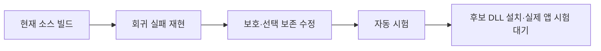

# 개발 회귀를 보강했으며 Windows 전체 동작 승인은 남아 있다

- C# 단위 단언 26,391개가 현재 기준 소스에서 통과했다.
- 트레이 통합 시험은 TSF 동시 처리 제거 후 106/106이다.
- TSF 113개 검사와 양쪽 빌드를 통과했으며 실제 앱 검증이 남아 있다.
- Word 언어 속성 후보의 실제 효과와 6종 앱 승인은 미검증이다.

## 판정과 검증 경로

[계획](WINDOWS-QUALITY-PLAN.md)의 95점·필수 게이트 전부 통과를 아직 충족하지 않는다. 개발 검사 수는 품질 점수가 아니다. 현재 종합 점수는 산정 보류이며 TSF 전체 앱 승인은 **0/6**이다. 설치 API 성공을 앱 승인으로 합산하지 않는다.

## 실행된 증거

로그 정본은 무시된 `build/windows-quality/`에 보존한다. 기준 소스는 `36794fe`, 변경 소스는 `codex/windows-quality`의 해당 커밋·diff와 연결한다. 바이너리 SHA256은 `baseline.json` 및 후보 묶음 manifest에 둔다.

| 항목 | 실제 관측·명령 | 판정과 범위 |
|---|---|---|
| C# 기준 단위 | `build.ps1 -Test`, exit 0, `PASS: 26391 assertions; 0 failures` | 통과. 엔진·저장소 검증이며 실제 앱 보증 아님 |
| C# 개발 앱 | `build.ps1`, exit 0, .NET Framework 4.8용 EXE 생성 | 0.5.0 개발 빌드 |
| 기준 패키지 | `tests/ReleaseTests.ps1`, exit 0, 19 assertions | 기준 문서 구성의 패키징·해시·설치 사전 검증. 실제 설치/로그인 아님 |
| 기준 TSF | `tsf/build.ps1 -Test -X86`, exit 0, 70 tests + 양쪽 selftest | 병합된 0.5.0 기준 소스의 새 증거 |
| 보호 회귀 최초 | `cargo test --release protection_tests`, exit 101, 1 passed / 2 failed | 조회 오류 실패는 유효하다. PRIVATE도 입력 차단해야 한다던 두 번째 기대값은 독립 검토 후 교정했다 |
| 선택 결함 재현 | `cargo test --release selection_tests`, exit 101, 0 passed / 2 failed | 4,097 UTF-16 단위 선택의 앞부분만 교체, 부분 읽기·분리 surrogate 손실 |
| 후보 TSF | `tsf/build.ps1 -Test -X86`, exit 0, 52 core + 14 TSF lib + 15 shell = **81 tests** | x64/x86 release 및 양쪽 DLL selftest 통과. 미설치 후보 |
| 트레이 통합 최초 | `build.ps1 -Integration`, exit 1, 104/106 | Caps Lock 활성 확인과 영문 대문자 출력 실패 |
| 트레이 통합 수정 후 | 같은 명령, exit 0, **106/106** | 시험용 WinForms의 후크·합성 키 경로. 물리 키/다른 앱 아님 |
| 중복 시험 거부 | 실행 중인 트레이를 둔 상태의 `--integration-test`, exit 2 | 새 후크/입력 전에 중복 소유자를 거부 |
| 권한 거부 경로 | `tsf/test-machine-registration.ps1`, exit 0 | 비관리자 등록/제거 거부, 관측한 등록 경로 존재 여부·사용자 언어 목록 불변 |
| 패키징 교차 시험 | PowerShell 7 및 5.1의 `tests/ReleaseTests.ps1`, 각각 exit 0, 20 assertions | 추가 문서를 포함한 패키지. 이후 변경은 최종 묶음에서 다시 확인 |
| 입력 보존 재생 | `cargo test --release replay_loses_nothing -- --nocapture`, exit 0 | `replay: 19616 keys in 300 sentences`; 키 로직과 모의 문서 범위 |

회귀를 만들면서 발생한 Rust 컴파일 오류는 수정 후 다시 실행했다. 위 결함 재현 행은 컴파일 실패가 아닌 실제 assertion 실패 로그다. 테스트를 통과시키려고 기대 문자열·필수 기준을 낮추지 않았다.

## 변경과 원인

### 보호 필드는 오류와 정상 조회를 구분한다

이전 구현은 InputScope 조회 실패를 `false`로 바꾸고 같은 컨텍스트에서 계속 재사용했다. 최종 후보 정책은 일반·비공개·보호·조회 불명으로 구분한다. 암호/PIN/비활성 컨텍스트와 조회 불명은 키를 가로채지 않는다. 비공개 필드는 한글 조합을 유지하며 학습과 입력 상태 추적을 제한한다.

키 처리 여부를 묻는 probe에서는 조합을 끝내거나 엔진을 초기화하지 않는다. 같은 컨텍스트·키·lParam·방향의 실제 콜백이 100ms 안에 오면 그 관측을 한 번만 소비한다. 초점·컨텍스트 변경 때는 폐기한다. 조회 불명은 조합을 파괴하지 않으며, 진단을 켠 경우 내용 없이 HRESULT만 남긴다. 실제 보호/비공개 전환에서는 미확정 단어를 원래 조합 범위에 확정하고 재변환 이력을 끊는다. 늦게 온 이전 조합 종료 콜백은 새 세션에 적용하지 않는다. 실제 호스트의 편집 거부·초점 경쟁 시험은 남아 있다.

`IS_PASSWORD`는 보안 경계 자체가 아니므로 앱의 입력 서비스 비활성화도 확인한다. 공식 정의: [InputScope](https://learn.microsoft.com/en-us/windows/win32/api/inputscope/ne-inputscope-inputscope), [TSF compartments](https://learn.microsoft.com/en-us/windows/win32/tsf/predefined-compartments). 실제 앱의 조회 호환성과 지연은 설치 후 검증해야 한다.

### 선택 변환은 전체를 읽었을 때만 바꾼다

이전 구현은 최대 4,096 단위만 읽고 원래 전체 선택을 덮어썼다. 후보는 원본 선택을 유지한 채 복제 범위를 나눠 읽고 한도 초과·조회 오류·잘못된 UTF-16이면 교체하지 않는다. 인라인 개체(U+FFFC)도 일반 문자로 덮어쓰지 않는다. 한도와 정확히 같은 길이, 분리된 surrogate, 작은 청크를 각각 회귀로 검증했다.

### 통합 시험도 실제 트레이의 소유권을 따른다

최초 실패 때 설치된 TSF 로그는 시험 프로세스에서 `tray=false`였다. 시험 진입점은 실제 앱의 mutex를 건너뛰고 있어 TSF도 Caps Lock을 처리했다. 동일 사용자 mutex를 보유하도록 바꾼 후 새 시험 프로세스의 로그는 `tray=true`, 결과는 106/106이었다. Caps Lock 기대값은 그대로 유지했다. 기존 트레이는 정상 종료·복원했고 사용자 문서를 닫지 않았다.

### Word F2의 언어 속성은 아직 후보다

기존 `TF_ST_CORRECTION`만으로는 Word 한/영 자동 고침 ON 충돌을 해결하지 못했다. 후보는 확정 단어를 교체한 같은 편집 세션에서 `GUID_PROP_LANGID`를 결과에 맞춰 기록한다(ASCII 영문 0409, 한글 0412). 기존 기본 언어가 같으면 영국·호주 영어 등의 지역 설정을 보존한다. 혼합 언어·다른 문자·숫자만 있는 선택은 임의로 재분류하지 않는다. 형식 속성은 유지하고 Word 설정은 바꾸지 않는다.

이 API는 [텍스트의 언어 식별자](https://learn.microsoft.com/en-us/windows/win32/tsf/predefined-properties)를 나타낸다. Microsoft SampleIME도 [조합 언어 속성을 기록](https://github.com/microsoft/Windows-classic-samples/blob/main/Samples/IME/cpp/SampleIME/Composition.cpp)한다. **Word 자동 고침 억제를 보장하는 문서가 아니므로 실제 성공은 설치 후 화면 결과로 판정한다.**

## 남은 필수 시험

### 편집 실패 주입 보강 — 2026-10-14 후속 작업

실제 서비스 COM 콜백을 호출하는 격리 호스트를 `tsf/src/service_tests.rs`에 추가했다. 시스템 등록·프로필·사용자 앱·키 입력을 변경하지 않는다. 최초 3개 시험은 모두 실패했다(`edit-failures-before.log`, exit 101): 편집 권한 거절이 엔진에만 글자를 남김, 지연 확정이 호스트가 덧붙인 `x`를 삭제함, 거절된 확정의 소유권이 사라져 재시도하지 못함.

키 처리는 편집 권한을 얻은 후 시작하고, 확정 요청은 성공할 때까지 원래 조합을 보유한다. 같은 컨텍스트에서는 현재 동기 편집 세션에서 먼저 확정하며, 지연 콜백은 완료 여부와 마지막으로 쓴 원문을 검사한다. 조회 불명은 새 키를 엔진에 넣지 않고 기존 조합만 정리한다. 호스트의 중간 변경은 보존한다. 텍스트 쓰기 성공 뒤 커서 이동이 실패하면 이미 반영된 키가 다시 전달되지 않도록 처리한다.

확장 시험에서 복구 중 RefCell 재대여 panic도 발견해 수정했다(`edit-failures-expanded-before.log`, 시험 프로세스 종료 코드 0xc0000409). COM 편집 콜백 안에서 panic을 잡아 실패 HRESULT로 반환하도록 보강했다. 호스트의 조합 종료 콜백 역시 원문 확인 없이 덮어쓰던 것을 별도 실패 재현 후 수정했다(`edit-termination-before.log`, 11 통과·1 실패).

`edit-lifecycle-build.log`의 전체 검사는 **98개(공통 엔진 52 + TSF lib 29 + shell 17)**, x64/x86 빌드 및 양쪽 DLL selftest 통과, 실행 exit 0이다. 이 중 새 COM 실패 주입은 12개다. 반대 공급자의 독립 검토는 `edit-lifecycle-review.json`에 기록하며 이 시점에는 실행 중이다. 실제 앱 승인 0/6과 설치 보류는 유지한다.

추가로 기존 자동 시작 보강 `7d600a3`이 이 개발 브랜치에 포함되지 않은 것을 확인했다. 기존 회귀 스크립트를 프로세스 전용 HKCU 시험 영역에서 실행한 결과 `Windows-disabled startup is incorrectly reported as enabled`로 실패했다(`startup-missing-fix-before.log`, exit 1). 기존 보강을 통합하고 검증해야 한다. HKCU Run 값 부재만으로 자동 시작 OFF를 판정할 수 없으며, 0.4.1의 작업 스케줄러 등록까지 확인해야 한다.

### 2026-10-14 첫 세션 마감 체크포인트 — 이전 기록

사용자의 `[pm] done`에 따라 이번 개발·검증 기록을 마감한다. **제품 목표는 미완료이며 설치·출시는 보류한다.** 마감 턴에는 테스트나 실제 앱 시험을 다시 실행하지 않았다.

- 후속 수정 검사는 `review-fixes-build.log`에서 **86개(공통 엔진 52 + TSF lib 17 + shell 17)** 및 x64/x86 빌드·DLL selftest 통과, exit 0으로 기록됐다. 마지막 범위 수정의 `review-scope-fix-build.log`에도 검사와 양쪽 빌드·selftest 통과가 남아 있으나, 종료 코드 영수증은 대화 압축 과정에서 유실되어 별도 exit 0을 주장하지 않는다.
- 도구 없는 반대 공급자 후속 검토(`independent-review-followup.json`)는 완료됐다. 배경 문서의 컨텍스트 이벤트가 현재 조합을 끝내던 문제, 선택 읽기 오류가 키 처리 실패로 전파되던 문제는 후속 수정에 반영했다. 동일 문서 관리자 초점 알림에서도 불필요한 초기화를 줄였다.
- **미해결 검토 항목:** 조합 도중 InputScope 조회가 Unknown이면 원시 키가 살아 있는 조합 범위에 들어가 이후 덮어써지거나 순서가 바뀔 가능성, 원래 범위 확정의 비동기 순서, 편집 세션 요청 실패 처리. 실제 보호 필드로 바뀔 수 있으므로 이전 일반 필드 판정을 무조건 재사용해서 해결하지 않는다.
- 실제 초점 이동 시 F2 이력 폐기는 Word 재시험에서 검증해야 한다. 비공개 필드 안에서 학습 설정을 바꿀 때의 복원 정책은 설정 UI 구현 시 재검토한다.
- 첫 81검사 후보 묶음 `build/tsf/wq-safety-language-20261014`는 `superseded-by-review-fixes-do-not-install` 상태다. 이번 변경을 설치본으로 오인하거나 적용하지 않는다. 시스템 설치는 이번 작업으로 변경하지 않았다.
- 재개 순서: 위 입력 보존·편집 실패 경로 수정 및 회귀 → 독립 검토 → 최종 설치 묶음 재생성 → 사용자 화면의 관리자 적용 → Word F2와 6종 앱 실제 입력 검증. 현재 **0/6**, 품질 점수 산정 보류를 유지한다.

소스는 `codex/windows-quality` 개발 브랜치에 체크포인트로 보존하며, 미해결 후보를 기본 브랜치에 병합하지 않는다. 무시된 빌드 로그·설치 후보는 작업 디렉터리에 보존한다. 새 메모리 atom은 만들지 않는다. 이번 세션의 교훈과 재개 근거는 이 문서가 정본이다.

독립 검토는 도구 없는 Claude CLI 1턴으로 수행했다(`independent-review.json`, exit 0). 첫 검토에서 High 1·Medium 2·Low 2가 나와 설치 후보를 보류했다. PRIVATE의 의미를 [Chromium의 실제 구현](https://chromium.googlesource.com/chromium/src/+/main/ui/base/ime/win/tsf_input_scope.cc)과 대조하고 정책·probe 부작용·원래 범위 확정·잘못된 선택·영어 지역 설정을 수정했다. 초기 PRIVATE 회귀의 잘못된 기대값도 함께 고쳤다. 후속 회귀와 독립 재검토가 끝나기 전에는 이 후보를 설치 가능 상태로 표시하지 않는다.

| 항목 | 현재 상태 | 다음 증거 |
|---|---|---|
| Word F2 | 설치된 이전 후보 실패, 새 후보 미설치 | 새 DLL·Auto 모드·자동 고침 ON에서 실제 왕복 |
| 6종 앱 | 전체 승인 0/6 | 앱별 조합/확정/삭제/초점/재변환 및 물리 입력 |
| 자동 시작 | 설치된 0.4.1의 작업 스케줄러 등록은 Enabled/Registered/Healthy=true | 실제 로그인 실행은 미검증. HKCU Run 부재는 OFF 근거가 아님 |
| 설치·복구 | 비관리자 거부와 preflight만 자동화 가능 | 관리자 갱신·제거·실패 복구 실제 실행 |
| 개인정보·입력 보존 | 초기 회귀 통과 후 독립 검토 수정 반영 중 | 실제 보호 필드, 비공개 창 입력·학습 억제, 동일 컨텍스트 이동, 편집 거부, 취소/복귀 |
| TSF 기능 완성 | 후보/설정 UI·영속 학습 없음 | 구현 및 트레이와 기능별 교차 검증 |
| 성능·지속 사용 | 엔진 재생만 있으며 UI 지연·장기 시험 없음 | 10,000키 실제 경로·p95·30분 입력 |
| 배포 | 개발 후보·미서명 | 출시 게이트 별도, 현재 공개 릴리즈 없음 |

Chrome/Edge는 허용된 Aside 실행면, 시작 검색은 도구 정책, 관리자 메모장은 사용자 화면의 관리자 권한이 필요하다. 기존 제약을 우회하지 않는다. 독립 코드 검토와 설치 후보의 최종 사전 점검은 별도 원장에 남긴다.

## 최신 마감 체크포인트 — 편집 수명과 자동 시작 통합

2026-10-14 후속 작업을 사용자의 `[pm] done`으로 마감한다. 위 81·86·98개 검사와 첫 마감 절은 해당 시점의 이력이며, 최신 자동 검사 결과는 아래와 같다. **제품 인수는 미완료, 실제 앱 승인 0/6, 후보 설치·출시는 보류**다. 마감 턴에는 코드 수정·시험·독립 검토를 다시 수행하지 않았다.

| 항목 | 작업 턴에서 확보한 결과 | 증거 |
|---|---|---|
| TSF 최종 자동 검사 | 104개 = 공통 엔진 52 + TSF lib 35 + shell 17, exit 0 | `edit-review-final-build.log` |
| 양쪽 빌드 | x64/x86 release 및 DLL selftest 통과 | 같은 로그 |
| 실제 COM 콜백 회귀 | 격리 호스트 18개 포함, 사용자 앱을 승인하는 시험은 아님 | `tsf/src/service_tests.rs` |
| 자동 시작 통합 | main의 기존 보강 `7d600a3`을 개발 0.5.0에 병합, 32개 단언 + 기존 회귀 1개 통과 | `startup-merge-tests.log`, 병합 `6f40d5d` |
| 개발 패키징 | 21개 단언 통과, 버전 원천 0.5.0 일치 | `startup-merge-release.log`, 버전 검사 출력 |
| 병합 후 트레이 통합 | 106/106, exit 0, 시험용 WinForms 합성 입력 범위 | `startup-merge-integration.log`, `.json` |
| 설치본 상태 | 0.4.1 자동 시작 작업 정상 등록, 시험 후 기존 트레이 복원·ready 확인 | `installed-startup-status.json`, 작업 턴의 복원 로그 |

편집 권한을 얻기 전 엔진이 진행하지 않도록 하고, 실패한 확정은 원래 조합을 보유해 재시도한다. 외부 컨텍스트의 실패가 현재 입력을 막지 않게 분리했으며, 이미 호스트가 종료한 조합의 늦은 콜백은 무효화한다. 조합 중 커서 이동 실패는 조합을 분리하지 않는다. 보호 여부 조회가 불명인 key-up은 쓰기 세션을 요청하지 않으며, key-down은 실제 쓰기 권한 안에서 조회를 재시도한다. preserved-key의 추적 억제는 쓰기 권한 거절보다 먼저 적용한다.

독립 검토 `edit-lifecycle-review.json`은 도구 없는 반대 공급자 CLI 1턴으로 완료됐다(exit 0). 그 뒤 B1·B3·B4·B5·B6 관련 보강과 회귀를 반영했지만 **수정본의 최종 독립 승인은 아직 없다**. `edit-review-before.log`에는 12 통과·4 실패, 이후 16 통과가 남아 있다. 추가 조회 시험의 최초 실패에는 모의 호스트의 플래그 계산과 실행 중 트레이 영향이 섞였으므로, 그 실패 전체를 제품 결함 증거로 간주하지 않는다. 시험 호스트를 고치고 영향을 분리한 최종 전체 결과가 104개 통과다.

남은 검토 항목은 다음 작업의 시작점으로 보존한다.

- B2: 여러 편집 동작이 연속될 때 어느 키까지 실제 반영됐는지 판정하는 오류 경로를 검토·보강한다.
- B7: F2 원문 검증 실패 시 키 소비와 재변환 이력 유지 정책을 보강한다.
- B8: 서비스 비활성화 시 활성 조합 및 지연 콜백의 수명을 정리한다.
- 나머지 COM 진입점의 panic 경계와 오류 시 입력 모드·Caps Lock 부수 효과를 검토한다.
- 위 항목 후 독립 재검토, 새 설치 묶음·해시·복구 경로, 관리자 적용, Word F2와 6종 앱 실제 입력 순서로 진행한다.

소스는 `codex/windows-quality` 체크포인트에 보존한다. 설치된 TSF는 `d2-word-correction-20261013` 그대로이며 새 DLL은 설치하지 않았다. 첫 `wq-safety-language-20261014` 묶음은 계속 적용 금지다. 실제 로그인 시험, TSF 후보·설정 UI·영속 학습과 성능·지속 사용 게이트도 남아 있다. 무시된 로그와 후보를 보존하기 위해 작업 디렉터리를 유지한다.

disposition은 `local-reusable`이다. 메모리 신규 0건·기존 atom UPDATE 0건·인덱스 반영 0건이며, 상세 기술 기록은 이 정본에 있어 별도 atom에 중복 저장하지 않는다. Vault/ATLAS waiver: 마감은 기존 증거의 기록으로 제한하며 재검색하지 않는다.

## 목표 재개 — F2와 종료 경로 보강

마감 이후 활성 목표를 재개했다. `f2-deactivation-before.log`는 기존 18개 통과와 새 3개 실패, `key-effects-before.log`는 18개 통과와 5개 실패를 기록한다(exit 101). 시험 코드의 최초 인터페이스 선택 컴파일 오류는 고친 뒤 재현했으며, 위 로그는 실제 assertion 실패다.

- B2: 이전 단어 쓰기 성공을 현재 키의 성공으로 계산하지 않는다. 마지막 문서 동작의 실제 쓰기를 추적하며, 그 쓰기 뒤 커서/종료 처리가 실패한 경우에는 키 중복을 막는다. 현재 엔진의 보통 응답은 commit과 marked 중 하나이고, Commit+Compose 실패 시험은 향후에도 유지할 다중 동작 계약을 합성한 것이다.
- B7: F2 대상이 바뀌거나 선택이 접혀 있지 않으면 키를 처리하지 않았다고 반환하고 재변환 이력을 버린다. 단어 교체 성공 때만 재변환 학습을 갱신한다.
- B8: Deactivate에서 마지막 동기 확정을 시도하고, 성공 여부와 관계없이 이미 큐에 있는 편집을 무효화한다. 권한을 얻지 못하면 기존 화면의 문자를 보존하며 늦은 쓰기를 수행하지 않는다.
- F12 등의 제어 상태가 이미 바뀐 경우, 동반 확정 실패로 같은 명령을 호스트에 다시 전달하지 않는다. 입력 모드 표시와 Caps Lock 효과도 오류 경로에서 갱신한다.
- ThreadMgr·compartment·활성화/비활성화 콜백의 panic 경계를 보강했다. 활성화 panic은 성공으로 위장하지 않고 실패를 반환하며 부분 상태를 정리한다.

수정 후 COM 호스트 회귀는 25개다(`f2-range-after.log`, exit 0). 추가한 두 범위 시험은 실제 서비스 F2 경로에서 `prefix 안녕 `↔`prefix dkssud ` 왕복, 호스트 변경 원문 보존과 재변환 이력 해제를 확인한다. 모의 호스트는 실제 Word 자동 고침·서식·언어 속성을 구현하지 않는다.

전체 결과는 `key-lifecycle-final-build.log`: **111개(공통 엔진 52 + TSF lib 42 + shell 17)**, x64/x86 release와 양쪽 DLL selftest, exit 0이다. 첫 실행은 빌드 스크립트의 위치 변경으로 상대 로그 경로가 없어 중단됐고, 절대 로그 경로를 사용한 실행이 이 결과다. 독립 후속 검토 입력과 결과는 `key-lifecycle-review-input.txt`·`key-lifecycle-review.json`에 보존한다. 이 절 작성 시 최종 검토는 실행 중이며 설치 승인을 뜻하지 않는다.

공식 계약도 대조했다. [OnPreservedKey](https://learn.microsoft.com/en-us/windows/win32/api/msctf/nf-msctf-itfkeyeventsink-onpreservedkey)의 FALSE는 미처리 결과이며, Word가 이를 어떤 UI 동작으로 받는지는 실제 시험 대상이다. [RequestEditSession](https://learn.microsoft.com/en-us/windows/win32/api/msctf/nf-msctf-itfcontext-requesteditsession)은 동기 요청 거절 가능성과 비동기 순서를 명시한다. [Deactivate](https://learn.microsoft.com/en-us/windows/win32/api/msctf/nf-msctf-itftextinputprocessor-deactivate)는 반환 전에 thread manager 참조를 해제하도록 요구한다.

Windows Computer Use의 앱 목록과 기존 Word 시험 창 읽기는 성공했다. 프로세스 DLL 확인에서는 기존 d2-session/d2-f2/d2-f2-trace/d2-word-correction revision이 섞여 있어, 새 창만으로 새 후보 적재를 판정하지 않는다. 이 읽기 확인에서는 입력·문서·Word 옵션을 바꾸지 않았다. 실제 앱 전체 승인 **0/6**과 제품 인수 미완료를 유지한다.

### 독립 검토 후 설치 후보 판정

`key-lifecycle-review.json`은 검토 범위에서 입력 누락·중복을 일으키는 설치 차단 경로를 찾지 못했고, panic 설정 확인 후 제한된 실제 앱 시험용 설치를 허용했다. 이는 출시나 전체 기능 승인이 아니다. 지적된 Shift+F2 정책 변경은 기존의 명령 소비 정책으로 되돌렸고, 문서 쓰기 뒤 표시 갱신에서 panic이 나도 외부 키 콜백까지 전파되어 입력을 중복 전달하지 않도록 별도 경계를 두었다.

`command-review-before.log`에서 위 두 회귀가 실패했으며(25 통과·2 실패), 최종 `command-review-final-build.log`는 **113개(52+44+17)** 및 x64/x86 release·양쪽 DLL selftest 통과, exit 0이다. COM 호스트 시험은 27개다. `tsf/Cargo.toml`은 release의 `panic="unwind"`를 명시하며 같은 도구체인·프로필·대상에서 실제 컴파일러 cfg도 양쪽 모두 unwind였다(`release-panic-config.log`, `release-panic-config-x86.log`).

후속 제한 검토 `command-review.json`은 새 차단 항목이 없다고 판정했다. 검토자가 실행하지 않은 시험은 위 실행 로그로 구분한다. 입력기 비활성화에서 동기 잠금을 거절당하면 미리보기만 보존되는 한계, 드문 panic 중 이벤트 해제, 실제 앱의 COM/범위 동작과 Shift+F2 반복 입력은 여전히 실제 시험 항목이다. 마지막 단어와 같은 문구가 있는 다른 위치로 커서를 옮겼을 때의 F2 검증도 추가한다.

현재 후보는 `build/tsf/wq-reviewed-20261014`에 새로 묶어 검증·적용 영수증과 연결한다. 원격 UAC 요청이 보이지 않았던 환경이므로 관리자 적용은 사용자 화면에서 수행한다. 적용 후 새 Word 프로세스의 DLL 경로를 확인해야 하며, 기존 문서를 강제 종료하지 않는다. 이전 `wq-lifecycle-20261014-b54763a` 묶음과 첫 81검사 묶음은 대체되어 적용 대상에서 제외한다. 설치 전까지 시스템 등록은 `d2-word-correction-20261013`이다.

## 목표 재개 — TSF 설정 편집기와 활성화 적용

설정 기능의 스텁을 실제 파서·저장소·편집 화면으로 구현했다. 기존 f839115 설치 후보와 별도의 개발 변경이며 시스템에 설치하지 않았다. 시작 시 해당 후보의 설치 영수증은 여전히 없었다. 이번 작업은 WQ-07 일부 구현이며 **실제 앱 승인 0/6, 제품 인수 미완료**를 유지한다.

- `Hanautomata.ImeOptions.exe`는 설정 편집만 수행한다. `Hanautomata.exe --ime-settings`도 후크 mutex·마이그레이션·자동 시작 처리보다 앞에서 같은 편집기로 진입한다. `Program`의 선행 static 초기화는 없으며, TSF의 트레이 감지는 프로세스 이름이 아닌 트레이 전용 mutex다.
- `tsf-settings.json`은 64 KiB 이하의 PascalCase Format 1 객체다. 양쪽 파서는 잘못된 자료형·알 수 없는 필드·지원하지 않는 값·중복 필드·경로를 포함한 제외 앱 이름을 거부한다. TSF는 활성화 시만 읽고, 누락 외의 읽기 실패에서는 입력을 통과시킨다.
- 앱 제외는 일반 키·preserved F2·문맥 변경·실제 편집 전달에서 유지한다. 제외 앱에서는 필드 조회에 앞서 키를 통과시킨다. Windows 실행 파일명은 [CompareStringOrdinal](https://learn.microsoft.com/en-us/windows/win32/intl/handling-sorting-in-your-applications)의 대소문자 비교로 처리해 비영문 이름도 지원한다.
- 편집기는 저장 시 파일 해시와 프로세스 간 잠금으로 오래된 편집을 거부한다. 교체 전용 임시 파일을 쓰고 직전 파일 1개를 `.previous`에 남긴다. [ReplaceFileW의 오류 1177](https://learn.microsoft.com/en-us/windows/win32/api/winbase/nf-winbase-replacefilew)처럼 본 파일이 사라진 경우에는 임시 데이터를 지우지 않는다. `.lock` 또는 백업이 있는데 본 파일이 없으면 양쪽 모두 복구 상태로 처리하며 기본값으로 제외 앱을 다시 활성화하지 않는다. 실제 1177 발생을 유도한 시험은 아니며, 문서화된 상태를 재현한 회귀다.
- 새 학습은 입력기 재활성화나 앱 종료 시 사라질 수 있음을 UI에 적었다. 후보 UI와 다중 앱 영속 학습은 여전히 미구현이다.

### 실행 증거

모든 상대 로그 경로는 제품 작업 트리의 `build/windows-quality/` 기준이다.

| 범위 | 결과 | 로그 |
|---|---|---|
| 설정 스텁의 최초 회귀 | Rust 1 통과·2 실패, C# 1 통과·7 실패 | `settings-before.log`, `settings-csharp-before.log` |
| 제외 앱 정책 회귀 | 보강 전 실제 assertion 실패 | `settings-exclusion-before.log` |
| Unicode 앱 이름 | 보강 전 실제 assertion 실패 | `settings-unicode-before.log` |
| 검토 지적 재현 | Rust 6 통과·2 실패(배열·복구 상태), C# 10 통과·1 실패(복구 상태) | `settings-review-before.log`, `settings-recovery-before.log` |
| 수정 후 전체 Rust | **123개 = 공통 엔진 52 + TSF lib 54 + shell 17**, exit 0 | `settings-review-final-build.log` |
| 양쪽 빌드 | x64/x86 release·각 DLL selftest 통과, 등록 없음 | 같은 로그 |
| C# 설정 저장소 | **11개 통과**, exit 0; 동시 프로세스 충돌·잘못된 JSON·실패한 교체의 원본 보존 포함 | `settings-csharp-final.log` |
| 공용 설정 형식 | C#가 실제 생성한 JSON을 Rust가 읽고 모든 필드 비교 | 전체 Rust 실행에서 `HANAUTOMATA_CSHARP_SETTINGS_TEST`를 지정함 |
| 앱 빌드 | 기존 트레이 앱과 전용 설정 앱 컴파일 성공 | `settings-ui-final-build.log` |
| 사용자 상태 | 작업 전후 실제 TSF 설정 파일 없음, 기존 트레이 PID 4476 유지 | `ime-settings-ui/before.json`과 작업 턴 상태 출력 |

기본 `cargo test`는 공용 fixture만 확인하며 C# 실행 결과 비교는 환경 변수를 지정한 별도 실행 증거다. 처음 비공개 필드 복귀 시험이 빈 엔진 저장 경로로 만든 `tsf/.lock`은 시험 코드에서 임시 경로를 사용하도록 수정했다. 기존 임시 파일 삭제 명령은 자동 승인 검토에서 정책 차단되어 파일을 보존하고 커밋 대상에서 제외한다.

### 독립 검토 및 남은 게이트

도구를 비활성화한 반대 공급자 CLI 1턴 검토가 완료됐다(`settings-review.json`, exit 0, 약 265초). 이 검토자는 테스트를 실행하지 않았다. H1의 트레이 감지 우려는 실제 mutex 구현과 선행 초기화 부재로 대조했다. 배열 역직렬화·손상/누락 복구·Unicode 비교·학습 및 적용 문구·제외 앱 콜백을 보강했으며 후속 검토를 별도로 수행한다.

후속 독립 검토도 완료됐다(`settings-review-followup.json`, exit 0, 약 343초). 배열 객체 검사·교체 실패 복구 상태·제외 앱의 키 진입점 보강은 소스에서 확인했다. 추가 항목은 다음 작업으로 유지한다: NFC/NFD 실행 파일명의 사용자 기대 처리, `GetModuleFileNameW` 실패·520자 경로 잘림 시 제외 판정, `.previous`와 남은 임시 파일을 선택해 복원하는 UI. Windows는 서로 다른 정규화의 파일명을 구분하므로 NFC/NFD 확대 매칭은 제외 기능의 정책으로 명시하고 회귀를 추가해야 한다. 현재 화면은 기본값 복구만 제공하므로 원래 옵션 복원 UX는 아직 완료가 아니다.

비공개 필드 복귀 시험의 저장 경로를 임시 경로로 바꾼 뒤 해당 1개 회귀를 다시 통과했다(`settings-test-isolation.log`). `ImeSettingsTests.ps1 -BuildPreview`도 11개 검사 및 격리 화면 시험 앱 컴파일에 성공했다(`settings-csharp-preview-final.log`). 이후 제품 런타임 코드는 바꾸지 않았다.

CI Windows 작업에 설정 저장 시험·화면 시험 앱 컴파일을 추가하고, 전체 .NET Framework 4.8 컴파일 프로젝트에 주 진입점과 새 참조를 맞췄다. 로컬 `dotnet build`는 SDK가 없어 실행하지 못했다(`settings-net48-before.log`). 이후 개발 커밋 `c279cd42488d6c17558507ed8f4ff9d53f9c0e8c`의 [CI 38585646452](https://github.com/peterkimpmp/hanautomata/actions/runs/38585646452)가 성공했다. `windows-build`의 설정 시험·편집기 컴파일·기존 패키징·자동 시작 회귀와 `cross-platform-tests`의 .NET Framework 4.8 전체 컴파일·.NET 9 단위 검사가 모두 성공임을 job/step 결과로 확인했다(`settings-ci.json`). 이는 실제 사용자 앱·화면·설치 승인을 대체하지 않는다.

AppContainer와 패키지 앱에서 `%LOCALAPPDATA%`가 같은 사용자의 설정 위치를 가리키는지, 그 파일을 읽을 수 있는지는 미검증이다. 경로가 다른 경우 NotFound 기본값을 사용할 가능성도 있으므로 이 문제가 해소되기 전에는 **설정 지원 DLL을 설치 후보로 승인하지 않는다**. 시작 검색·관리자 앱을 포함한 실제 적용, ITfFnConfigure/Windows 메뉴 연결과 설정 앱 패키징도 남아 있다.

설정 화면은 Windows Computer Use로 실행을 두 번 시도했으나 `accessibility window-opened handler did not become ready` 오류가 반복돼 렌더링을 확인하지 못했다. 실제 UI 저장·재열기·DPI 100/150/200%·접근성은 통과로 처리하지 않는다. `tests/ImeSettingsTests.ps1 -BuildPreview`로 실제 사용자 설정 대신 실행 파일 옆 JSON을 사용하는 화면 시험 앱을 만들 수 있다. 이 파일은 자동 실행하지 않는다.

다음 작업은 AppContainer 설정 전달 경계와 설치·메뉴 연결, 실제 UI 시험을 해결하는 것이다. 기존 f839115 후보의 관리자 적용 회신이 오면 그 후보와 새 개발 소스를 구분하여 Word의 실제 DLL 적재부터 검증한다. 전체 점수 산정은 보류하며 기존 자동 시작 로그인·성능·30분 지속 입력 게이트도 유지한다.

## 제외 앱 이름 및 보관 설정 복원 보강 — 2026-10-15

후속 검토의 F1/F2/R1을 구현했다. 프로세스 경로는 최대 32,768 UTF-16 단위까지 버퍼를 늘려 읽고, 잘림·API 실패·잘못된 UTF-16은 알 수 없는 이름으로 처리한다. 제외 목록이 있는데 이름을 확인할 수 없으면 키를 통과시킨다. 가능한 8.3 축약 이름은 확장하며 프로세스별로 결과를 캐시한다. [GetModuleFileNameW](https://learn.microsoft.com/en-us/windows/win32/api/libloaderapi/nf-libloaderapi-getmodulefilenamew)의 잘림 반환값과 [GetLongPathNameW](https://learn.microsoft.com/en-us/windows/win32/api/fileapi/nf-fileapi-getlongpathnamew)의 버퍼 크기 계약을 따랐다.

제외 이름은 [NormalizeString](https://learn.microsoft.com/en-us/windows/win32/api/winnls/nf-winnls-normalizestring)의 NFC 변환 후 Windows ordinal 대소문자 비교를 사용한다. 정규화가 동등한 이름을 함께 제외하는 것은 제품 정책이며 파일 시스템의 이름 동일성에 대한 주장이 아니다. 악센트·전각 호환 문자 차이를 유지하는 회귀를 포함한다.

편집기에 보관 파일 선택·미리보기·명시적 저장을 추가했다. 복원은 일반 저장과 같은 충돌 검사를 적용하며, `.previous`를 선택했어도 원본을 덮어쓰지 않는다. 복원 전 본 파일은 별도의 고유 백업에 남는다. 접근할 수 없는 복구 표시 파일을 `File.Exists`의 false로 오인하지 않도록 C# 로더도 보강했다.

| 검증 | 결과 | build/windows-quality/ 로그 |
|---|---|---|
| 최초 Rust 초안 | E0599 컴파일 실패. 테스트 미실행 | identity-recovery-before.log |
| 컴파일 오류만 고친 기준 | 54 통과·4 실패: unknown/NFC-NFD/긴 경로/계속 잘린 반환값 | identity-before-compiled.log |
| 복원 스텁 기준 | 12 통과·3 실패. 예외만으로 통과한 거부 검사는 구현 증거에서 제외 | restore-before.log |
| 보강 후 전체 Rust | **129개 = core 52 + TSF lib 60 + shell 17**, exit 0 | identity-recovery-full-build.log |
| C# 설정·복원 | **16개 통과**, 기존 백업·임시 파일·복원 전 파일 보존과 동시 편집 충돌 포함 | restore-after.log |
| 공용 형식 | 실제 C# 생성 JSON을 Rust에 지정해 필드 대조 | 위 전체 Rust 실행의 HANAUTOMATA_CSHARP_SETTINGS_TEST |
| 빌드 | x64/x86 release 및 각 DLL selftest 통과; 트레이·설정 앱 컴파일 성공 | identity-recovery-full-build.log, identity-recovery-app-build.log |
| 바이너리 | DLL·setup·설정 앱 SHA256 보존 | identity-recovery-binary-hashes.json |
| 실제 설정 화면 | 새 시험 앱 실행도 accessibility window-opened handler did not become ready로 실패; 창·프로세스 생성 미확인 | 이번 작업의 Computer Use 출력 |

도구를 비활성화한 반대 공급자 독립 검토가 완료됐다(`identity-recovery-review.json`, exit 0, 1턴, 약 297초). 검토자는 소스만 읽었으며 실행·화면 검증은 하지 않았다. 높은 심각도 회귀는 보고하지 않았지만, 다른 편집기의 백업 교체 후 복원 미리보기 재시도와 상대 경로의 파일 선택 영향을 Medium으로 지적했다. 이를 다음과 같이 보강했다.

- 복원 충돌은 전용 예외로 구분한다. 미리보기를 유지하고, 사용자가 명시적으로 동의했을 때만 최신 fingerprint를 읽어 복원 저장을 다시 시도한다. 최신 파일은 고유 백업으로 남기며, 그 사이 또 변경되면 CAS가 다시 거부한다. 일반 저장에는 이런 재시도를 적용하지 않는다.
- 편집기 생성 시 대상 경로를 절대 경로로 고정하고 파일 대화상자에 RestoreDirectory를 설정했다. 잘못된 파일 선택이나 취소는 기존 초안을 버리지 않는다.
- NFC 변환 실패는 양쪽 검증 단계에서 거부한다. 오류 메시지는 너비·높이를 제한하고 전체 문구를 툴팁으로 제공한다. 복원 전 백업 경로를 반환해 사용자에게 표시한다. 이름 기반 제외의 한계는 README에 기록했다.

백업 위치·명시적 재시도 보존 검사를 추가한 첫 실행은 14 통과·2 실패였다(`restore-review-before.log`). 보강 후 C# 16개 및 시험 UI·제품 앱 컴파일을 통과했다(`restore-review-after.log`, `restore-reviewed-app-build.log`). Rust 전체 129개와 양쪽 release/selftest도 다시 통과했다(`identity-recovery-reviewed-build.log`). UI의 확인 대화상자·경로 고정·DPI는 실제 화면에서 검증한 것으로 계산하지 않는다. 후속 독립 검토는 별도로 기록한다.

현재 변경은 개발 소스이며 고정 f839115 설치 후보나 시스템 등록을 바꾸지 않았다. 실제 앱 승인 0/6, UI/DPI와 전체 인수 게이트 미완료를 유지한다.

### 보완 검토와 최종 빌드

후속 독립 검토(`identity-recovery-followup.json`, exit 0, 약 186초)에서 복원 미리보기 후 기본값 선택이 복원 모드를 유지하는 Medium 결함을 발견했다. 기본값은 복원 상태를 해제해 일반 CAS 저장으로 돌아가도록 수정했다. 두 번째 충돌에서도 미리보기를 보존한다는 안내를 사용하고, 교체 실패로 본 파일을 확인할 수 없으나 백업이 남으면 보관 경로를 표시한다. 상태 영역은 키보드로 선택·복사하고 스크롤할 수 있는 읽기 전용 텍스트 상자로 바꿨다. 잘못된 설정 경로는 UI 시작 전에 종료 코드 2를 반환한다.

부모 디렉터리의 잘못된 UTF-16 코드 단위 때문에 정상 실행 파일명까지 잃는 회귀를 추가해 먼저 실패를 확인했다(`identity-directory-before.log`). 경로를 UTF-16 상태에서 나누고 파일명만 해석하도록 수정했다. 최종 `identity-recovery-final-build.log`는 **130개(core 52 + TSF lib 61 + shell 17)**, x64/x86 release와 각 DLL selftest 통과(exit 0)다. C# 설정·복원 16개 및 트레이·설정·시험 UI 컴파일도 통과했다(`restore-final-csharp.log`, `restore-final-products.log`). 잘못된 경로의 실제 CLI 종료 코드 2는 `settings-invalid-cli.log`에 있다.

마지막 소스 검토(`identity-recovery-final-review.json`, exit 0, 약 132초)는 남은 Medium/High 및 데이터 손실·CAS 우회·잘못된 대상 쓰기 결함을 발견하지 않았다. 검토자가 제시한 Low 줄바꿈 문제는 Windows 줄바꿈으로 통일해 수정하고 C# 검사·빌드를 다시 통과했다. 일반 기본값 저장의 `.previous` 1세대 교체 정책, 복원 백업 자동 삭제 부재와 실제 UI 검증 필요성은 유지한다. 세 차례 검토 모두 다른 공급자의 도구 없는 단일 턴 소스 검토이며, 독립 런타임 검증이라고 부르지 않는다.

시험 UI에는 제품과 같은 manifest에 더해 같은 .NET Framework 4.8 runtime config를 복사하도록 빌드 스크립트를 보완했다. 재빌드와 config SHA256 일치를 확인했다(`restore-preview-parity.log` 및 실행 출력). 최종 바이너리 해시는 `identity-recovery-final-hashes.json`이다. 사용자에게 격리된 시험 화면을 직접 열어 달라고 요청했으며 실제 화면 확인은 아직 대기다.
