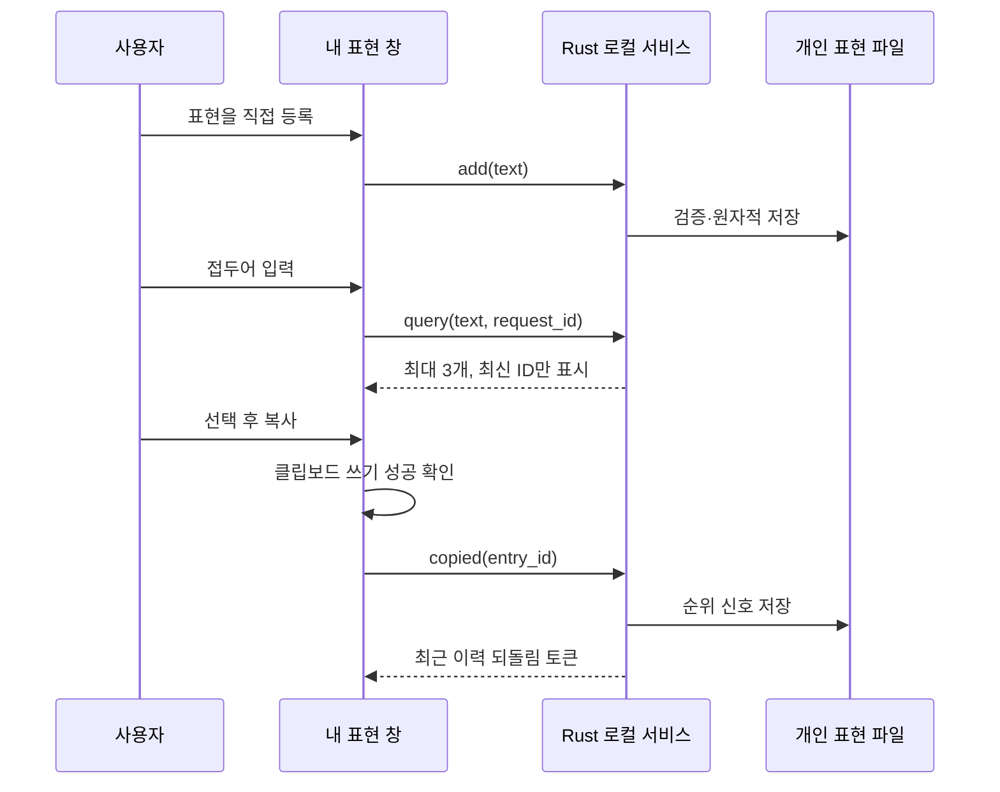

# 다듬 내 표현 MVP는 직접 저장한 표현을 빠르게 찾고 선택 이력으로 순위를 개선한다

- 사용자가 직접 저장한 단어·표현만 기억한다. [FR-01](#기능-요구사항)
- 두 글자부터 최대 세 후보를 제시한다. [FR-02](#기능-요구사항)
- 복사 이력은 순위 신호이며 실제 채택과 구분한다. [FR-03](#기능-요구사항)
- Windows·macOS가 같은 Rust 서비스를 호출한다. [프로토콜](#서비스-프로토콜-v1)

범위: 전체 [기술 로드맵](../TECHNICAL-ROADMAP.md)의 **R1a**. 입력 중 자동 팝업·본문 제자리 교체·다음 단어·자동 문장 수집·문체 학습·LLM 호출·TSF 진입 UI는 후속이다. 사용자는 별도 창에서 조금 입력해 저장한 표현을 찾아 복사한다.



## 사용자 흐름

Windows 트레이 메뉴 또는 macOS 입력 메뉴의 `내 표현…`으로 연다. 별도 미리보기 실행 옵션도 제공한다. 기본은 추천 꺼짐·빈 목록이다. UI에 `직접 등록한 표현만 이 기기에 평문으로 저장합니다. 입력 내용은 자동 수집하지 않습니다.`를 표시한다.

1. `새 표현`에 `검토 후 회신드리겠습니다.`를 입력하고 `등록`한다.
2. `추천 사용`을 켜고 `표현 찾기`에 `검토`를 쓴다.
3. 최대 세 후보 중 하나를 선택하고 `복사`한다. 원래 앱에서 원하는 범위에 붙여넣는다.
4. 복사가 성공한 후보는 다음 검색에서 순위가 올라갈 수 있다.
5. `최근 순위 기억 되돌리기`는 순위만 복원한다. 클립보드·원래 앱 문서를 되돌리지 않는다.
6. 검색어를 비우면 관리 목록을 표시한다. 개별 `삭제`, 확인 후 `전체 삭제`, 추천 끄기를 제공한다.

등록과 복사는 명시적 행동이다. 프로그램 시작만으로 기존 문서·클립보드·타이핑을 읽지 않는다. 클립보드를 쓰는 것은 복사 버튼뿐이다. 복사한 내용은 운영체제의 클립보드 기록/동기화 설정 영향을 받을 수 있다.

## 기능 요구사항

| ID | 계약 | 수용 시험 |
|---|---|---|
| FR-01 | 한 줄 2~256 Unicode scalar, 최대 512항목, NFC·양끝/연속 공백 정규화 | NFD 한글·중복·공백·한도·줄바꿈·제어문자 |
| FR-02 | 공백을 정리한 접두어 2글자부터, 대소문자 무시 검색, 최대 3개 | 한글/영문/emoji, 정확 동일 표현 미추천, 빈/긴 접두어 |
| FR-03 | 정규화 접두어 일치 → 30일 단위 복사 빈도 감쇠 → 최근 복사 → 텍스트 순서 | 동일 입력 결정적 순서, 시간 경계, 복사로 순위 상승 |
| FR-04 | clipboard 성공 뒤 copied, 최근 순위 이력 한 단계 복원 | 실패 시 신호 없음, undo 1회, 삭제/초기화/중지 후 stale 토큰 거부 |
| FR-05 | 추천 끔은 검색·순위 변경 중지, 관리·삭제는 가능 | 재시작 후 설정 유지, disabled 응답 |
| FR-06 | 파일 버전·크기·모든 항목 검증 후 로드 | 손상·미래 스키마·중복 ID·초과 항목이면 원본 보존 |
| FR-07 | 파일당 단일 writer, 교체 전 flush, 실패 시 메모리 상태도 rollback | 두 프로세스 경합, 쓰기 실패, 프로세스 재시작 |
| FR-08 | UI 비동기·요청 ID 대조·검색 지연 150ms | 빠른 검색에서 오래된 후보 표시·복사 없음 |
| FR-09 | UI 상태: 초기/로딩/목록/추천/오류, 재시작 가능 | 서비스 없음·종료·timeout·불일치 응답 |
| FR-10 | 두 OS 네이티브 컨트롤, 키보드 이동·레이블·가변 창 | 빌드·컨트롤 테스트와 실제 화면은 별도 기록 |

순위는 작은 휴리스틱이다. 사용자가 선호하는 의미나 문체를 이해한다고 주장하지 않는다. prefix 자체와 보여 주기만 한 후보는 저장하지 않는다. 스코어의 감쇠는 오래된 신호 영향 감소이며 항목 자동 삭제는 아니다.

## 데이터와 파일 계약

파일명 `personal-expressions.json`; Windows `%LOCALAPPDATA%\Hanautomata`, macOS `~/Library/Application Support/Hanautomata`. 기존 `words.json`/`learned-words.json`에 섞지 않는다. 별도 `.lock`은 OS 잠금용이고 표현 텍스트를 담지 않는다. 저장 임시 파일은 성공·실패 정리하며 앱이 만든 백업 사본은 남기지 않는다.

```json
{"schema_version":1,"enabled":false,"entries":[
  {"id":"<정규화된 표시 문자열의 SHA-256>","text":"검토 후 회신드리겠습니다.",
   "copies":0,"last_copied_day":0}
]}
```

항목 ID는 중복 및 응답 상관관계용이며 암호화가 아니다. 평문 저장은 직접 등록 기능에 한정한다. macOS 파일은 0600으로 생성하고 Windows는 사용자 전용 데이터 폴더의 상속 ACL을 사용한다. 암호화·보존 기간·동의와 삭제되는 파생 기억은 자동 수집 R1c 전에 구현한다. 현 MVP는 수동 삭제까지 보관한다. 삭제는 애플리케이션 활성 저장소에서의 삭제이며 SSD·OS 백업의 보안 소거를 뜻하지 않는다.

실패한 변이 요청은 파일과 메모리를 모두 이전 상태로 유지한다. 손상 파일은 자동 리셋하지 않는다. 사용자에게 다른 창을 닫고 재시도/파일 백업 후 관리하도록 알린다. 로드 오류에는 입력 원문·경로·비밀을 stderr로 쓰지 않는다.

## 서비스 프로토콜 v1

실행: `hanautomata-assist --store <절대 파일 경로>`; stdin/stdout UTF-8 JSONL. 파일은 요청 문자열에서 지정하지 않고 부모 프로세스가 사용자 데이터 위치로 고정한다. 별도 셸을 실행하지 않는다. 요청 최대 16 KiB, 파일 최대 1 MiB, 응답 최대 1 MiB. EOF로 종료한다.

```json
{"schema_version":1,"request_id":"17","command":"query","text":"검토"}
{"schema_version":1,"request_id":"17","ok":true,"enabled":true,"items":[],"error":"","undo_id":""}
```

| command | 필수 인자 | 결과·효과 |
|---|---|---|
| list | 없음 | 전체 관리 목록·enabled; 저장하지 않음 |
| query | text | top-3, disabled이면 빈 후보; 검색어 저장 없음 |
| add | text | 정규화·등록 또는 기존 항목 유지, 전체 목록 |
| set_enabled | enabled | 추천 설정 저장; 끌 때 undo 토큰 무효화 |
| copied | entry_id | 해당 항목 신호 증가, 하나의 undo_id |
| undo | undo_id | 가장 최근 신호만 복원; 토큰 1회 소비 |
| delete | entry_id | 항목 삭제·관련 undo 제거 |
| clear | 없음 | 모든 항목·순위 신호 제거, 추천 설정은 유지 |

`request_id`는 최대 64 ASCII 영숫자/하이픈이며 UI는 세션 내 증가 ID를 쓴다. 응답 items는 `{id,text,copies,last_copied_day}`이다. 오류 코드는 `invalid_request`, `invalid_text`, `full`, `disabled`, `not_found`, `stale_undo`, `store_unavailable` 등 내용 없는 코드다. unknown command/schema/필드, 초과 프레임은 거부한다. 서비스 시작 시 저장소 실패는 request_id가 빈 오류 프레임 후 종료한다. UI는 이를 연결 실패로 표시한다.

복원 토큰은 프로세스 수명 안에서만 유효하다. 새 copied 또는 등록/삭제/전체삭제/끄기 등의 기억 변경은 이전 토큰을 무효화한다. 검색·list는 토큰에 영향을 주지 않는다. UI 재실행으로 영구 복원 로그를 만들지 않는다.

## UI 상태·프로세스 수명

서비스는 창이 처음 열릴 때 시작한다. 생성·I/O·응답 판독은 직렬 작업 큐에서 한다. 같은 창을 다시 열면 인스턴스를 재사용한다. 창을 닫으면 stdin을 닫고 응답을 무시하며 서비스가 종료되도록 한다. 읽기/쓰기 응답 제한은 3초이며 정지된 자식은 종료한다. UI는 완료되지 않은 변이가 있는 동안 등록/삭제/복사/토글을 막는다. 검색은 debounce 후 요청하며 응답 때 현재 검색어·세대가 같은지 확인한다. 오류 시 후보를 비우고 재시도 동작을 제공한다.

UI는 복사 성공과 순위 저장 성공을 구분해 안내한다. 저장 실패여도 이미 복사된 텍스트는 유지된다. 꺼진 상태에서도 관리 목록을 볼 수 있지만 복사로 추천 순위를 학습하지 않는다. 등록 버튼은 평문 저장 안내와 붙여 배치한다. 전체 삭제만 데이터 손실 확인을 받는다. 일반 검색·복사는 불필요한 확인을 추가하지 않는다.

## 검증과 MVP 종료 기준

- Rust 단위: 정규화·NFD·접두어·정렬·감쇠·중복·한도·복원·중지.
- 실제 서비스: JSONL·재시작·프로세스 경합·오류 입력·손상 파일·삭제 후 재로드·쓰기 실패.
- 두 UI: 서비스 계약·빌드·stale 검색·복사 실패·프로세스 종료. macOS/Windows 실제 클릭은 확인한 경우에만 완료 표기.
- 기존 입력: Rust·Swift 입력 로직·C# 회귀를 유지하고 키 경로 파일에 추천 I/O가 들어가지 않았는지 검토.
- 패키지: helper 존재·아키텍처·실행·버전·고지·체크섬. 서명 신뢰/공증은 별도.

**개발 빌드 완료**는 실제 구현과 지정 회귀의 통과다. **R1a 배포 승격**은 Windows/macOS 실제 UI·설치·접근성 인수까지 통과해야 한다. **전체 MVP**는 R1b의 입력 중 추천과 R1c의 허용된 사용 패턴 기억까지 충족해야 한다. 이 첫 빌드로 전체 AI 입력기가 완성됐다고 표기하지 않는다.

## 후속 작업의 구체화

R1b는 `CompletionRequest {request_id, epoch, document_id, prefix, utf16_range, source_hash, privacy}`와 `CompletionProposal {request_id, epoch, item_id, replacement, source_hash}`를 사용한다. 보호/unknown/excluded 상태는 요청 자체를 만들지 않는다. 수락은 소스가 같은 경우에만 적용하고 undo token을 rank feedback과 연결한다. 별도 패널의 copied 이벤트를 인라인 applied 이벤트로 재사용하지 않는다.

R1c는 확정 문장을 모두 저장하는 대신 사용자 허용 범위의 단어·짧은 표현·수락 반응을 구분한다. 생성됐지만 수락하지 않은 제안, 즉시 undo된 결과, 숨김·무시를 강한 선호 학습으로 처리하지 않는다. 차기 문장 AI 스키마와 모델 비교 게이트는 기술 로드맵 §5~7에 있다.
