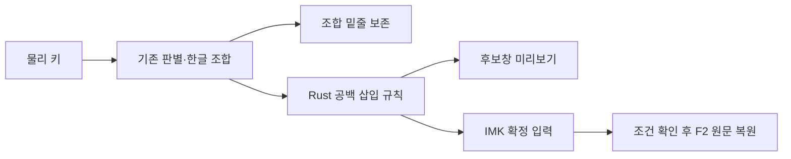

# macOS 자동 띄어쓰기 구현·패키지 검증은 통과했고 실물 입력 인수는 남았다

- 공통 사례 133개를 C#·Rust 양쪽에서 같은 기대값으로 검사했다.
- 원문 복원은 같은 칸·커서·원문·15초 조건을 모두 확인한다.
- 입력기와 선택문 검사기 모두 Apple Silicon·Intel을 포함한다.
- OS가 Aside 화면 접근을 거부해 TextEdit 실물 인수는 미확인이다.

## 구현 범위

기준은 Windows PR [#2](https://github.com/peterkimpmp/hanautomata/pull/2)의 병합 커밋 `46f4e61`이다. 해당 main [CI](https://github.com/peterkimpmp/hanautomata/actions/runs/38980942443)의 성공을 확인했다. 기존 `v0.6.0` 태그·사전 공개 자산은 변경하지 않고, 다음 macOS 증분의 제품 버전을 `0.6.1`로 맞췄다. Windows 트레이 동작은 변경하지 않았다. Windows TSF에는 이 자동 띄어쓰기 연결을 추가하지 않았다.

`core/src/spacing.rs`는 `src/Spacing.cs`의 14개 규칙과 예외를 이식한 순수 함수다. NFC 한글 덩어리에 ASCII 공백만 넣고, 기존 공백·탭·다른 문자는 보존한다. UTF-16 256자 초과는 그대로 돌려준다. 인터넷·외부 프로세스·사전 모델 호출이 없다. NFD를 자동 정규화하거나 일반 문장 전체를 띄우지 않는다.

macOS는 확정 직전에만 적용한다. Space·Enter·Tab·방향키·단축키·포커스 이동 경로를 사용하며, 조합 중 원래 문자열은 유지한다. 입력 메뉴와 설정 → 입력의 ‘자동 띄어쓰기’가 같은 `autoSpacing` 설정을 쓰고 기본값은 켬이다. 설정 내보내기·가져오기도 포함한다.

Space로 확정한 교정은 F2로 복원한다. 클라이언트의 실제 객체 식별자, 활성화 회차, UTF-16 범위, 현재 커서, 현재 문자열, 단조 시각 15초를 모두 확인한다. IMK가 키마다 새 어댑터를 만들더라도 같은 실제 클라이언트를 식별한다. 복원에는 언어 선택 학습·저장이 없다. 같은 표현의 재교정 제외는 프로세스 메모리 256개만 사용한다. 두 번째 의도적 F2는 기존 언어 재변환이다. F2 반복 입력·보안 입력·다른 칸·바뀐 원문은 안전하게 거절한다.

## 자동 검증 결과

환경: macOS 26.6.2, Apple Silicon arm64. 아래 통과는 실제 앱·물리 키보드 G2 승인을 뜻하지 않는다.

| 검증 | 결과 | 재현 경로 |
|---|---|---|
| 공유 사례·반례 | 원천 133 = Rust 133 = C# 133, 기대값 일치·멱등성 | `core/tests/spacing_tests.rs`, `tests/corpora/spacing.tsv` |
| 위키백과 61,759어절 | 기존 Windows가 교정하는 6어절만 동일하게 변경 | 같은 Rust 시험 |
| 별도 평가 1,000어절 | 변경 0 | 같은 Rust 시험 |
| Rust 공통 엔진 | 132 통과, 기존 ignored 2 | `macos/build.sh --test` |
| Swift 키 매핑·FFI | 71 + 32 단언 통과 | `Tests/KeyMap`, `Tests/Engine` |
| Swift 입력 로직 | 194 단언 통과 | `Tests/Input` |
| AppKit 텍스트 저장소 | 5 단언 통과: emoji 앞 UTF-16, 실제 marked text, Space 확정, 새 어댑터의 F2 왕복 | `Tests/AppKit` |
| 키 재생 보존 | 26,185키·272입력 칸, 손실·중복·순서 바뀜 0 | `Tests/Input`의 기존 재생 |
| 셸 연산 지연 | 10,000키, p50 0.016ms·p99 0.023ms | 최종 로컬 검사 바이너리; 앱 응답 대기·실물 입력 지연 제외 |
| C# 회귀 | 27,869 단언, 실패 0 | `.NET 9` 테스트 프로젝트 |
| 안전한 설치 | 8 통과: 첫 설치/백업 갱신, 서명 손상, 검사기 누락/불완전, 교체 실패 복구, 동시 설치·잠금 전후 상태 변경, 교체 완료 뒤 활성화 중단 | `Tests/test_install.py` |
| 데이터 준비·고지 | 5 통과; universal 타깃 의존성 불일치 시 배포 중단 | `core/tools/proofread/test_*.py` |

공통 fixture와 어절 표본은 규칙 이식·회귀 검증 자료다. 일반 문장에서의 맞춤법 정확도나 오교정률을 이 숫자로 추정하지 않는다. 기존 C# 언어 판별의 heldout 오변환 3건은 이 변경으로 해결된 것으로 주장하지 않는다.

## 배포와 복구

`./macos/package.sh --with-proofreading`으로 universal 앱과 검사기, 사전·원본 소스·라이선스, 설치기·안내를 함께 만든다. `macos/Tests/verify_package.py <zip> --with-proofreading`은 ZIP을 별도 임시 경로에 풀고 파일 고지, 두 바이너리의 arm64/x86_64, 번들 서명, payload 파일 30개의 manifest 해시, 실제 검사기의 `되요 → 돼요`를 확인한다. 검사기 실행에는 UI와 같은 `--rules` 옵션을 사용한다.

설치기는 검증된 복사본을 준비하고, 기존 앱을 `~/Library/Application Support/Hanautomata/Backups/`에 원형으로 옮긴다. 교체 실패 시 이전 앱을 복구한다. 새 파일의 서명 검증까지 끝난 뒤에는 등록·실행 단계가 중단되어도 새 파일을 유지한다. 기본 실행은 이전 프로세스가 종료되지 않으면 파일 교체를 중단한다. `--no-activate`는 파일 교체·백업만 하는 명시적 옵션이며, 실행 중 버전의 갱신을 증명하지 않는다. 학습 파일·사용자 설정은 보존한다.

이번 앱은 **ad-hoc 서명**이다. 검사 시 유효한 코드 서명 인증서는 0개였으며 Developer ID 서명·Apple 공증·공개 릴리스 게시는 수행하지 않았다. 서명 무결성 통과는 Gatekeeper 신뢰·공증 통과와 다르다. 내려받은 앱의 실행 허가는 시스템 설정 → 개인정보 보호 및 보안에서 사용자가 수행한다.

최종 로컬 ZIP: `Hanautomata-0.6.1-macos.zip`, SHA-256 `6bfc82b2fdf6e46322265d988951dd514b9b5dd7016a717222b65c80f1356d0a`. 저장소의 무시된 `deliverables/macos-0.6.1/`에 ZIP·체크섬·검증 영수증을 보관했다.

구현 커밋 `36b36fc`의 [GitHub CI #38985068819](https://github.com/peterkimpmp/hanautomata/actions/runs/38985068819)는 **6개 작업 모두 성공**했다. Windows 빌드, 공통 C# 회귀, Windows·macOS·Linux 맞춤법 검사와 새 macOS 입력기 작업을 포함한다. 새 macOS 작업은 Rust·Swift·AppKit·설치 회귀를 거친 후 universal 묶음을 만들고, 재추출한 바이너리·서명·manifest·실제 사전 제안을 검사했다. CI에서 생성한 ZIP과 이 Mac의 설치 ZIP은 빌드 환경이 달라 바이트 동일성을 주장하지 않는다.

### 이 Mac의 파일 설치 확인 (2026-10-17)

Aside로 위 ZIP을 다시 검증·추출하고 `Install.command --no-activate`를 실행했다. 설치 경로는 `~/Library/Input Methods/Hanautomata.app`이다. 설치본 판 번호 **0.6.1**, 원본 **40파일 = 설치 40파일** 전부 해시 일치, `codesign --verify --deep --strict` 종료 0을 확인했다. 실행 파일 SHA-256은 `036d9c1c6501fe28ca20d2960e34d28aacd729d66c0e9edcd002c8ae80d9e05e`이다.

이전 0.5.0은 `~/Library/Application Support/Hanautomata/Backups/upgrade-20261017-090519.WeSyZs/Hanautomata.app`에 남겼다. 로컬 `deliverables/macos-0.6.1/installation-receipt.json`이 설치 영수증이다. 실행 중 프로세스를 종료하거나 입력 소스를 등록하지 않았으므로 **활성 입력기 판 번호·실제 키 입력은 미확인**이다. 사용자에게 종료·재선택 후 정보 화면과 TextEdit의 교정·복원 확인을 요청했다.

## 남은 인수와 확인 방법

Aside의 Guard·Full Access 세션 모두 프로세스 열람에 `Operation not permitted`, System Events/TextEdit/입력 메뉴 열람에 OS 오류 `-10827`을 반환했다. 다른 UI 도구로 우회하지 않았다. 기존 설치 파일은 0.5.0으로 읽혔지만 이 관측만으로 실행 중 버전을 단정하지 않는다.

1. 새 설치 후 입력 메뉴에서 한오토마타를 다시 선택하고 정보 화면의 **0.6.1**을 확인한다. 이전 프로세스가 남으면 작업 저장 후 입력기 종료·재선택 또는 로그아웃·로그인을 한다.
2. TextEdit의 새 빈 문서에서 **키 입력**으로 `할수있다`와 Space를 친다. 후보 미리보기 및 `할 수 있다 `를 확인한다.
3. 15초 안에 F2: `할수있다 `, 다시 F2: `gkftndlTek `를 확인한다. 이어서 `하는것 `, `설거지 `, 자동 띄어쓰기 끔, Enter·Tab·앱 전환을 확인한다.
4. Safari/Chrome 편집 칸·Word·VS Code의 해당 경로와 기존 [G2 점검표](COMPATIBILITY.md)를 기록한다. AppKit 저장소 시험을 이 시험의 대체로 세지 않는다.

Intel 네이티브 실행·실물 키보드·앱별 IMK 연결은 별도 인수다. Windows Chrome·Edge 재시험 역시 이번 macOS 자동 검증으로 완료되지 않는다.

## 제작·검증 기록

Claude의 Aside 정적 교차 검토는 입력·설치·묶음 7개 파일을 읽었다. 파일 교체 완료 후 등록 단계 중단 시 되돌아가는 문제를 재현 시험으로 확인하고, 서명 검증 완료 시 교체를 확정하도록 수정했다. F2 안내는 Space 확정에 한정함을 표시했다. 검토자가 수정된 두 파일을 다시 읽어 두 수정과 잠금 내부 보존 검사를 확인했고, 남은 blocker가 없다고 판정했다. IMK 재실행 경쟁·앱별 읽기 응답·공증은 실제 환경 확인이 남은 조건이다. 최초 로컬 CLI 검토는 응답 없이 실행 오류로 끝났으며 통과 근거로 세지 않았다.

사용자 요청: Windows에서 완료한 띄어쓰기 기능을 macOS가 이어받아 배포 수준으로 완성. 범위는 공통 규칙 이식, macOS 입력 경로·설정, 안전한 복원, universal 묶음과 복구, 검증 기록이다. 원래 PM 마감 스크립트 장애를 재조사하거나 서명 상품을 구매하는 작업은 포함하지 않았다.
