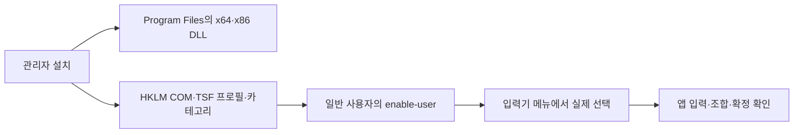

# D2 관리자 설치는 성공했으나 앱 입력 승인은 보류

- D2는 관리자 1회 설치 후 일반 사용자 실행으로 결정했다.
- x64·x86 시스템 등록과 COM DLL 로딩은 성공했다.
- 전환 API 성공만으로 실제 앱 입력을 승인할 수 없다.
- 사용자가 메뉴 표시·선택을 확인했고, 수정 DLL의 관리자 적용도 완료했다.
- 새 DLL에서 Word·메모장의 합성 키 기본 조합·확정을 관찰했다.

## 범위와 구조

Windows TSF S0의 설치 권한·입력기 선택·6개 앱 입력을 시험한다. 후보창, 설정창, 학습 저장, 서명, macOS 실기기 시험과 공개 릴리즈 승인은 이번 설치 시험에 포함하지 않는다.

기존 `register`는 관리자 실행에서도 COM 등록 위치가 HKCU였다. 다른 관리자 계정으로 인증하는 PC와 관리자 앱에서 사용할 시스템 등록 경로를 분리했다. `register-machine`·`unregister-machine`은 권한 검사 후 HKLM과 공식 TSF API를 사용한다. 일반 사용자의 `enable-user`·`disable-user`가 그 사용자의 목록을 다룬다. 설치 파일은 사용자 쓰기 가능한 빌드 폴더 대신 Program Files에 둔다.

## 관찰과 검증

| 항목 | 관찰 | 판정 범위 |
|---|---|---|
| 빌드·단위 검사 | 공통 엔진 52개, TSF 키 로직 12개, HRESULT 회귀 1개 통과 | 실제 앱 검증과 별도 |
| x64·x86 selftest | DLL 로드, COM exports, `dkssud + Space → 안녕 ` 통과 | 직접 DLL 로딩·엔진 시험 |
| 비관리자 거부 | 양쪽 setup의 설치·제거가 `0x80070005`, 레지스트리·언어 목록 변화 없음 | 권한 없는 부분 설치 방지 |
| 최초 관리자 설치 | 양쪽 HKLM COM·프로필·5개 카테고리 등록 성공 | 설치 receipt 확인 |
| 실제 사용자 등록 | `InstallLayoutOrTip`, `EnableLanguageProfile` 성공; 한국어 목록에 자체 TIP 추가 | 현재 사용자의 설정 존재 |
| 등록 COM 로딩 | `CoCreateInstance` 성공, `IsEnabledLanguageProfile=true` | 등록 경로로 DLL 적재 가능 |
| 최초 전환 | `ActivateProfile=0x80004005` | 실패 |
| 활성화 플래그 추가 | 원시 HRESULT `0x00000000` | API 성공; 화면·DLL 활성화는 별도 확인 필요 |
| 메모장 | 빈 시험 탭에서 합성 `d` 키가 영문 그대로 표시; TSF 런타임 활성화 로그 없음 | TSF 입력 성공 미확인 |
| 최초 사용자 확인 | 작업 표시줄 입력기 메뉴에 한오토마타 없음 | 당시 메뉴 노출 미충족; 재개 후 해결 확인 |

최초 설치는 기본 비활성 프로필을 만들었다. `HKLM Enable=0`, 현재 사용자 `Enable=1`, 프로필 열거 `flags=0`이 함께 관찰됐다. 원인 후보를 줄이기 위해 [Microsoft SampleIME](https://github.com/microsoft/Windows-classic-samples/blob/main/Samples/IME/cpp/SampleIME/Register.cpp)와 같은 기본 활성 등록으로 소스와 빌드를 수정했다. **메뉴 누락의 확정 원인이나 해결 완료를 뜻하지 않는다.** 첫 수정본 적용 요청은 `consent.exe`에서 대기하다 Windows가 작업 취소로 반환했다. 사용자는 보안 창이 보이지 않는다고 답했다. 사용자가 직접 취소했다고 단정할 수 없으며, 이 시점에는 수정본이 적용되지 않았다. 이후 사용자가 화면에서 직접 관리자 스크립트를 실행해 적용했다(아래 재개 기록).

`ActivateProfile`의 [공식 반환값](https://learn.microsoft.com/en-us/windows/win32/api/msctf/nf-msctf-itfinputprocessorprofilemgr-activateprofile)은 `S_FALSE`를 프로필 비활성으로 정의한다. 기존 Rust 래퍼는 이를 `Ok(())`로 바꾸므로 원시 HRESULT가 정확히 0일 때만 성공으로 판단하도록 수정했다. 회귀 검사의 실패→통과를 확인했다. 이번 플래그 추가 후 실측값은 `S_OK`였으므로, `S_FALSE`가 이번 화면 실패의 원인이었다고 주장하지 않는다.

## 앱 승인표

| 대상 | 진행 상태 | 남은 증거 |
|---|---|---|
| 일반 메모장 | 새 DLL 적재 후 ⇧Space 전환, 합성 `dkssud → 안녕` 조합·Space 확정·F2 재변환 확인 | 실제 키보드 결과 확정·나머지 확정 키·전환 |
| Chrome | 미실행 | TSF 입력·확정·전환 |
| Edge | 미실행 | TSF 입력·확정·전환 |
| Word | 새 DLL에서 합성 기본 조합·Space·Enter·Tab 확정·Backspace·⇧Space 확인. F2 재변환은 반응 없음 | F2 후보 적용 후 재시험·실제 키보드·나머지 전환 |
| 시작 검색 | 미실행 | AppContainer 입력·확정 |
| 관리자 메모장 | 미실행 | 관리자 앱의 TSF 입력·확정 |

기본 조합·Space 확정을 관찰한 앱은 **2/6(Word·메모장)**, 모든 동작을 승인한 앱은 여전히 **0/6**이다. 합성 키의 통과를 물리 키보드 검증으로 대체하지 않는다. S0-5 전환·보정 키, S0-6 관리자/AppContainer, S0-7 트레이 공존은 아직 남아 있다.

## 2026-10-12 수동 관리자 적용 후 재개

사용자가 관리자 수정과 일반 사용자 명령을 실행한 뒤에도 메뉴에 보이지 않는다고 보고했다. `repair-tools.log`는 x64·x86 setup 교체 및 기존 DLL 경로의 기본 활성 재등록 성공으로 끝났고, HKLM 프로필 `Enable=1`을 확인했다. 관리자 설치를 다시 요청할 근거는 없었다.

다만 재개 직후 **현재 일반 사용자는 `IsEnabledLanguageProfile=false`, HKCU `Enable=0`, 한국어 언어 목록의 자체 TIP 없음**이었다. `GetProfile`/`EnumProfiles`의 `flags=0x2`와 현재 사용자의 활성 상태가 달랐다. 이전 사용자 명령이 이 상태를 남긴 이유는 확인하지 못했으며, 다른 계정에서 실행했다고 단정하지 않는다.

현재 계정의 비관리자 셸에서 설치된 x64 도구의 `enable-user`를 실행했다. 두 API가 성공했고, 별도 실행의 `selftest-registered`는 COM 적재 성공과 `IsEnabledLanguageProfile=true`, `status`와 `Get-WinUserLanguageList`는 한국어 목록에 자체 TIP가 있음을 확인했다. 이후 재조회에서도 유지됐다. 기존 한국어 입력기 2개와 영어 입력기 1개는 보존했다. 이후 사용자가 **“보이고 선택할 수 있음”**이라고 확인했다. 현재 메뉴 표시·선택 문제는 해결된 것으로 기록한다.

또한 기존 `selftest-registered`가 비활성 조회 결과를 `ok ... false`와 종료 코드 0으로 보고하던 결함을 보강했다. 사용자 활성화와 언어 목록 존재를 필수 조건으로 삼고, `enable-user`도 호출 후 같은 조건을 확인한다. 비활성 조회 성공·활성 상태지만 목록 누락의 두 회귀 검사가 기존 판단에서 실패함을 재현했다. 이 보강은 진단 결과의 정확성을 높이며, 메뉴 누락 자체의 해결 증거를 대신하지 않는다.

수정 후 공통 엔진 52개·TSF 키 로직 12개·등록 판단 3개, 총 **67개 검사 통과**. x64·x86 빌드와 DLL 직접 selftest, 설치된 COM을 사용하는 두 아키텍처의 `selftest-registered`가 통과했다. 새 x64 `enable-user`의 사후 조건 확인도 통과했다. Program Files의 도구·DLL을 이번 재개에서 다시 교체하지 않았으며, 새 진단 도구는 로컬 `build/tsf/x64`·`x86`에 보관한다.

## 메뉴 선택 후 실제 앱 시험과 조합 상태 결함

트레이 앱을 정상 종료하고 종료된 프로세스를 확인한 뒤, 기존 문서를 보존하면서 메모장의 새 탭과 Word의 새 문서를 시험했다. Word의 런타임 로그에는 같은 프로세스에서 두 차례 `activate ... tray=false`가 기록됐다. 처음 `d`를 입력했을 때 밑줄 조합이 보였지만 다음 키에서 첫 글자가 사라져, `dkssud + Space`의 결과가 `Kssud`로 남았다. 같은 새 문서의 다음 줄에서는 `안녕`의 조합 밑줄과 Space 확정 후 밑줄 해제를 확인했다. 첫 문장의 대문자화와 입력기 결함은 구분한다.

코드에서 프로세스 전체가 하나의 `Engine`을 공유하고, 서비스가 추가 활성화될 때 `Shell::reset()`이 그 엔진의 조합을 취소하는 결함을 발견했다. **첫 서비스가 `d`를 조합하는 동안 두 번째 서비스를 생성·초기화하고, 첫 서비스가 `kssud + Space`를 이어 입력하는 회귀 검사**가 `kssud `로 실패했다. 화면에서 관찰한 소실을 설명하는 구체적인 결함이며, 엔진을 서비스별로 분리한 뒤 `안녕 `으로 통과했다. S0의 학습 저장 미구현 조건은 그대로이며, 사전 파일은 읽기만 한다.

메모장은 DLL이 프로세스에 적재된 것을 확인했으나 전체 단어도 영문 그대로 확정됐다. 현재 로그에는 메모장의 활성 완료 기록이 없고, 이 현상의 원인은 아직 확정하지 않았다. [Microsoft의 IME 요구사항](https://learn.microsoft.com/en-us/windows/apps/develop/input/input-method-editor-requirements)은 Windows 앱 및 AppContainer의 별도 제약을 설명한다. 카테고리나 보안 설정을 추측으로 바꾸지 않았으며 새 DLL 적용 후 앱별 활성화 경로를 확인한다. 공통 조합 결함을 먼저 고치고 Chrome·Edge·시작 검색·관리자 메모장 시험을 이어 간다.

최신 빌드는 **68개 검사**(공통 엔진 52, 키 로직 12, 등록 3, 서비스 격리 1)와 x64·x86 DLL selftest를 통과했다. 이 단계에서는 설치 DLL 적용 전이었고, 이후 사용자가 아래 절차로 적용했다. 원격 main이나 공개 릴리즈에 반영했다고 주장하지 않는다. 이 최초 시험 후 Microsoft 한국어 입력기 복원 API의 `S_OK`와 기존 트레이 앱 재실행을 확인했다. 한오토마타의 사용자 목록 항목은 유지했다.

`update-machine.ps1`은 검증한 새 파일을 Program Files 아래 새 revision 폴더에 배치하고 두 비트수의 COM 경로를 등록한다. 이미 로드된 DLL 파일은 덮어쓰지 않고 이전 경로를 receipt에 남긴다. 일부 등록 실패 시 이전 경로 재등록을 시도하며 파일을 보관한다. 정상 payload 사전 검사, 비관리자 실행 거부, 잘못된 해시 거부 및 등록 경로·언어 목록 무변경을 확인했다. 관리자 적용 성공 경로는 아래에서 확인했으며, **등록 실패 시 복구 경로의 실제 시험은 남아 있다.** 자동 앱 종료·로그오프·재부팅은 없다.

## 새 런타임 적용 후 재시험

사용자가 `build/tsf/d2-session-fix-20261012/apply-admin.ps1`을 직접 실행했다. `revisions/d2-session-20261012/update-result.json`의 결과는 `updated-restart-apps-required`, 시각은 **2026-10-12 22:38:47 KST**다. x64·x86 selftest와 `register-machine`이 각각 종료 코드 0으로 끝났다. 설치 파일 4개의 SHA256, 두 HKLM COM 등록 경로, 일반 사용자의 `selftest-registered`를 확인했다. 이전 DLL은 보관했고 사용자 활성 상태와 언어 목록 항목도 유지됐다.

새 Word 프로세스와 메모장 프로세스에서 `revisions/d2-session-20261012/x64/hanautomata_tsf.dll` 적재를 확인했다. 트레이 앱은 실행되지 않은 상태였다. Word는 새 문서에서 ⇧Space 전환 후 `ㅇ → 아 → 안 → 안ㄴ → 안녀 → 안녕` 조합과 Space 확정을 관찰했다. 두 번째 서비스 활성화가 있었지만 이번 최초 단어에서는 첫 글자 소실이 나타나지 않았다. 이는 이번 합성 키 시도의 결과이며 모든 입력 상황의 결함 해소를 뜻하지 않는다.

메모장 첫 합성 시험은 `안ㄴ` 뒤에 도구가 사용자 입력 감지로 다음 키를 보내지 않았고, 재관찰 후 이어 입력했을 때 `안ㄴㅕ`가 됐다. 중간 포커스·입력이 섞인 시험이므로 연속 입력 결함의 재현으로 단정하지 않는다. 이후 물리 키보드 결과에 대해 사용자가 “글자가 빠지거나 자모가 분리됨”을 선택했으나, 뒤이어 실수로 눌렀다는 정정이 왔다. 정정 대상이 페이지 열기인지 시험 응답인지 확인 중이며 **물리 키보드 판정은 미확정**이다. 재관찰 시 준비했던 시험 탭은 비어 있었다.

다음 합성 시험은 그 빈 탭에서 첫 `d`가 영문으로 표시되는 것을 확인한 뒤 ⇧Space로 전환하고 `dkssud + Space`를 중단 없이 입력했다. 최종 화면은 앞선 영문 `d`와 확정된 `안녕 `이었으며, 한글 조합 중 밑줄과 Space 후 해제를 확인했다. 현재 재현만으로 추가 DLL 변경이나 관리자 재설치를 요청하지 않는다. 메모장 활성 완료 로그는 여전히 없어서 로그 부재만으로 TSF 미동작을 판단할 수도 없다.

화면 근거는 AIPM의 비공개 로컬 scratch `hanautomata-tsf-d2-20261012`에 `word-new-runtime-basic-commit.png`, `notepad-new-runtime-basic-commit.png`로 보관했다. 사용자 탭 제목 등이 포함되므로 공개 저장소에는 추가하지 않는다. 이후 실제 키보드 결과와 앱별 전체 검증을 이어 간다.

확인 응답을 기다리는 동안 Microsoft 한국어 입력기로 복원했다. 전환 API의 `S_OK`와 후속 `active`의 Microsoft TIP 토큰을 확인했고, 기존 트레이 실행 파일의 프로세스도 확인했다. 설치된 새 DLL·시스템 등록·한오토마타 사용자 목록 항목·시험 문서는 보존했다.

## 추가 확정 키 시험과 Word F2 후보 수정

계속 진행 요청 후 트레이가 실행되지 않고 한오토마타가 선택된 상태에서 시험을 재개했다. Word 새 시험 문서에서 조합 중 ⇧Space, Enter 확정 후 다음 줄 입력, Tab 확정 후 탭 뒤 입력, Backspace의 `아 → ㅇ` 조합 삭제를 확인했다. Enter 직후 화면만으로 줄바꿈이 불명확했으나 다음 문자가 실제 다음 줄에 들어가는 것으로 구분했다.

Word에서 자동 판별 `dkssud + Space → 안녕 ` 확정 직후 F2를 눌러도 변화가 없었다. 메모장에서는 같은 입력 뒤 F2가 `dkssud `로 바뀌었다. 이 앱별 차이는 합성 키로 관찰했으며 물리 키보드 결과를 대신하지 않는다. Word가 일반 키 이벤트에 앞서 F2를 처리하는 것이 원인 후보이고, 실제 콜백 전달 순서는 아직 추적하지 못했다.

기존 서비스는 TSF 보존 단축키를 등록하지 않았고 `OnPreservedKey`가 항상 미처리를 반환했다. [PreserveKey](https://learn.microsoft.com/en-us/windows/win32/api/msctf/nf-msctf-itfkeystrokemgr-preservekey)와 [OnPreservedKey](https://learn.microsoft.com/en-us/windows/win32/api/msctf/nf-msctf-itfkeyeventsink-onpreservedkey)를 통해 F2 재변환 경로를 추가한 **후보**를 준비했다. 등록 성공한 키만 서비스 종료 때 해제한다. 명령 경로는 현재 필드·트레이 상태를 다시 확인하고, 직전 Space 확정 단어가 없거나 비밀번호/트레이 공존·일시정지·보정 기능 꺼짐이면 처리하지 않는다. 등록 실패는 로그에 남기고 기존 일반 키 경로를 유지한다. Shift+F2·F12 등의 보존 단축키 등록은 이번 변경에 포함하지 않았다.

새 명령 경로의 단어 재변환·다시 되돌리기·새 조합 시 앱으로 전달, 그리고 공존·일시정지·기능 꺼짐의 두 검사를 추가했다. 미처리 명령 분기에서 재변환 검사가 실패했고, 연결 후 전체 **70개 검사**(공통 엔진 52, 키 로직 14, 등록 3, 서비스 격리 1)와 x64·x86 빌드·DLL selftest가 통과했다. 별도 Windows COM 시험 프로세스에서 서비스 활성화를 시도한 검사는 준비 단계가 `0x80070057`로 실패해 등록/해제 검증으로 사용할 수 없었다. 이 실패를 제품 회귀 검사 통과로 계산하지 않았고 해당 시험 코드는 후보에 포함하지 않았다. **실제 앱에서 보존 단축키 등록·콜백·해제를 확인하는 검증은 남아 있다.**

적용 묶음은 로컬 `build/tsf/d2-f2-fix-20261012`다. 설치할 파일 4개의 복사 전후 해시와 `sha256.json`, 기존 설치 경로를 확인했고, `-CheckOnly`는 `preflight-passed`, `changes=none`이었다. 기존 등록은 `d2-session-20261012`이며 후보는 아직 적용하지 않았다. 이 후보를 Word 해결 완료로 기록하지 않는다. 비교 화면은 로컬 scratch의 `word-f2-no-change.png`, `notepad-f2-reconverted.png`다. 시험 후 Microsoft TIP 복원과 트레이 프로세스를 확인했다.

## 재개·복구 절차

1. 메뉴 수정과 새 런타임 DLL의 관리자 적용은 완료했다. 같은 `d2-session-20261012` 적용 스크립트를 반복하지 않는다.
2. 결과 정본은 `Program Files/Hanautomata-TSF-S0/revisions/d2-session-20261012/update-result.json`이다. 현재 사용자 활성화는 유지돼 있다.
3. 아직 새 DLL을 적재하지 않은 시험 앱만 필요한 문서를 저장한 뒤 다시 연다. Word·메모장의 새 DLL 적재는 확인했다. 자동 종료·로그오프·재부팅은 하지 않는다.
4. Word F2 후보를 시험하려면 새 `build/tsf/d2-f2-fix-20261012/apply-admin.ps1`을 화면의 관리자 PowerShell에서 적용한다. 기존 DLL은 보관하고 새 revision의 COM 경로만 갱신한다. Word·메모장을 다시 열고 새 DLL·F2 등록/콜백 로그·재변환·앱 고유 F2를 확인한다.
5. 물리 키보드 응답의 정정 대상을 확인하고, 트레이 앱을 종료한 새 시험 문서에서 6종 앱의 나머지 항목을 검증한다. API 성공이나 합성 키 결과만으로 승인하지 않는다.
6. 기존 입력기로 복원하고 트레이 앱을 다시 실행한다. S0 시험을 종료할 때 일반 창에서 `disable-user`, 관리자 창에서 `install-machine.ps1 -Action Unregister`로 제거한다.

설치 스크립트는 등록 중 실패 시 등록 해제를 시도하고 파일과 진단 기록을 보관한다. **관리자 제거·실패 자동 복구의 실제 실행 검증은 아직 남아 있다.** 이번 기록은 설치 성공을 제품 동작 승인이나 공개 릴리즈 승인으로 확대하지 않는다.

이전 시험 종료 시에는 기존 Microsoft 한국어 입력기로 복원하는 API가 `S_OK`를 반환했고, 자체 TIP를 사용자 언어 목록에서 제거했다. 한국어 키보드 2개와 영어(미국) 1개가 남음을 확인했다. 기존 Hanautomata 트레이 앱도 다시 실행했다. 이번 재개에서는 **Program Files·HKLM 등록을 유지한 채 현재 사용자를 다시 활성화하고 자체 TIP를 추가했다.** 시스템 등록 제거에는 관리자 실행이 필요하며, 전체 제거 완료로 기록하지 않는다.

## 검증 방법 메모

`Get-WinUserLanguageList`는 이 호스트에서 열거되지 않는 List를 반환한다. 바로 `Select-Object LanguageTag,InputMethodTips`로 보내면 null 필드가 나왔다. 권한 거부 회귀 검사는 전체 List를 `ConvertTo-Json -Depth 5`로 직렬화하도록 수정하고 재실행했다. 최초 언어 목록 JSON의 null 값은 복구 기준으로 사용하지 않는다.

Windows PowerShell 5.1에서 Rust UTF-8 출력을 OEM 코드 페이지로 읽어 최초 설치 로그의 한글이 깨졌다. 후속 설치 스크립트는 UTF-8로 읽는다. HRESULT와 ASCII 등록 단계는 최초 기록에서도 판독 가능하다.
