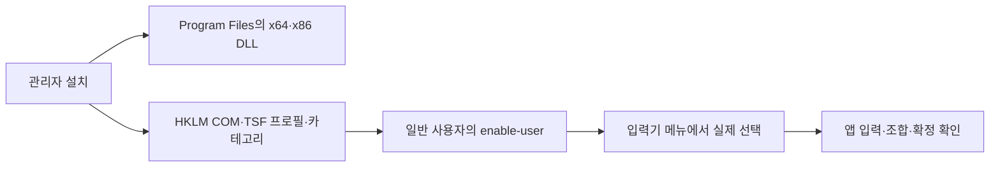

# D2 관리자 설치는 성공했으나 앱 입력 승인은 보류

- D2는 관리자 1회 설치 후 일반 사용자 실행으로 결정했다.
- x64·x86 시스템 등록과 COM DLL 로딩은 성공했다.
- 전환 API 성공만으로 실제 앱 입력을 승인할 수 없다.
- 수동 관리자 수정은 적용됐고, 현재 사용자 재활성화 후 메뉴 확인을 기다린다.

## 범위와 구조

Windows TSF S0의 설치 권한·입력기 선택·6개 앱 입력을 시험한다. 후보창, 설정창, 학습 저장, 서명, macOS 실기기 시험과 공개 릴리즈 승인은 이번 설치 시험에 포함하지 않는다.

기존 `register`는 관리자 실행에서도 COM 등록 위치가 HKCU였다. 다른 관리자 계정으로 인증하는 PC와 관리자 앱에서 사용할 시스템 등록 경로를 분리했다. `register-machine`·`unregister-machine`은 권한 검사 후 HKLM과 공식 TSF API를 사용한다. 일반 사용자의 `enable-user`·`disable-user`가 그 사용자의 목록을 다룬다. 설치 파일은 사용자 쓰기 가능한 빌드 폴더 대신 Program Files에 둔다.

## 관찰과 검증

| 항목 | 관찰 | 판정 범위 |
|---|---|---|
| 빌드·단위 검사 | 공통 엔진 52개, TSF 키 로직 12개, HRESULT 회귀 1개 통과 | 실제 앱 검증과 별도 |
| x64·x86 selftest | DLL 로드, COM exports, `dkssud + Space → 안녕 ` 통과 | 직접 DLL 로딩·엔진 시험 |
| 비관리자 거부 | 양쪽 setup의 설치·제거가 `0x80070005`, 레지스트리·언어 목록 변화 없음 | 권한 없는 부분 설치 방지 |
| 최초 관리자 설치 | 양쪽 HKLM COM·프로필·5개 카테고리 등록 성공 | 설치 receipt 확인 |
| 실제 사용자 등록 | `InstallLayoutOrTip`, `EnableLanguageProfile` 성공; 한국어 목록에 자체 TIP 추가 | 현재 사용자의 설정 존재 |
| 등록 COM 로딩 | `CoCreateInstance` 성공, `IsEnabledLanguageProfile=true` | 등록 경로로 DLL 적재 가능 |
| 최초 전환 | `ActivateProfile=0x80004005` | 실패 |
| 활성화 플래그 추가 | 원시 HRESULT `0x00000000` | API 성공; 화면·DLL 활성화는 별도 확인 필요 |
| 메모장 | 빈 시험 탭에서 합성 `d` 키가 영문 그대로 표시; TSF 런타임 활성화 로그 없음 | TSF 입력 성공 미확인 |
| 사용자 확인 | 작업 표시줄 입력기 메뉴에 한오토마타 없음 | 메뉴 노출 미충족 |

최초 설치는 기본 비활성 프로필을 만들었다. `HKLM Enable=0`, 현재 사용자 `Enable=1`, 프로필 열거 `flags=0`이 함께 관찰됐다. 원인 후보를 줄이기 위해 [Microsoft SampleIME](https://github.com/microsoft/Windows-classic-samples/blob/main/Samples/IME/cpp/SampleIME/Register.cpp)와 같은 기본 활성 등록으로 소스와 빌드를 수정했다. **메뉴 누락의 확정 원인이나 해결 완료를 뜻하지 않는다.** 첫 수정본 적용 요청은 `consent.exe`에서 대기하다 Windows가 작업 취소로 반환했다. 사용자는 보안 창이 보이지 않는다고 답했다. 사용자가 직접 취소했다고 단정할 수 없으며, 이 시점에는 수정본이 적용되지 않았다. 이후 사용자가 화면에서 직접 관리자 스크립트를 실행해 적용했다(아래 재개 기록).

`ActivateProfile`의 [공식 반환값](https://learn.microsoft.com/en-us/windows/win32/api/msctf/nf-msctf-itfinputprocessorprofilemgr-activateprofile)은 `S_FALSE`를 프로필 비활성으로 정의한다. 기존 Rust 래퍼는 이를 `Ok(())`로 바꾸므로 원시 HRESULT가 정확히 0일 때만 성공으로 판단하도록 수정했다. 회귀 검사의 실패→통과를 확인했다. 이번 플래그 추가 후 실측값은 `S_OK`였으므로, `S_FALSE`가 이번 화면 실패의 원인이었다고 주장하지 않는다.

## 앱 승인표

| 대상 | 진행 상태 | 남은 증거 |
|---|---|---|
| 일반 메모장 | 새 탭에서 키 입력 관찰; TSF 활성 미확인 | 실제 TSF 조합·확정·단축키 |
| Chrome | 미실행 | TSF 입력·확정·전환 |
| Edge | 미실행 | TSF 입력·확정·전환 |
| Word | 시작 화면 준비 | 빈 문서의 TSF 입력·확정 |
| 시작 검색 | 미실행 | AppContainer 입력·확정 |
| 관리자 메모장 | 미실행 | 관리자 앱의 TSF 입력·확정 |

현재 통과로 승인한 앱은 **0/6**이다. 합성 키의 통과도 물리 키보드 검증으로 대체하지 않는다. S0-5 전환·보정 키, S0-6 관리자/AppContainer, S0-7 트레이 공존은 실제 입력기 선택 후 확인한다.

## 2026-10-12 수동 관리자 적용 후 재개

사용자가 관리자 수정과 일반 사용자 명령을 실행한 뒤에도 메뉴에 보이지 않는다고 보고했다. `repair-tools.log`는 x64·x86 setup 교체 및 기존 DLL 경로의 기본 활성 재등록 성공으로 끝났고, HKLM 프로필 `Enable=1`을 확인했다. 관리자 설치를 다시 요청할 근거는 없었다.

다만 재개 직후 **현재 일반 사용자는 `IsEnabledLanguageProfile=false`, HKCU `Enable=0`, 한국어 언어 목록의 자체 TIP 없음**이었다. `GetProfile`/`EnumProfiles`의 `flags=0x2`와 현재 사용자의 활성 상태가 달랐다. 이전 사용자 명령이 이 상태를 남긴 이유는 확인하지 못했으며, 다른 계정에서 실행했다고 단정하지 않는다.

현재 계정의 비관리자 셸에서 설치된 x64 도구의 `enable-user`를 실행했다. 두 API가 성공했고, 별도 실행의 `selftest-registered`는 COM 적재 성공과 `IsEnabledLanguageProfile=true`, `status`와 `Get-WinUserLanguageList`는 한국어 목록에 자체 TIP가 있음을 확인했다. 이후 재조회에서도 유지됐다. 기존 한국어 입력기 2개와 영어 입력기 1개는 보존했다. **실제 메뉴 노출·선택 확인은 대기 중이며, 트레이 앱을 유지했다.**

또한 기존 `selftest-registered`가 비활성 조회 결과를 `ok ... false`와 종료 코드 0으로 보고하던 결함을 보강했다. 사용자 활성화와 언어 목록 존재를 필수 조건으로 삼고, `enable-user`도 호출 후 같은 조건을 확인한다. 비활성 조회 성공·활성 상태지만 목록 누락의 두 회귀 검사가 기존 판단에서 실패함을 재현했다. 이 보강은 진단 결과의 정확성을 높이며, 메뉴 누락 자체의 해결 증거를 대신하지 않는다.

수정 후 공통 엔진 52개·TSF 키 로직 12개·등록 판단 3개, 총 **67개 검사 통과**. x64·x86 빌드와 DLL 직접 selftest, 설치된 COM을 사용하는 두 아키텍처의 `selftest-registered`가 통과했다. 새 x64 `enable-user`의 사후 조건 확인도 통과했다. Program Files의 도구·DLL을 이번 재개에서 다시 교체하지 않았으며, 새 진단 도구는 로컬 `build/tsf/x64`·`x86`에 보관한다.

## 재개·복구 절차

1. 관리자 수정은 완료했다. 현재 설치를 대상으로 같은 관리자 적용을 반복하지 않는다.
2. 현재 사용자 활성화와 언어 목록 등록도 재확인했다. 새 도구로 진단할 때는 일반 창에서 빌드 폴더의 setup `selftest-registered`를 실행할 수 있다. 이 명령은 등록된 COM DLL을 읽으므로 Program Files 교체나 관리자 실행이 필요 없다.
3. 입력기 메뉴를 닫았다가 다시 열어 나타나고 실제 선택되는지 확인한다. API 성공만으로 다음 단계를 승인하지 않는다. 자동 로그오프·재부팅은 하지 않는다.
4. 트레이 앱을 종료하고 새 시험 문서에서 6종 앱을 검증한다. 사용 중인 기존 문서를 시험 대상으로 쓰지 않는다.
5. 기존 입력기로 복원하고 트레이 앱을 다시 실행한다. S0 시험을 종료할 때 일반 창에서 `disable-user`, 관리자 창에서 `install-machine.ps1 -Action Unregister`로 제거한다.

설치 스크립트는 등록 중 실패 시 등록 해제를 시도하고 파일과 진단 기록을 보관한다. **관리자 제거·실패 자동 복구의 실제 실행 검증은 아직 남아 있다.** 이번 기록은 설치 성공을 제품 동작 승인이나 공개 릴리즈 승인으로 확대하지 않는다.

이전 시험 종료 시에는 기존 Microsoft 한국어 입력기로 복원하는 API가 `S_OK`를 반환했고, 자체 TIP를 사용자 언어 목록에서 제거했다. 한국어 키보드 2개와 영어(미국) 1개가 남음을 확인했다. 기존 Hanautomata 트레이 앱도 다시 실행했다. 이번 재개에서는 **Program Files·HKLM 등록을 유지한 채 현재 사용자를 다시 활성화하고 자체 TIP를 추가했다.** 시스템 등록 제거에는 관리자 실행이 필요하며, 전체 제거 완료로 기록하지 않는다.

## 검증 방법 메모

`Get-WinUserLanguageList`는 이 호스트에서 열거되지 않는 List를 반환한다. 바로 `Select-Object LanguageTag,InputMethodTips`로 보내면 null 필드가 나왔다. 권한 거부 회귀 검사는 전체 List를 `ConvertTo-Json -Depth 5`로 직렬화하도록 수정하고 재실행했다. 최초 언어 목록 JSON의 null 값은 복구 기준으로 사용하지 않는다.

Windows PowerShell 5.1에서 Rust UTF-8 출력을 OEM 코드 페이지로 읽어 최초 설치 로그의 한글이 깨졌다. 후속 설치 스크립트는 UTF-8로 읽는다. HRESULT와 ASCII 등록 단계는 최초 기록에서도 판독 가능하다.
